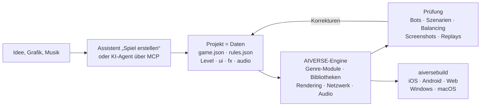

<p align="center">
  
</p>

<h3 align="center">Eine Game-Engine für jedes Genre, in der ein KI-Agent das Spiel aus Daten baut, nicht aus Code</h3>

<p align="center">
  jedes Genre · vollständige RTS- und FPS-Module · 88 Mechanik-Bibliotheken · deterministische Simulation · ~190 MCP-Tools · 6 Plattformen
</p>

<p align="center">
  
  
  
  
  
</p>

<p align="center">
  <a href="README.md">English</a> · <a href="README.ru.md">Русский</a> · <a href="README.zh-CN.md">简体中文</a> · <a href="README.ja.md">日本語</a> · <a href="README.ko.md">한국어</a> · <a href="README.es.md">Español</a> · <a href="README.pt-BR.md">Português</a> · <b>Deutsch</b> · <a href="README.fr.md">Français</a>
</p>

<p align="center">
  <a href="#warum-es-sie-gibt">Warum</a> ·
  <a href="#jedes-genre">Genres</a> ·
  <a href="#funktionsweise">Funktionsweise</a> ·
  <a href="#fertige-vorlagen">Vorlagen</a> ·
  <a href="#schnellstart">Schnellstart</a> ·
  <a href="docs/de/overview.md">Vollständige Übersicht</a>
</p>

---

## Kurz gesagt

**AIVERSE** ist eine von Grund auf neu geschriebene C++20-Engine mit einem einzigen Ziel: Ein Spiel
**jedes Genres** soll man **beschreiben** können, statt es von Null an zu programmieren.

Ein Spiel ist ein Ordner mit Daten: Objekte, Regeln, Level, Oberfläche, Audio, Effekte. Die Engine ist
eine Bibliothek fertiger, deterministischer Mechaniken, die diese Daten zum Leben erweckt – vom Basisbau
und Armeen aus Tausenden Einheiten bis zu Plattforming, Nahkampf, Dialogen, Kartenregeln und Rätseln.
Dazwischen stehen der Editor und ein MCP-Server, über die ein Mensch oder ein KI-Agent am Projekt
arbeitet: das Spiel erstellt, das Balancing abstimmt, Bot-Matches laufen lässt, Screenshots prüft und
Store-Builds erzeugt.

> Beschreiben Sie die Idee und geben Sie einen Ordner mit Grafiken an – der Assistent **Spiel erstellen**
> baut ein Projekt mit Leveln, Tutorial, Meta, Shop, Icon und Startbildschirm, spielt das Tutorial
> anschließend selbst mit einem Bot durch und prüft jedes Level.

---

## Warum es sie gibt

Schwierig an einem Spiel ist nicht die Grafik. Schwierig ist, was darunter liegt: Bewegung, Kampf, KI,
Netzwerk, Balancing, Progression. Universelle Engines liefern einen Renderer und überlassen Ihnen den Rest.
AIVERSE liefert die Mechaniken selbst – und macht das Spiel zu etwas, an dem ein Agent arbeiten kann.

| Problem | Wie AIVERSE es löst |
|---|---|
| **Universelle Engines liefern kein Gameplay.** Unity, Unreal und Godot bieten Rendering und Physik; Wegfindung für Massen, Kampf mit Kombos und Paraden, Gegner-KI, Zugreihenfolge, Kartenregeln, Wirtschaft – das schreibt jedes Studio monatelang selbst. | Mechaniken sind die Bausteine der Engine: vollständige RTS- und FPS-Module plus 88 deterministische Bibliotheken für andere Genres. Sie werden mit Daten konfiguriert und, wenn das nicht reicht, mit Lua oder projekteigenem C++ erweitert. |
| **Klassische Engines sind für KI-Agenten unpraktisch.** Binäre Szenen, alles über eine GUI, kein schnelles Feedback – der Agent arbeitet blind. | Ein Projekt besteht aus lesbaren Textdateien. ~190 MCP-Tools decken Karten, Regeln, Terrain, UI, Effekte, Beleuchtung und Builds ab. Der Agent prüft seine Arbeit selbst: Bot-Matches, Szenarien mit Bestanden/Durchgefallen-Prüfungen, Balancing-Matrizen, ein Regel-Linter mit „did you mean…“-Hinweisen, Screenshots. |
| **Multiplayer heißt endlose Desyncs.** Ein einziges `float` genügt, damit ein Match zwischen iPhone und Android auseinanderläuft. | Die Simulation ist überall bitgenau identisch: Festkomma statt Gleitkomma, eigener Zufallsgenerator, Prüfsummen. Die CI vergleicht bei jedem Push Matches auf Linux x64/ARM64, Windows und macOS. Über das Netz gehen nur Befehle; es gibt Lockstep mit Rollback und einen Server mit Matchmaking und Entscheidungen anhand von Replays. |
| **Mobile GPUs sind schwach, das Spiel soll trotzdem gut aussehen.** | Jede teure Funktion – Schatten, Partikel, Terrain, Post-Effekte – hat Qualitätsstufen und passt sich der GPU an, von alten Mali- und Adreno-Chips bis Apple Silicon. |
| **Die Veröffentlichung auf allen Plattformen ist ein eigenes Projekt.** Signaturen, Icons, Store- und Werbe-SDKs. | `aiversebuild` erzeugt mit einem Befehl eine .app, ein Xcode-Projekt, Gradle/APK, Web und .exe. Icons und Startbildschirme werden generiert. Plugins für App Store, Google Play, RuStore, Yandex Games, Steam, AdMob, AppLovin und mehr – ein Build enthält nur die, die das Spiel auswählt. |
| **Jedes neue Spiel beginnt bei null.** | Über 30 spielbare Vorlagen, Genre-Kits mit Abnahme-Checklisten, 126 Skills für Agenten. Ein neues Spiel beginnt mit einem, das bereits funktioniert. |
| **Meta und LiveOps werden in jedem Projekt neu geschrieben.** | `aiverse::meta`: Shop, Währungen, Quests, Pässe, tägliche Belohnungen, Energie, Clans, Turniere, Truhen mit Pity-System – in JSON konfiguriert. |

---

## Jedes Genre

Zwei Genres haben vollständige Engine-Module mit Editor, Bots und Vorlagen. Alles andere wird aus den
Mechanik-Bibliotheken zusammengesetzt – jede deterministisch, getestet, mit Speichern/Wiederherstellen und
validierbarer Konfiguration.

| Genre | Was die Engine bietet |
|---|---|
| **RTS, Tower Defense, Eroberungsspiele** | Vollständiges `rts`-Modul: datengetriebene Einheiten und Gebäude, A\* / HPA\* / Flow Fields für Armeen aus Tausenden Einheiten auf Karten bis 2048², Wirtschaft, Bau, Nebel des Krieges, KI, Terrain und Planeten, 26 Vorlagen |
| **FPS und TPS** | Vollständiges `fps`-Modul: Client und autoritativer Server, große gestreamte Welten für bis zu 100 Spieler, Bots, 4 Vorlagen; `weapon-policies` (Rückstoß, Ballistik, Durchschlag), `match-rules` (Runden, Payload, Bombe, Extraktion) |
| **Action, Fighting, Soulslike** | `combat-actions`, `melee-combat`: Hitboxen und Hurtboxen, Kombos und Abbruchfenster, Unverwundbarkeit beim Ausweichen, Parade, Haltung, Zielerfassung; `genre-bots` für Gegner |
| **Plattformer, Metroidvania** | `character-locomotion`: Coyote Time, Sprungpuffer, Kanten, Leitern, Schwimmen, Klettern, Überklettern; `zone-graph`: Fähigkeitssperren, Checkpoints und Nachweis, dass es keine Sackgassen gibt |
| **Stealth, Immersive Sim** | `stealth-senses`: Sichtkegel, Gehör, Verdacht und Alarm, Suche, Verkleidung; `physical-interactions`: Tragen, Werfen, Seile, Türen, Plattformen, zerstörbare Objekte |
| **Storyspiele, Visual Novels** | `narrative-graphs`: Dialoge mit Bedingungen, Beziehungen, Konsequenzen, VN-Verlauf und automatisches Weiterblättern; `cinematic-gameplay`: Zeitleisten, QTE, Zeitlupe |
| **Rundentaktik, Karten- und Brettspiele** | `turn-scheduler`: Initiative, Aktionspunkte, Reaktionen; `card-runtime`: Zonen, Prioritätsstapel, verdeckte Informationen |
| **Rätsel** | `grid-puzzles`: Sokoban-Regeln, Rückgängig/Wiederholen und ein Löser; `puzzle-machine`: eine virtuelle Maschine für Programmierrätsel |
| **Roguelikes** | `run-graph`: Runs mit Seed und Begegnungsbudgets; `loot-tables` mit garantiertem seltenem Drop |
| **Idle, Fabrik, Kolonie** | `big-numbers`, `offline-production` (exakter Offline-Fortschritt), `production-networks`, `logistics`, `tasks` |
| **Rhythmusspiele** | `rhythm-timing`: Tempokarten und bildratenunabhängige Trefferbewertung |
| **Jedes Mobile-Spiel** | `aiverse::meta` und LiveOps, Tutorials, UI-Bildschirme, Store- und Werbe-Plugins |

Rennspiele, Sport und Fahrzeuge stehen noch auf der [Roadmap](docs/genre-mechanics-roadmap.md). Vollständige
Liste der Bibliotheken: [`libraries/catalog.json`](libraries/catalog.json) und [Genre-Pakete](docs/genre-packages.md).

---

## Funktionsweise



Ein Objekt ist nur eine Beschreibung. Hier der Arbeiter aus der RTS-Vorlage `skirmish`: Er sammelt Gold
und Holz, baut fünf Gebäude und kämpft mit einer Spitzhacke.

```jsonc
"peasant": {
  "health":  { "max": 220, "armorType": "light" },
  "move":    { "speed": 2.4, "radius": 0.35 },
  "sight":   7,
  "weapons": [{ "id": "pick", "range": 0.5, "damage": 5, "cooldown": 1.5 }],
  "cost":    { "gold": 75, "time": 12, "supply": 1 },
  "gather":  { "gold": { "carry": 10, "time": 2.0 }, "wood": { "carry": 10, "time": 3.0 } },
  "builds":  ["townhall", "farm", "barracks", "workshop", "tower"],
  "view":    { "shape": "worker", "scale": 0.8 }
}
```

Reichen Daten nicht aus, gibt es drei Stufen: **Trigger** in JSON → **Lua** (eine Sandbox mit
deterministischer Mathematik und Hot Reload) → projekteigene **native C++-Module**, die die obigen
Bibliotheken einbinden. Die Engine selbst bleibt unverändert: Mechaniken kommen nur in allgemeiner Form
hinzu, nie als Sonderfall für ein bestimmtes Spiel.

---

## Umstieg von Unity

Richten Sie den Importer auf ein Unity-Projekt und erhalten Sie ein AIVERSE-Projekt. Assets, Szenen und Parameter werden automatisch übernommen; alles andere landet in einem Bericht, anhand dessen ein Agent die Portierung über MCP abschließt. Auch im Editor unter **Projekt → Engine-Projekt importieren** und per MCP mit `port_scan` / `port_import` / `port_report` / `port_resolve`.

```bash
python3 tools/importers/port/aiverse_port.py /path/to/UnityProject --out /path/to/MyGame --mode auto
```

| In Unity | In AIVERSE |
|---|---|
| Szene | Karte `maps/*.json`: Objektplatzierung, Kamera, 2D- oder 3D-Modus |
| Prefab, verschachtelte Prefabs und Varianten | Objekttyp in `rules.json`; serialisierte Felder (`hp`, `speed`, `damage`, `fireRate`, …) werden zu Datenblöcken |
| ScriptableObject | Regeldaten |
| MonoBehaviour-Logik in C# | portiert der Agent: Datenblöcke → Lua → natives C++-Modul |
| Modelle, Texturen, Materialien, Audio | werden unverändert kopiert; PBR-Materialien, glTF/FBX/OBJ werden direkt geladen |
| Sprites und Tilemap | Atlas-Sprites und Tilemaps |
| ParticleSystem | `fx/*.json`, fast alle Module werden unterstützt |
| Inspector, Hierarchy, Scene, Game | dieselben Fenster im AIVERSE-Editor |
| Build Settings, Unity IAP, Unity Ads | `aiversebuild`, Store- und Werbe-Plugins |
| Addressables / Asset Bundles | `.rpak`-Pakete, geteilte Builds und Nachladen von Inhalten |

Der Bericht markiert jedes Element als exakt, näherungsweise oder nicht übernommen. Ein erneuter Import behält Ihre Änderungen. Das Projekt braucht die Asset-Serialisierung **Force Text**. Godot-Projekte werden auf dieselbe Weise importiert. Details: [Import von Engine-Projekten](docs/de/engine-import.md).

---

## Fertige Vorlagen

Jede Vorlage ist ein vollständig spielbares Spiel mit Bots. Im Editor öffnen und direkt loslegen.

| Genre | Vorlagen |
|---|---|
| Klassisches RTS mit Basisbau | **Iron and Gold** (Warcraft / Red Alert) · **Iron Front** (Red Alert: MCV, Erz, Seitenleiste) · **Starfall Sectors** (StarCraft: drei Völker) · **Frost Crown** (Warcraft III: Helden, Creeps, Terrain) · **Four Ages** (Age of Empires II) · **Amber Sands** (Dune II) · **Metal Tide** (Total Annihilation: Flusswirtschaft) |
| Eroberung und Garnisonen | **Mushroom Clash** und **Shroom Wars** (Mushroom Wars 1–2) · **Spore Lanes** · **Spell Bunkers** (Bunker Wars) · **Border Rush** (State.io) · **Clan Lands** (Northgard) · **Flag Sectors** (Z) |
| Trupps, Wellen, Überleben | **Hold the Line** (Company of Heroes) · **Last Colony** (They Are Billions) · **Lane Clash** (Lane-Battler) |
| Wirtschaft und Aufbau | **Hearth and Haul** (Knights and Merchants) · **Underlord** (Dungeon Keeper) |
| 2D und Experimente | **Crystal Dunes** (Tiles, Dune II) · **Green Hills** (2D-Sprites auf 3D-Terrain) · **Planets** (kugelförmige Planeten und Umlaufbahnen) · **Wildfire** (Felder: Waldbrände und Creep) |
| FPS | **Crossfire Arena** (5 gegen 5) · **Breach Protocol** (taktische Runden) · **Last Survivor** (Battle Royale mit 100 Spielern) · **Aim Lab** (Schießstand) |

---

## Was drinsteckt

<table>
<tr>
<td width="50%" valign="top">

**Gameplay**
- ECS-Simulation in Festkomma, Replays, Snapshots für Rollback
- Genre-Module: RTS (Wirtschaft, Bau, Armeen, KI) und FPS (autoritativer Server, große Welten)
- 88 Bibliotheken: Bewegung, Kampf, Waffen, Sinne, Dialoge, Züge, Karten, Rätsel, Runs, Rhythmus, Produktion
- Wegfindung: A\*, HPA\*, Flow Fields, Navmesh, ORCA/RVO2
- Terrain mit Steigungen und Sichtlinie, Karten bis 2048², kugelförmige Planeten
- Trigger, Lua 5.4, native C++-Module

</td>
<td width="50%" valign="top">

**Grafik und Audio**
- Eigenes RHI: Metal, GLES3 / WebGL2, GL 3.3
- PBR, glTF/OBJ, Skelett- und prozedurale Animation, prozedurale Kabel, Rendering hierarchischer Entitäten
- Schatten, dynamische Lichter, Nacht, Post-Effekte, Shader Graph
- Partikel mit den Modulen von Unitys ParticleSystem und Importer aus Unity
- 2D: Sprites, Tilemaps mit Autotiling
- Audio: 3D, adaptive Musik, plattformspezifische Kompression

</td>
</tr>
<tr>
<td valign="top">

**Werkzeuge**
- Andockbarer Editor im Unity-Stil: Szene, Inspector, Terrain, Effekte, Beleuchtung, UI, Testspiel und Gerätesimulator
- `aiversemcp` – MCP-Server für Agenten
- Assistent **Spiel erstellen**
- 126 Skills für Agenten und Genre-Kits mit Abnahme-Checklisten
- Importer für Assets klassischer Spiele aus Ihrer eigenen Kopie

</td>
<td valign="top">

**Veröffentlichung**
- `aiversebuild`: .app, Xcode, Gradle/APK, Web, .exe
- `.rpak`-Ressourcenpakete (zstd), geteilte Builds und Nachladen von Inhalten
- Store- und Werbe-Plugins
- Spiel-UI in HTML/CSS (RmlUi), Lokalisierung
- Multiplayer: UDP und WebSocket, dedizierter Server, Elo-Matchmaking
- Meta-Bibliothek und LiveOps

</td>
</tr>
</table>

---

## Schnellstart

**1. Engine bauen** (macOS; benötigt Xcode und CMake):

```bash
cmake -S . -B build/mac -DCMAKE_BUILD_TYPE=Release
cmake --build build/mac -j 8
open build/mac/AiverseEditor.app        # Editor: Projekt-Hub und Vorlagen
```

Linux: `cmake --preset linux-release && cmake --build build/linux-release`. Wer nicht kompilieren möchte,
findet im Branch `builds` vorgefertigte Editor- und Tool-Builds
([Details](docs/de/overview.md#fertige-engine-branch-builds-und-aiversemcp-ohne-compiler)).

**2. Spiel erstellen.** Im Hub auf **Spiel erstellen** klicken oder ein Projekt aus einer Vorlage anlegen.
Im Game-Fenster lässt es sich sofort gegen Bots spielen.

**3. KI-Agent verbinden.** Das Fenster **Agent** im Editor zeigt eine fertige Konfiguration. Für Claude Code:

```bash
claude mcp add aiverse -- /path/to/aiversemcp --engine /path/to/AIVERSE
```

Danach können Sie dem Agenten etwa sagen: *„Mach ein Strategiespiel im Stil von Northgard auf einer
Winterkarte, prüfe das Balancing von drei Fraktionen mit Bots und baue eine Web-Version.“*

**4. Veröffentlichen:**

```bash
./build/mac/aiversebuild --project "Mein Spiel.aiverse" --target all   # macOS, iOS, Android, Web, Windows
```

---

## Status

Die Engine wird aktiv weiterentwickelt. Bereits geprüft:

- ✅ **Linux**: Client, Editor, Tests, Bot-Matches; identische Prüfsummen auf x64 und ARM64
- ✅ **macOS / Metal**: Build, Tests, Spiel; `aiversebuild` → .app und ein iOS-Projekt mit Simulator-Build
- ✅ **Web**: ein Match läuft in Headless-Chromium (WebGL2)
- ✅ **Windows**: .exe per MinGW-Cross-Build, unter Wine ausgeführt
- 🛠 Fertige Vorlagen für Genres jenseits von RTS und FPS sind in Arbeit

Details je Subsystem unter
[Geprüft / nicht geprüft](docs/de/overview.md#geprüft--nicht-geprüft).

---

## Dokumentation

Die Referenzdokumente sind auf Englisch. Die Übersicht, der Spiel-Assistent, der Umstieg von Unity und die Genre-Pakete gibt es auch auf Deutsch.

| | |
|---|---|
| [**Vollständige Übersicht**](docs/de/overview.md) | alle Subsysteme, Build, Plattformen, CI, Releases |
| [Spielformat](docs/game-format.md) | `game.json`, `rules.json`, Karten und alle Datenblöcke |
| [Genre-Pakete](docs/genre-packages.md) · [Bibliotheken](docs/libraries.md) | Mechaniken für jedes Genre |
| [Assistent Spiel erstellen](docs/de/game-wizard.md) | wie aus Idee und Grafik ein fertiges Projekt wird |
| [Scripting](docs/scripting.md) · [C++-Module](docs/native-modules.md) | wenn Daten nicht ausreichen |
| [Terrain](docs/terrain.md) · [Planeten](docs/planets.md) · [Wegfindung](docs/pathfinding.md) | Welt und Bewegung |
| [Partikel](docs/particles.md) · [Modelle](docs/models.md) · [Shader Graph](docs/shader-graph.md) | Grafik |
| [Meta-Spiel](docs/meta-game.md) · [LiveOps](docs/meta-liveops.md) · [Plugins](docs/plugins.md) | Monetarisierung und Stores |
| [FPS](docs/fps.md) · [Große Welten](docs/large-worlds.md) | FPS-Modul |
| [Top-down-Helden](docs/topdown.md) · [Fahren](docs/driving.md) · [Stadtverkehr](docs/traffic.md) | Stadtspiele: Autos, Ampeln, Fußgänger, Dienste, Einwohner mit Arbeit |
| [AGENTS.md](AGENTS.md) | Regeln für Agenten, die die Engine selbst ändern |
| [Umstieg von Unity](docs/de/engine-import.md) | Szenen, Prefabs und Assets importieren, Logik mit einem Agenten portieren |

## Lizenz

[MIT](LICENSE). Drittanbieter-Bibliotheken liegen mit ihren eigenen Lizenzen in `third_party/` (nur MIT,
BSD, zlib, OFL, CC0 und CC-BY). Originale Assets kommerzieller Spiele sind nicht enthalten: Die Importer
lesen sie aus Ihrer eigenen Kopie.
