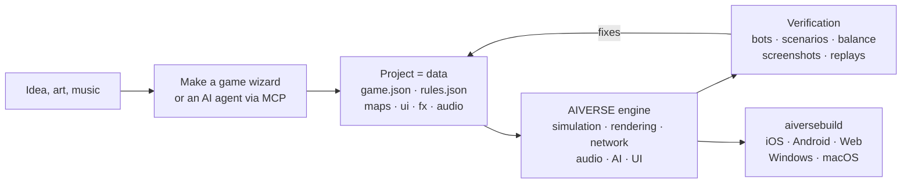

<p align="center">
  
</p>

<h3 align="center">A game engine where an AI agent builds the game — from data, not code</h3>

<p align="center">
  RTS of any sub-genre and FPS · deterministic simulation · ~190 MCP tools · one command builds for 6 platforms
</p>

<p align="center">
  
  
  
  
  
</p>

<p align="center">
  <b>English</b> · <a href="README.md">Русский</a>
</p>

<p align="center">
  <a href="#why-it-exists">Why</a> ·
  <a href="#how-it-works">How it works</a> ·
  <a href="#what-you-can-build-today">Templates</a> ·
  <a href="#quick-start">Quick start</a> ·
  <a href="docs/overview.md">Full overview (RU)</a>
</p>

---

## In short

**AIVERSE** is a C++20 engine written from scratch for one goal: you should be able to make a strategy
game (and now a shooter) by **describing it**, not by programming it.

A game is a folder of JSON: units, buildings, resources, maps, UI, audio, effects. The engine is a
fixed library of mechanics that can bring any such data set to life. In between sit the editor and an
MCP server, through which a person or an AI agent works on the project: creates the game, tunes the
balance, runs bot matches, looks at screenshots and ships store builds.

> Describe the idea and point at a folder of art — the **Make a game** wizard produces a project with
> levels, a tutorial, meta, a shop, an icon and a splash screen, then plays through the tutorial with a
> bot and checks every level itself.

---

## Why it exists

Graphics are not what makes an RTS hard. The hard part is under the hood: thousands of units,
pathfinding, synchronized networking, AI, balance. General-purpose engines leave all of that to you.
AIVERSE ships it out of the box — and makes the game something an agent can work on.

| Problem | How AIVERSE solves it |
|---|---|
| **Unity, Unreal and Godot don't know what an RTS is.** Crowd pathfinding, economy, construction, fog of war, enemy AI — every studio spends months writing them. | All of it is in the engine and configured with data. A unit type is a set of blocks (`health`, `move`, `weapons`, `gather`, `garrison`, …): whatever is set, the unit can do. A\*, HPA\* and flow fields: an order for 2,000 units on a 1024² map takes 13 ms. |
| **Classic engines are awkward for AI agents.** Binary scenes, everything through a GUI, no fast feedback — the agent works blind. | A project is readable text files. ~190 MCP tools cover maps, rules, terrain, UI, effects, lighting and builds. The agent checks its own work: bot matches, scenarios with pass/fail checks, balance matrices, a rules linter with "did you mean…" hints, screenshots. |
| **Networked RTS means endless desyncs.** One `float` is enough for a match on an iPhone and an Android phone to drift apart. | The simulation is bit-identical everywhere: fixed-point instead of floats, its own RNG, checksums. CI compares matches across Linux x64/ARM64, Windows and macOS on every push. Only commands go over the network; there is rollback lockstep and a server with matchmaking and replay-based verdicts. |
| **Mobile GPUs are weak, yet the game must look good.** | Every expensive feature — shadows, particles, terrain, post-effects — has quality tiers and adapts to the GPU, from old Mali and Adreno to Apple Silicon. |
| **Shipping on every platform is a project of its own.** Signing, icons, store and ads SDKs. | `aiversebuild` makes an .app, an Xcode project, Gradle/APK, web and .exe in one command. Icons and splash screens are generated. Plugins for the App Store, Google Play, RuStore, Yandex Games, Steam, AdMob, AppLovin and more — a build carries only the ones the game selects. |
| **Every genre clone is written from scratch.** | 30+ ready templates — from Warcraft and Red Alert to Mushroom Wars, Northgard and They Are Billions. A new game starts from a working one. |
| **Meta and LiveOps get rewritten in every project.** | `aiverse::meta`: shop, currencies, quests, passes, daily rewards, energy, clans, tournaments, chests with pity — configured in JSON. |

---

## How it works



A unit is just a description. Here is the worker from the `skirmish` template: it gathers gold and
wood, builds five structures and fights with a pick.

```jsonc
"peasant": {
  "health":  { "max": 220, "armorType": "light" },
  "move":    { "speed": 2.4, "radius": 0.35 },
  "sight":   7,
  "weapons": [{ "id": "pick", "range": 0.5, "damage": 5, "cooldown": 1.5 }],
  "cost":    { "gold": 75, "time": 12, "supply": 1 },
  "gather":  { "gold": { "carry": 10, "time": 2.0 }, "wood": { "carry": 10, "time": 3.0 } },
  "builds":  ["townhall", "farm", "barracks", "workshop", "tower"],
  "view":    { "shape": "worker", "scale": 0.8 }
}
```

When data isn't enough, there are three steps up: **triggers** in JSON → **Lua** (a sandbox with
deterministic math and hot reload) → the project's own **native C++ modules**. The engine itself stays
untouched: mechanics are added to it only in a general form, never for one specific game.

---

## What you can build today

Every template is a fully playable game with bots. Open it in the editor and start changing it.

| Genre | Templates |
|---|---|
| Classic base-building RTS | **Iron and Gold** (Warcraft / Red Alert) · **Iron Front** (Red Alert: MCV, ore, sidebar) · **Starfall Sectors** (StarCraft: three races) · **Frost Crown** (Warcraft III: heroes, creeps, terrain) · **Four Ages** (Age of Empires II) · **Amber Sands** (Dune II) · **Metal Tide** (Total Annihilation: flow economy) |
| Capture and garrisons | **Mushroom Clash** and **Shroom Wars** (Mushroom Wars 1–2) · **Spore Lanes** · **Spell Bunkers** (Bunker Wars) · **Border Rush** (State.io) · **Clan Lands** (Northgard) · **Flag Sectors** (Z) |
| Squads, waves, survival | **Hold the Line** (Company of Heroes) · **Last Colony** (They Are Billions) · **Lane Clash** (lane battler) |
| Economy and building | **Hearth and Haul** (Knights and Merchants) · **Underlord** (Dungeon Keeper) |
| 2D and experiments | **Crystal Dunes** (tiles, Dune II) · **Green Hills** (2D sprites on 3D terrain) · **Planets** (spherical planets and orbits) · **Wildfire** (fields: wildfires and creep) |
| FPS | **Crossfire Arena** (5v5) · **Breach Protocol** (tactical rounds) · **Last Survivor** (100-player battle royale) · **Aim Lab** (shooting range) |

---

## What's inside

<table>
<tr>
<td width="50%" valign="top">

**Gameplay**
- Fixed-point ECS simulation, replays, snapshots for rollback
- Pathfinding: A\*, HPA\*, flow fields, ORCA/RVO2
- Economy (gathering and flow), construction, production, tech trees, garrisons, roads, territories
- Terrain with slopes and line of sight, maps up to 2048², spherical planets
- Enemy AI, deterministic map generator
- Triggers, Lua 5.4, native C++ modules

</td>
<td width="50%" valign="top">

**Graphics and audio**
- Own RHI: Metal, GLES3 / WebGL2, GL 3.3
- PBR, glTF/OBJ, skeletal and procedural animation
- Shadows, dynamic lights, night, post-effects, Shader Graph
- Particles with Unity ParticleSystem modules and an importer from Unity
- Terrain: chunks, CDLOD, splat materials, water
- Audio: 3D, adaptive music, per-platform compression

</td>
</tr>
<tr>
<td valign="top">

**Tools**
- Unity-style docking editor: scene, inspector, terrain, effects, lighting, UI, bot test and device simulator
- `aiversemcp` — MCP server for agents
- **Make a game** wizard
- 118 skills and a catalog of reusable mechanics libraries
- Importers for assets of classic games from your own copy

</td>
<td valign="top">

**Shipping**
- `aiversebuild`: .app, Xcode, Gradle/APK, web, .exe
- `.rpak` resource packs (zstd), split builds and content download
- Store and ads plugins
- In-game UI in HTML/CSS (RmlUi), localization
- Multiplayer: UDP and WebSocket, dedicated server, Elo matchmaking
- Meta library and LiveOps

</td>
</tr>
</table>

---

## Quick start

**1. Build the engine** (macOS; requires Xcode and CMake):

```bash
cmake -S . -B build/mac -DCMAKE_BUILD_TYPE=Release
cmake --build build/mac -j 8
open build/mac/AiverseEditor.app        # editor: project hub and templates
```

Linux: `cmake --preset linux-release && cmake --build build/linux-release`. If you'd rather not compile,
the `builds` branch has prebuilt editor and tools
([details, in Russian](docs/overview.md#готовые-сборки-движка-ветка-builds-и-aiversemcp-без-компилятора)).

**2. Make a game.** In the hub, click **Make a game** or create a project from a template. You can
play it with bots right away in the Game window.

**3. Connect an AI agent.** The **Agent** window in the editor shows a ready-made config. For Claude Code:

```bash
claude mcp add aiverse -- /path/to/aiversemcp --engine /path/to/AIVERSE
```

Then you can tell the agent something like: *"Make a Northgard-style strategy on a winter map, check
the balance of three factions with bots and build a web version."*

**4. Ship:**

```bash
./build/mac/aiversebuild --project "My Game.rtsproj" --target all   # macOS, iOS, Android, web, Windows
```

---

## Status

The engine is under active development. What has been verified:

- ✅ **Linux**: client, editor, tests, bot matches; identical checksums on x64 and ARM64
- ✅ **macOS / Metal**: build, tests, game; `aiversebuild` → .app and an iOS project with a simulator build
- ✅ **Web**: a match runs in headless Chromium (WebGL2)
- ✅ **Windows**: .exe cross-built with MinGW, run under Wine
- ⏳ **Android** (the APK is built only in CI), **iOS on a device** and **Windows on real hardware** — not run yet
- ⏳ Some Metal shaders of newer subsystems have not been compiled yet

Per-subsystem details are in
[Verified / not verified](docs/overview.md#проверено--не-проверено) (in Russian).

---

## Documentation

Most documents are written in Russian; `AGENTS.md` and a few technical guides are in English.

| | |
|---|---|
| [**Full overview**](docs/overview.md) | every subsystem, building, platforms, CI, releases |
| [Game format](docs/game-format.md) | `game.json`, `rules.json`, maps and all data blocks |
| [Make a game wizard](docs/game-wizard.md) | how an idea plus art becomes a finished project |
| [Scripting](docs/scripting.md) · [C++ modules](docs/native-modules.md) | when data isn't enough |
| [Terrain](docs/terrain.md) · [Planets](docs/planets.md) · [Pathfinding](docs/pathfinding.md) | world and movement |
| [Particles](docs/particles.md) · [Models](docs/models.md) · [Shader Graph](docs/shader-graph.md) | visuals |
| [Meta game](docs/meta-game.md) · [LiveOps](docs/meta-liveops.md) · [Plugins](docs/plugins.md) | monetization and stores |
| [FPS](docs/fps.md) · [Large worlds](docs/large-worlds.md) | FPS module |
| [AGENTS.md](AGENTS.md) | rules for agents that change the engine itself |
| [Migrating from RTSEngine](docs/aiverse-migration.md) | old names, projects and build options |

## License

[MIT](LICENSE). Third-party libraries live in `third_party/` with their own licenses (MIT, BSD, zlib,
OFL, CC0 and CC-BY only). Original assets of commercial games are not included: importers read them
from your own copy.
