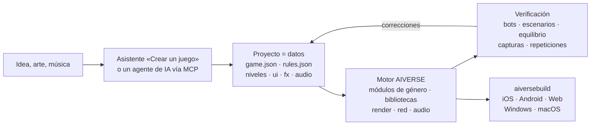

<p align="center">
  
</p>

<h3 align="center">Un motor de juegos para cualquier género, donde un agente de IA construye el juego con datos, no con código</h3>

<p align="center">
  cualquier género · módulos completos de RTS y FPS · 88 bibliotecas de mecánicas · simulación determinista · ~190 herramientas MCP · 6 plataformas
</p>

<p align="center">
  
  
  
  
  
</p>

<p align="center">
  <a href="README.md">English</a> · <a href="README.ru.md">Русский</a> · <a href="README.zh-CN.md">简体中文</a> · <a href="README.ja.md">日本語</a> · <a href="README.ko.md">한국어</a> · <b>Español</b> · <a href="README.pt-BR.md">Português</a> · <a href="README.de.md">Deutsch</a> · <a href="README.fr.md">Français</a>
</p>

<p align="center">
  <a href="#por-qué-existe">Por qué</a> ·
  <a href="#cualquier-género">Géneros</a> ·
  <a href="#cómo-funciona">Cómo funciona</a> ·
  <a href="#plantillas-listas">Plantillas</a> ·
  <a href="#inicio-rápido">Inicio rápido</a> ·
  <a href="docs/es/overview.md">Visión completa</a>
</p>

---

## En resumen

**AIVERSE** es un motor en C++20 escrito desde cero con un único objetivo: un juego **de cualquier género**
debería poder **describirse**, no programarse desde cero.

Un juego es una carpeta de datos: objetos, reglas, niveles, interfaz, audio, efectos. El motor es una
biblioteca de mecánicas deterministas listas para usar que da vida a esos datos: desde construir bases y
ejércitos de miles de unidades hasta plataformas, combate cuerpo a cuerpo, diálogos, reglas de cartas y
puzles. Entre ambos están el editor y un servidor MCP, a través de los cuales una persona o un agente de IA
trabaja en el proyecto: crea el juego, ajusta el equilibrio, lanza partidas entre bots, revisa capturas de
pantalla y genera builds para las tiendas.

> Describe la idea y señala una carpeta con arte: el asistente **Crear un juego** genera un proyecto con
> niveles, tutorial, meta, tienda, icono y pantalla de carga, y luego completa el tutorial con un bot y
> comprueba cada nivel por sí mismo.

---

## Por qué existe

Lo difícil de un juego no son los gráficos. Lo difícil está debajo: movimiento, combate, IA, red,
equilibrio, progresión. Los motores de propósito general te dan un renderizador y te dejan todo lo demás.
AIVERSE ofrece las mecánicas en sí y hace que un agente pueda trabajar en el juego.

| Problema | Cómo lo resuelve AIVERSE |
|---|---|
| **Los motores generalistas no traen jugabilidad.** Unity, Unreal y Godot ofrecen renderizado y física; la búsqueda de rutas para multitudes, el combate con combos y paradas, la IA enemiga, el orden de turnos, las reglas de cartas, la economía: cada estudio pasa meses escribiéndolos. | Las mecánicas son las piezas del motor: módulos completos de RTS y FPS más 88 bibliotecas deterministas para otros géneros. Se configuran con datos y, cuando no basta, se amplían con Lua o con C++ propio del proyecto. |
| **Los motores clásicos son incómodos para agentes de IA.** Escenas binarias, todo a través de una GUI, sin respuesta rápida: el agente trabaja a ciegas. | Un proyecto son archivos de texto legibles. ~190 herramientas MCP cubren mapas, reglas, terreno, UI, efectos, iluminación y builds. El agente verifica su propio trabajo: partidas entre bots, escenarios con comprobaciones de éxito/fallo, matrices de equilibrio, un linter de reglas con sugerencias «did you mean…», capturas de pantalla. |
| **El multijugador implica desincronizaciones sin fin.** Basta un `float` para que una partida entre un iPhone y un Android se desvíe. | La simulación es idéntica bit a bit en todas partes: punto fijo en lugar de flotantes, generador aleatorio propio, sumas de verificación. La CI compara partidas en Linux x64/ARM64, Windows y macOS en cada push. Por la red solo viajan comandos; hay lockstep con rollback y un servidor con emparejamiento y veredictos basados en repeticiones. |
| **Las GPU móviles son débiles, pero el juego debe verse bien.** | Cada función costosa —sombras, partículas, terreno, posprocesado— tiene niveles de calidad y se adapta a la GPU, desde viejas Mali y Adreno hasta Apple Silicon. |
| **Publicar en todas las plataformas es un proyecto en sí mismo.** Firmas, iconos, SDK de tiendas y anuncios. | `aiversebuild` genera con un solo comando un .app, un proyecto de Xcode, Gradle/APK, web y .exe. Los iconos y pantallas de carga se generan solos. Plugins para App Store, Google Play, RuStore, Yandex Games, Steam, AdMob, AppLovin y más; cada build incluye solo los que el juego elige. |
| **Cada juego nuevo empieza de cero.** | Más de 30 plantillas jugables, kits de género con listas de aceptación y 118 habilidades para agentes. Un juego nuevo parte de uno que ya funciona. |
| **La meta y el LiveOps se reescriben en cada proyecto.** | `aiverse::meta`: tienda, monedas, misiones, pases, recompensas diarias, energía, clanes, torneos, cofres con garantía, todo configurado en JSON. |

---

## Cualquier género

Dos géneros tienen módulos completos del motor con editor, bots y plantillas. Todo lo demás se construye a
partir de las bibliotecas de mecánicas: cada una es determinista, está probada, admite guardado/restauración
y tiene una configuración validable.

| Género | Qué aporta el motor |
|---|---|
| **RTS, tower defense, juegos de conquista** | Módulo `rts` completo: unidades y edificios definidos por datos, A\* / HPA\* / flow fields para ejércitos de miles de unidades en mapas de hasta 2048², economía, construcción, niebla de guerra, IA, terreno y planetas, 26 plantillas |
| **FPS y TPS** | Módulo `fps` completo: cliente y servidor autoritativo, grandes mundos por streaming con hasta 100 jugadores, bots, 4 plantillas; `weapon-policies` (retroceso, balística, penetración), `match-rules` (rondas, escolta, bomba, extracción) |
| **Acción, lucha, soulslike** | `combat-actions`, `melee-combat`: hitboxes y hurtboxes, combos y ventanas de cancelación, invulnerabilidad al esquivar, parada, aguante, fijación de objetivo; `genre-bots` para los rivales |
| **Plataformas, metroidvania** | `character-locomotion`: coyote time, búfer de salto, salientes, escaleras, nado, escalada, encaramarse; `zone-graph`: puertas de habilidad, puntos de control y prueba de que no hay bloqueos sin salida |
| **Sigilo, immersive sim** | `stealth-senses`: conos de visión, oído, sospecha y alertas, búsquedas, disfraces; `physical-interactions`: cargar, lanzar, cuerdas, puertas, plataformas, objetos destructibles |
| **Juegos narrativos, novelas visuales** | `narrative-graphs`: diálogos con condiciones, relaciones, consecuencias, historial y avance automático de VN; `cinematic-gameplay`: líneas de tiempo, QTE, cámara lenta |
| **Tácticas por turnos, cartas, juegos de mesa** | `turn-scheduler`: iniciativa, puntos de acción, reacciones; `card-runtime`: zonas, pila de prioridad, información oculta |
| **Puzles** | `grid-puzzles`: reglas de Sokoban, deshacer/rehacer y un solucionador; `puzzle-machine`: una máquina virtual para puzles de programación |
| **Roguelikes** | `run-graph`: partidas con semilla y presupuestos de encuentros; `loot-tables` con objeto raro garantizado |
| **Idle, fábricas, colonias** | `big-numbers`, `offline-production` (progreso offline exacto), `production-networks`, `logistics`, `tasks` |
| **Juegos de ritmo** | `rhythm-timing`: mapas de tempo y evaluación de aciertos independiente de los fotogramas |
| **Cualquier juego móvil** | `aiverse::meta` y LiveOps, tutoriales, pantallas de UI, plugins de tiendas y anuncios |

Carreras, deportes y vehículos siguen en la [hoja de ruta](docs/genre-mechanics-roadmap.md). Lista completa
de bibliotecas: [`libraries/catalog.json`](libraries/catalog.json) y [paquetes de género](docs/genre-packages.md).

---

## Cómo funciona



Un objeto es solo una descripción. Este es el campesino de la plantilla RTS `skirmish`: recolecta oro y
madera, construye cinco edificios y pelea con un pico.

```jsonc
"peasant": {
  "health":  { "max": 220, "armorType": "light" },
  "move":    { "speed": 2.4, "radius": 0.35 },
  "sight":   7,
  "weapons": [{ "id": "pick", "range": 0.5, "damage": 5, "cooldown": 1.5 }],
  "cost":    { "gold": 75, "time": 12, "supply": 1 },
  "gather":  { "gold": { "carry": 10, "time": 2.0 }, "wood": { "carry": 10, "time": 3.0 } },
  "builds":  ["townhall", "farm", "barracks", "workshop", "tower"],
  "view":    { "shape": "worker", "scale": 0.8 }
}
```

Cuando los datos no bastan, hay tres escalones: **disparadores** en JSON → **Lua** (un entorno aislado con
matemática determinista y recarga en caliente) → los **módulos nativos en C++** del propio proyecto, que
conectan las bibliotecas anteriores. El motor en sí no cambia: las mecánicas se añaden solo de forma
general, nunca para un juego concreto.

---

## Si vienes de Unity

Apunta el importador a un proyecto de Unity y obtén un proyecto de AIVERSE. Los recursos, las escenas y los parámetros se trasladan automáticamente; lo demás queda en un informe con el que un agente completa la migración vía MCP. También disponible en el editor como **Proyecto → Importar proyecto de motor** y por MCP con `port_scan` / `port_import` / `port_report` / `port_resolve`.

```bash
python3 tools/importers/port/aiverse_port.py /path/to/UnityProject --out /path/to/MyGame --mode auto
```

| En Unity | En AIVERSE |
|---|---|
| Escena | mapa `maps/*.json`: colocación de objetos, cámara, modo 2D o 3D |
| Prefab, prefabs anidados y variantes | tipo de objeto en `rules.json`; los campos serializados (`hp`, `speed`, `damage`, `fireRate`, …) se convierten en bloques de datos |
| ScriptableObject | datos de reglas |
| Lógica de MonoBehaviour en C# | la porta el agente: bloques de datos → Lua → módulo nativo en C++ |
| Modelos, texturas, materiales, audio | se copian tal cual; materiales PBR, glTF/FBX/OBJ se cargan directamente |
| Sprites y Tilemap | sprites de atlas y mapas de tiles |
| ParticleSystem | `fx/*.json`, casi todos los módulos son compatibles |
| Inspector, Hierarchy, Scene, Game | las mismas ventanas en el editor de AIVERSE |
| Build Settings, Unity IAP, Unity Ads | `aiversebuild`, plugins de tiendas y anuncios |
| Addressables / Asset Bundles | paquetes `.rpak`, builds divididos y descarga de contenido |

El informe marca cada elemento como trasladado exactamente, de forma aproximada o no trasladado. Reimportar conserva tus cambios. El proyecto necesita la serialización de recursos **Force Text**. Los proyectos de Godot se importan de la misma manera. Detalles: [Importar un proyecto de motor](docs/es/engine-import.md).

---

## Plantillas listas

Cada plantilla es un juego totalmente jugable con bots. Ábrela en el editor y empieza a modificarla.

| Género | Plantillas |
|---|---|
| RTS clásico con base | **Iron and Gold** (Warcraft / Red Alert) · **Iron Front** (Red Alert: MCV, mineral, barra lateral) · **Starfall Sectors** (StarCraft: tres razas) · **Frost Crown** (Warcraft III: héroes, creeps, terreno) · **Four Ages** (Age of Empires II) · **Amber Sands** (Dune II) · **Metal Tide** (Total Annihilation: economía de flujo) |
| Conquista y guarniciones | **Mushroom Clash** y **Shroom Wars** (Mushroom Wars 1–2) · **Spore Lanes** · **Spell Bunkers** (Bunker Wars) · **Border Rush** (State.io) · **Clan Lands** (Northgard) · **Flag Sectors** (Z) |
| Escuadras, oleadas, supervivencia | **Hold the Line** (Company of Heroes) · **Last Colony** (They Are Billions) · **Lane Clash** (batalla por carriles) |
| Economía y construcción | **Hearth and Haul** (Knights and Merchants) · **Underlord** (Dungeon Keeper) |
| 2D y experimentos | **Crystal Dunes** (tiles, Dune II) · **Green Hills** (sprites 2D sobre terreno 3D) · **Planets** (planetas esféricos y órbitas) · **Wildfire** (campos: incendios y creep) |
| FPS | **Crossfire Arena** (5 contra 5) · **Breach Protocol** (rondas tácticas) · **Last Survivor** (battle royale de 100 jugadores) · **Aim Lab** (galería de tiro) |

---

## Qué incluye

<table>
<tr>
<td width="50%" valign="top">

**Jugabilidad**
- Simulación ECS en punto fijo, repeticiones, instantáneas para rollback
- Módulos de género: RTS (economía, construcción, ejércitos, IA) y FPS (servidor autoritativo, mundos grandes)
- 88 bibliotecas: movimiento, combate, armas, sentidos, diálogos, turnos, cartas, puzles, partidas, ritmo, producción
- Búsqueda de rutas: A\*, HPA\*, flow fields, navmesh, ORCA/RVO2
- Terreno con pendientes y línea de visión, mapas de hasta 2048², planetas esféricos
- Disparadores, Lua 5.4, módulos nativos en C++

</td>
<td width="50%" valign="top">

**Gráficos y audio**
- RHI propio: Metal, GLES3 / WebGL2, GL 3.3
- PBR, glTF/OBJ, animación esquelética y procedural
- Sombras, luces dinámicas, noche, posprocesado, Shader Graph
- Partículas con los módulos de Unity ParticleSystem e importador desde Unity
- 2D: sprites, mapas de tiles con autotiling
- Audio: 3D, música adaptativa, compresión por plataforma

</td>
</tr>
<tr>
<td valign="top">

**Herramientas**
- Editor acoplable al estilo de Unity: escena, inspector, terreno, efectos, iluminación, UI, prueba de juego y simulador de dispositivos
- `aiversemcp`: servidor MCP para agentes
- Asistente **Crear un juego**
- 118 habilidades para agentes y kits de género con listas de aceptación
- Importadores de recursos de juegos clásicos desde tu propia copia

</td>
<td valign="top">

**Publicación**
- `aiversebuild`: .app, Xcode, Gradle/APK, web, .exe
- Paquetes de recursos `.rpak` (zstd), builds divididos y descarga de contenido
- Plugins de tiendas y anuncios
- UI del juego en HTML/CSS (RmlUi), localización
- Multijugador: UDP y WebSocket, servidor dedicado, emparejamiento Elo
- Biblioteca de meta y LiveOps

</td>
</tr>
</table>

---

## Inicio rápido

**1. Compila el motor** (macOS; requiere Xcode y CMake):

```bash
cmake -S . -B build/mac -DCMAKE_BUILD_TYPE=Release
cmake --build build/mac -j 8
open build/mac/AiverseEditor.app        # editor: centro de proyectos y plantillas
```

Linux: `cmake --preset linux-release && cmake --build build/linux-release`. Si prefieres no compilar, la
rama `builds` tiene el editor y las herramientas precompilados
([detalles](docs/es/overview.md#motor-precompilado-rama-builds-y-aiversemcp-sin-compilador)).

**2. Crea un juego.** En el centro de proyectos, pulsa **Crear un juego** o crea un proyecto desde una
plantilla. Puedes jugarlo con bots enseguida en la ventana Game.

**3. Conecta un agente de IA.** La ventana **Agent** del editor muestra una configuración lista. Para Claude Code:

```bash
claude mcp add aiverse -- /path/to/aiversemcp --engine /path/to/AIVERSE
```

Después puedes pedirle al agente algo como: *«Haz un juego de estrategia al estilo Northgard en un mapa
invernal, comprueba con bots el equilibrio de tres facciones y genera una versión web».*

**4. Publica:**

```bash
./build/mac/aiversebuild --project "Mi juego.rtsproj" --target all   # macOS, iOS, Android, web, Windows
```

---

## Estado

El motor está en desarrollo activo. Lo que se ha verificado:

- ✅ **Linux**: cliente, editor, pruebas, partidas entre bots; sumas de verificación idénticas en x64 y ARM64
- ✅ **macOS / Metal**: compilación, pruebas, juego; `aiversebuild` → .app y un proyecto de iOS con build para el simulador
- ✅ **Web**: una partida se ejecuta en Chromium headless (WebGL2)
- ✅ **Windows**: .exe compilado de forma cruzada con MinGW, ejecutado con Wine
- 🛠 Las plantillas para géneros distintos de RTS y FPS están en preparación

Los detalles de cada subsistema están en
[Verificado / no verificado](docs/es/overview.md#verificado--no-verificado).

---

## Documentación

Los documentos de referencia están en inglés. La visión completa, el asistente de juegos, la migración desde Unity y los paquetes de género también están en español.

| | |
|---|---|
| [**Visión completa**](docs/es/overview.md) | todos los subsistemas, compilación, plataformas, CI, versiones |
| [Formato del juego](docs/game-format.md) | `game.json`, `rules.json`, mapas y todos los bloques de datos |
| [Paquetes de género](docs/genre-packages.md) · [Bibliotecas](docs/libraries.md) | mecánicas para cualquier género |
| [Asistente Crear un juego](docs/es/game-wizard.md) | cómo una idea y arte se convierten en un proyecto terminado |
| [Scripting](docs/scripting.md) · [Módulos C++](docs/native-modules.md) | cuando los datos no bastan |
| [Terreno](docs/terrain.md) · [Planetas](docs/planets.md) · [Búsqueda de rutas](docs/pathfinding.md) | mundo y movimiento |
| [Partículas](docs/particles.md) · [Modelos](docs/models.md) · [Shader Graph](docs/shader-graph.md) | apartado visual |
| [Meta](docs/meta-game.md) · [LiveOps](docs/meta-liveops.md) · [Plugins](docs/plugins.md) | monetización y tiendas |
| [FPS](docs/fps.md) · [Mundos grandes](docs/large-worlds.md) | módulo FPS |
| [AGENTS.md](AGENTS.md) | reglas para agentes que modifican el propio motor |
| [Migrar desde Unity](docs/es/engine-import.md) | importar escenas, prefabs y recursos, y portar la lógica con un agente |

## Licencia

[MIT](LICENSE). Las bibliotecas de terceros están en `third_party/` con sus propias licencias (solo MIT,
BSD, zlib, OFL, CC0 y CC-BY). No se incluyen recursos originales de juegos comerciales: los importadores
los leen desde tu propia copia.
