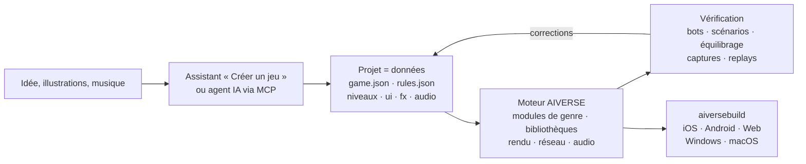

<p align="center">
  
</p>

<h3 align="center">Un moteur de jeu pour tous les genres, où un agent IA construit le jeu à partir de données, pas de code</h3>

<p align="center">
  tous les genres · modules RTS et FPS complets · 88 bibliothèques de mécaniques · simulation déterministe · ~190 outils MCP · 6 plateformes
</p>

<p align="center">
  
  
  
  
  
</p>

<p align="center">
  <a href="README.md">English</a> · <a href="README.ru.md">Русский</a> · <a href="README.zh-CN.md">简体中文</a> · <a href="README.ja.md">日本語</a> · <a href="README.ko.md">한국어</a> · <a href="README.es.md">Español</a> · <a href="README.pt-BR.md">Português</a> · <a href="README.de.md">Deutsch</a> · <b>Français</b>
</p>

<p align="center">
  <a href="#pourquoi-il-existe">Pourquoi</a> ·
  <a href="#tous-les-genres">Genres</a> ·
  <a href="#fonctionnement">Fonctionnement</a> ·
  <a href="#modèles-prêts-à-lemploi">Modèles</a> ·
  <a href="#démarrage-rapide">Démarrage rapide</a> ·
  <a href="docs/fr/overview.md">Vue d’ensemble complète</a>
</p>

---

## En bref

**AIVERSE** est un moteur C++20 écrit de zéro dans un seul but : un jeu **de n’importe quel genre** doit
pouvoir être **décrit**, et non programmé de A à Z.

Un jeu est un dossier de données : objets, règles, niveaux, interface, audio, effets. Le moteur est une
bibliothèque de mécaniques déterministes prêtes à l’emploi qui donne vie à ces données — de la
construction de base et des armées de milliers d’unités jusqu’à la plateforme, au combat au corps à corps,
aux dialogues, aux règles de cartes et aux puzzles. Entre les deux se trouvent l’éditeur et un serveur MCP,
par lesquels une personne ou un agent IA travaille sur le projet : crée le jeu, ajuste l’équilibrage, lance
des parties entre bots, examine des captures d’écran et produit des builds pour les stores.

> Décrivez l’idée et indiquez un dossier d’illustrations : l’assistant **Créer un jeu** génère un projet
> avec niveaux, tutoriel, méta, boutique, icône et écran de démarrage, puis termine lui-même le tutoriel
> avec un bot et vérifie chaque niveau.

---

## Pourquoi il existe

Ce qui rend un jeu difficile, ce ne sont pas les graphismes. La difficulté est en dessous : déplacement,
combat, IA, réseau, équilibrage, progression. Les moteurs généralistes vous donnent un moteur de rendu et
vous laissent tout le reste. AIVERSE fournit les mécaniques elles-mêmes — et permet à un agent de
travailler sur le jeu.

| Problème | Comment AIVERSE le résout |
|---|---|
| **Les moteurs généralistes ne fournissent pas de gameplay.** Unity, Unreal et Godot offrent rendu et physique ; recherche de chemin pour des foules, combat avec combos et parades, IA ennemie, ordre des tours, règles de cartes, économie : chaque studio passe des mois à les écrire. | Les mécaniques sont les briques du moteur : modules RTS et FPS complets plus 88 bibliothèques déterministes pour les autres genres. Elles se configurent par les données et, quand cela ne suffit pas, s’étendent avec Lua ou le C++ propre au projet. |
| **Les moteurs classiques sont peu pratiques pour les agents IA.** Scènes binaires, tout passe par une interface graphique, pas de retour rapide : l’agent travaille à l’aveugle. | Un projet est fait de fichiers texte lisibles. ~190 outils MCP couvrent cartes, règles, terrain, UI, effets, éclairage et builds. L’agent vérifie lui-même son travail : parties entre bots, scénarios avec contrôles réussi/échoué, matrices d’équilibrage, un linter de règles qui suggère « did you mean… », captures d’écran. |
| **Le multijoueur, c’est des désynchronisations sans fin.** Un seul `float` suffit pour qu’une partie entre un iPhone et un Android diverge. | La simulation est identique au bit près partout : virgule fixe au lieu de flottants, générateur aléatoire propre, sommes de contrôle. La CI compare les parties sur Linux x64/ARM64, Windows et macOS à chaque push. Seules les commandes transitent sur le réseau ; il y a un lockstep avec rollback et un serveur avec matchmaking et verdict par replay. |
| **Les GPU mobiles sont faibles, mais le jeu doit être beau.** | Chaque fonction coûteuse — ombres, particules, terrain, post-traitement — a des niveaux de qualité et s’adapte au GPU, des vieux Mali et Adreno jusqu’à Apple Silicon. |
| **Sortir sur toutes les plateformes est un projet à part entière.** Signatures, icônes, SDK des stores et de la publicité. | `aiversebuild` produit en une commande un .app, un projet Xcode, Gradle/APK, web et .exe. Icônes et écrans de démarrage sont générés. Plugins pour l’App Store, Google Play, RuStore, Yandex Games, Steam, AdMob, AppLovin et d’autres — un build n’embarque que ceux que le jeu choisit. |
| **Chaque nouveau jeu repart de zéro.** | Plus de 30 modèles jouables, des kits de genre avec listes de recette, 126 compétences pour les agents. Un nouveau jeu part d’un jeu qui fonctionne déjà. |
| **La méta et le LiveOps sont réécrits dans chaque projet.** | `aiverse::meta` : boutique, monnaies, quêtes, passes, récompenses quotidiennes, énergie, clans, tournois, coffres avec garantie — configurés en JSON. |

---

## Tous les genres

Deux genres disposent de modules moteur complets avec éditeur, bots et modèles. Tout le reste s’assemble à
partir des bibliothèques de mécaniques — chacune déterministe, testée, avec sauvegarde/restauration et une
configuration validable.

| Genre | Ce que fournit le moteur |
|---|---|
| **RTS, tower defense, jeux de conquête** | Module `rts` complet : unités et bâtiments définis par les données, A\* / HPA\* / flow fields pour des armées de milliers d’unités sur des cartes jusqu’à 2048², économie, construction, brouillard de guerre, IA, terrain et planètes, 26 modèles |
| **FPS et TPS** | Module `fps` complet : client et serveur autoritaire, grands mondes en streaming jusqu’à 100 joueurs, bots, 4 modèles ; `weapon-policies` (recul, balistique, pénétration), `match-rules` (manches, escorte, bombe, extraction) |
| **Action, combat, soulslike** | `combat-actions`, `melee-combat` : hitbox et hurtbox, combos et fenêtres d’annulation, invulnérabilité en esquive, parade, posture, verrouillage de cible ; `genre-bots` pour les adversaires |
| **Plateforme, metroidvania** | `character-locomotion` : coyote time, tampon de saut, rebords, échelles, nage, escalade, franchissement ; `zone-graph` : verrous de capacité, points de contrôle et preuve d’absence de blocage |
| **Infiltration, immersive sim** | `stealth-senses` : cônes de vision, ouïe, soupçon et alerte, fouilles, déguisements ; `physical-interactions` : porter, lancer, cordes, portes, plateformes, objets destructibles |
| **Jeux narratifs, visual novels** | `narrative-graphs` : dialogues conditionnels, relations, conséquences, historique et défilement automatique de VN ; `cinematic-gameplay` : timelines, QTE, ralenti |
| **Tactique au tour par tour, cartes, jeux de plateau** | `turn-scheduler` : initiative, points d’action, réactions ; `card-runtime` : zones, pile de priorité, information cachée |
| **Puzzles** | `grid-puzzles` : règles de Sokoban, annuler/rétablir et un solveur ; `puzzle-machine` : une machine virtuelle pour les puzzles de programmation |
| **Roguelikes** | `run-graph` : runs à graine et budgets de rencontres ; `loot-tables` avec objet rare garanti |
| **Idle, usine, colonie** | `big-numbers`, `offline-production` (progression hors ligne exacte), `production-networks`, `logistics`, `tasks` |
| **Jeux de rythme** | `rhythm-timing` : cartes de tempo et jugement des frappes indépendant de la fréquence d’images |
| **Tout jeu mobile** | `aiverse::meta` et LiveOps, tutoriels, écrans d’interface, plugins de stores et de publicité |

Course, sport et véhicules sont encore dans la [feuille de route](docs/genre-mechanics-roadmap.md). Liste
complète des bibliothèques : [`libraries/catalog.json`](libraries/catalog.json) et [paquets de genre](docs/genre-packages.md).

---

## Fonctionnement



Un objet n’est qu’une description. Voici le paysan du modèle RTS `skirmish` : il récolte de l’or et du bois,
construit cinq bâtiments et se bat avec une pioche.

```jsonc
"peasant": {
  "health":  { "max": 220, "armorType": "light" },
  "move":    { "speed": 2.4, "radius": 0.35 },
  "sight":   7,
  "weapons": [{ "id": "pick", "range": 0.5, "damage": 5, "cooldown": 1.5 }],
  "cost":    { "gold": 75, "time": 12, "supply": 1 },
  "gather":  { "gold": { "carry": 10, "time": 2.0 }, "wood": { "carry": 10, "time": 3.0 } },
  "builds":  ["townhall", "farm", "barracks", "workshop", "tower"],
  "view":    { "shape": "worker", "scale": 0.8 }
}
```

Quand les données ne suffisent pas, il y a trois paliers : **déclencheurs** en JSON → **Lua** (un bac à
sable avec mathématiques déterministes et rechargement à chaud) → **modules C++ natifs** propres au projet,
qui branchent les bibliothèques ci-dessus. Le moteur lui-même ne change pas : les mécaniques n’y sont
ajoutées que sous une forme générale, jamais pour un jeu particulier.

---

## Venir d’Unity

Indiquez un projet Unity à l’importateur et obtenez un projet AIVERSE. Les ressources, les scènes et les paramètres sont transférés automatiquement ; le reste va dans un rapport à partir duquel un agent termine la migration via MCP. Également disponible dans l’éditeur via **Projet → Importer un projet de moteur** et par MCP avec `port_scan` / `port_import` / `port_report` / `port_resolve`.

```bash
python3 tools/importers/port/aiverse_port.py /path/to/UnityProject --out /path/to/MyGame --mode auto
```

| Dans Unity | Dans AIVERSE |
|---|---|
| Scène | carte `maps/*.json` : placement des objets, caméra, mode 2D ou 3D |
| Prefab, prefabs imbriqués et variantes | type d’objet dans `rules.json` ; les champs sérialisés (`hp`, `speed`, `damage`, `fireRate`, …) deviennent des blocs de données |
| ScriptableObject | données de règles |
| Logique MonoBehaviour en C# | portée par l’agent : blocs de données → Lua → module C++ natif |
| Modèles, textures, matériaux, audio | copiés tels quels ; matériaux PBR, glTF/FBX/OBJ chargés directement |
| Sprites et Tilemap | sprites d’atlas et cartes de tuiles |
| ParticleSystem | `fx/*.json`, presque tous les modules sont pris en charge |
| Inspector, Hierarchy, Scene, Game | les mêmes fenêtres dans l’éditeur AIVERSE |
| Build Settings, Unity IAP, Unity Ads | `aiversebuild`, plugins de stores et de publicité |
| Addressables / Asset Bundles | paquets `.rpak`, builds fractionnés et téléchargement de contenu |

Le rapport marque chaque élément comme transféré exactement, approximativement ou non transféré. Une réimportation conserve vos modifications. Le projet doit utiliser la sérialisation des ressources **Force Text**. Les projets Godot s’importent de la même façon. Détails : [Import d’un projet de moteur](docs/fr/engine-import.md).

---

## Modèles prêts à l’emploi

Chaque modèle est un jeu entièrement jouable avec des bots. Ouvrez-le dans l’éditeur et modifiez-le aussitôt.

| Genre | Modèles |
|---|---|
| RTS classique avec base | **Iron and Gold** (Warcraft / Red Alert) · **Iron Front** (Red Alert : MCV, minerai, barre latérale) · **Starfall Sectors** (StarCraft : trois races) · **Frost Crown** (Warcraft III : héros, creeps, terrain) · **Four Ages** (Age of Empires II) · **Amber Sands** (Dune II) · **Metal Tide** (Total Annihilation : économie de flux) |
| Conquête et garnisons | **Mushroom Clash** et **Shroom Wars** (Mushroom Wars 1–2) · **Spore Lanes** · **Spell Bunkers** (Bunker Wars) · **Border Rush** (State.io) · **Clan Lands** (Northgard) · **Flag Sectors** (Z) |
| Escouades, vagues, survie | **Hold the Line** (Company of Heroes) · **Last Colony** (They Are Billions) · **Lane Clash** (lane battler) |
| Économie et construction | **Hearth and Haul** (Knights and Merchants) · **Underlord** (Dungeon Keeper) |
| 2D et expériences | **Crystal Dunes** (tuiles, Dune II) · **Green Hills** (sprites 2D sur terrain 3D) · **Planets** (planètes sphériques et orbites) · **Wildfire** (champs : incendies et creep) |
| FPS | **Crossfire Arena** (5 contre 5) · **Breach Protocol** (manches tactiques) · **Last Survivor** (battle royale à 100 joueurs) · **Aim Lab** (stand de tir) |

---

## Ce qu’il contient

<table>
<tr>
<td width="50%" valign="top">

**Gameplay**
- Simulation ECS en virgule fixe, replays, instantanés pour le rollback
- Modules de genre : RTS (économie, construction, armées, IA) et FPS (serveur autoritaire, grands mondes)
- 88 bibliothèques : déplacement, combat, armes, sens, dialogues, tours, cartes, puzzles, runs, rythme, production
- Recherche de chemin : A\*, HPA\*, flow fields, navmesh, ORCA/RVO2
- Terrain avec pentes et ligne de vue, cartes jusqu’à 2048², planètes sphériques
- Déclencheurs, Lua 5.4, modules C++ natifs

</td>
<td width="50%" valign="top">

**Graphismes et audio**
- RHI maison : Metal, GLES3 / WebGL2, GL 3.3
- PBR, glTF/OBJ, animation squelettique et procédurale, câbles procéduraux
- Ombres, lumières dynamiques, nuit, post-traitement, Shader Graph
- Particules avec les modules du ParticleSystem d’Unity et importateur depuis Unity
- 2D : sprites, cartes de tuiles avec autotiling
- Audio : 3D, musique adaptative, compression par plateforme

</td>
</tr>
<tr>
<td valign="top">

**Outils**
- Éditeur à fenêtres ancrables façon Unity : scène, inspecteur, terrain, effets, éclairage, UI, partie de test et simulateur d’appareils
- `aiversemcp` — serveur MCP pour les agents
- Assistant **Créer un jeu**
- 126 compétences pour les agents et kits de genre avec listes de recette
- Importateurs de ressources de jeux classiques depuis votre propre copie

</td>
<td valign="top">

**Publication**
- `aiversebuild` : .app, Xcode, Gradle/APK, web, .exe
- Paquets de ressources `.rpak` (zstd), builds fractionnés et téléchargement de contenu
- Plugins de stores et de publicité
- Interface du jeu en HTML/CSS (RmlUi), localisation
- Multijoueur : UDP et WebSocket, serveur dédié, matchmaking Elo
- Bibliothèque méta et LiveOps

</td>
</tr>
</table>

---

## Démarrage rapide

**1. Compiler le moteur** (macOS ; nécessite Xcode et CMake) :

```bash
cmake -S . -B build/mac -DCMAKE_BUILD_TYPE=Release
cmake --build build/mac -j 8
open build/mac/AiverseEditor.app        # éditeur : hub de projets et modèles
```

Linux : `cmake --preset linux-release && cmake --build build/linux-release`. Si vous préférez ne pas
compiler, la branche `builds` contient l’éditeur et les outils précompilés
([détails](docs/fr/overview.md#moteur-précompilé-branche-builds-et-aiversemcp-sans-compilateur)).

**2. Créer un jeu.** Dans le hub, cliquez sur **Créer un jeu** ou créez un projet à partir d’un modèle. Vous
pouvez y jouer contre des bots tout de suite dans la fenêtre Game.

**3. Connecter un agent IA.** La fenêtre **Agent** de l’éditeur affiche une configuration prête. Pour Claude Code :

```bash
claude mcp add aiverse -- /path/to/aiversemcp --engine /path/to/AIVERSE
```

Ensuite, vous pouvez demander à l’agent par exemple : *« Fais un jeu de stratégie à la Northgard sur une
carte hivernale, vérifie l’équilibrage de trois factions avec des bots et compile une version web. »*

**4. Publier :**

```bash
./build/mac/aiversebuild --project "Mon jeu.aiverse" --target all   # macOS, iOS, Android, web, Windows
```

---

## État

Le moteur est en développement actif. Ce qui a été vérifié :

- ✅ **Linux** : client, éditeur, tests, parties entre bots ; sommes de contrôle identiques sur x64 et ARM64
- ✅ **macOS / Metal** : compilation, tests, jeu ; `aiversebuild` → .app et un projet iOS avec build pour le simulateur
- ✅ **Web** : une partie tourne dans Chromium headless (WebGL2)
- ✅ **Windows** : .exe compilé en croisé avec MinGW, exécuté sous Wine
- 🛠 Des modèles pour les genres autres que RTS et FPS sont en préparation

Détails par sous-système dans
[Vérifié / non vérifié](docs/fr/overview.md#vérifié--non-vérifié).

---

## Documentation

Les documents de référence sont en anglais. La vue d’ensemble, l’assistant de création, la migration depuis Unity et les paquets de genre existent aussi en français.

| | |
|---|---|
| [**Vue d’ensemble complète**](docs/fr/overview.md) | tous les sous-systèmes, compilation, plateformes, CI, versions |
| [Format de jeu](docs/game-format.md) | `game.json`, `rules.json`, cartes et tous les blocs de données |
| [Paquets de genre](docs/genre-packages.md) · [Bibliothèques](docs/libraries.md) | des mécaniques pour tous les genres |
| [Assistant Créer un jeu](docs/fr/game-wizard.md) | comment une idée et des illustrations deviennent un projet fini |
| [Scripts](docs/scripting.md) · [Modules C++](docs/native-modules.md) | quand les données ne suffisent pas |
| [Terrain](docs/terrain.md) · [Planètes](docs/planets.md) · [Recherche de chemin](docs/pathfinding.md) | monde et déplacement |
| [Particules](docs/particles.md) · [Modèles 3D](docs/models.md) · [Shader Graph](docs/shader-graph.md) | visuel |
| [Méta-jeu](docs/meta-game.md) · [LiveOps](docs/meta-liveops.md) · [Plugins](docs/plugins.md) | monétisation et stores |
| [FPS](docs/fps.md) · [Grands mondes](docs/large-worlds.md) | module FPS |
| [AGENTS.md](AGENTS.md) | règles pour les agents qui modifient le moteur lui-même |
| [Venir d’Unity](docs/fr/engine-import.md) | importer scènes, prefabs et ressources, puis porter la logique avec un agent |

## Licence

[MIT](LICENSE). Les bibliothèques tierces se trouvent dans `third_party/` avec leurs propres licences
(uniquement MIT, BSD, zlib, OFL, CC0 et CC-BY). Les ressources originales des jeux commerciaux ne sont pas
incluses : les importateurs les lisent depuis votre propre copie.
