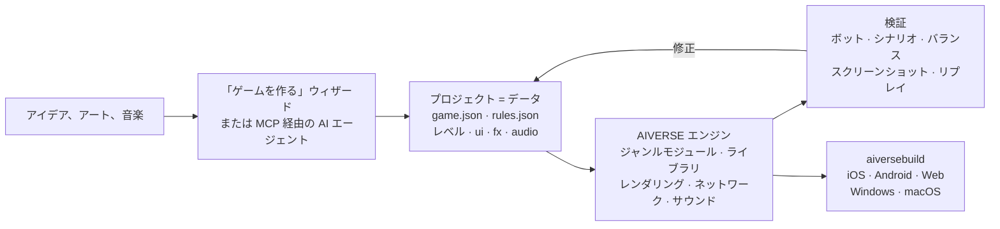

<p align="center">
  
</p>

<h3 align="center">あらゆるジャンルのためのゲームエンジン。AI エージェントがコードではなくデータでゲームを作る</h3>

<p align="center">
  あらゆるジャンル · 完全な RTS / FPS モジュール · 88 のメカニクスライブラリ · 決定論的シミュレーション · 約 190 の MCP ツール · 6 プラットフォーム
</p>

<p align="center">
  
  
  
  
  
</p>

<p align="center">
  <a href="README.md">English</a> · <a href="README.ru.md">Русский</a> · <a href="README.zh-CN.md">简体中文</a> · <b>日本語</b> · <a href="README.ko.md">한국어</a> · <a href="README.es.md">Español</a> · <a href="README.pt-BR.md">Português</a> · <a href="README.de.md">Deutsch</a> · <a href="README.fr.md">Français</a>
</p>

<p align="center">
  <a href="#なぜ必要か">なぜ</a> ·
  <a href="#あらゆるジャンル">ジャンル</a> ·
  <a href="#仕組み">仕組み</a> ·
  <a href="#すぐに使えるテンプレート">テンプレート</a> ·
  <a href="#クイックスタート">クイックスタート</a> ·
  <a href="docs/ja/overview.md">詳細な概要</a>
</p>

---

## 概要

**AIVERSE** は、ひとつの目的のためにゼロから書かれた C++20 エンジンです。**どんなジャンル**のゲームも、
一からプログラミングするのではなく、**記述する**だけで作れるようにすること。

ゲームはデータのフォルダです。オブジェクト、ルール、レベル、UI、サウンド、エフェクト。エンジンは
それらのデータに命を吹き込む、決定論的なメカニクスのライブラリです。基地建設や数千ユニットの軍勢から、
プラットフォームアクション、近接戦闘、会話、カードのルール、パズルまで。その間にエディターと MCP サーバーがあり、
人間や AI エージェントがそれを通じてプロジェクトに取り組みます。ゲームを作り、バランスを調整し、
ボット同士の対戦を回し、スクリーンショットを確認し、ストア向けビルドを出力します。

> アイデアを伝えてアート素材のフォルダを指定するだけ。**「ゲームを作る」**ウィザードが、レベル、
> チュートリアル、メタ、ショップ、アイコン、スプラッシュ画面を備えたプロジェクトを作り、
> ボットでチュートリアルを通しプレイして、すべてのレベルを自分で検証します。

---

## なぜ必要か

ゲーム作りを難しくしているのはグラフィックではありません。難しいのはその下にあるもの、つまり移動、戦闘、AI、
ネットワーク、バランス、成長要素です。汎用エンジンはレンダラーを提供し、残りはすべてあなた任せです。
AIVERSE はメカニクスそのものを提供し、エージェントがゲームに取り組めるようにします。

| 課題 | AIVERSE の解決策 |
|---|---|
| **汎用エンジンはゲームプレイを提供しない。** Unity、Unreal、Godot はレンダリングと物理を提供しますが、大群の経路探索、コンボとパリィのある戦闘、敵 AI、ターン順、カードのルール、経済は、どのスタジオも数か月かけて自作しています。 | メカニクスがエンジンの構成要素です。完全な RTS / FPS モジュールに加え、他ジャンル向けの 88 の決定論的ライブラリ。データで設定し、足りなければ Lua やプロジェクト独自の C++ で拡張します。 |
| **従来のエンジンは AI エージェントに向いていない。** バイナリのシーン、すべてが GUI 経由、素早いフィードバックがない。エージェントは手探りで作業することになります。 | プロジェクトは読めるテキストファイルです。約 190 の MCP ツールがマップ、ルール、地形、UI、エフェクト、ライティング、ビルドをカバー。エージェントは結果を自分で検証できます。ボット対戦、合否判定付きシナリオ、バランス表、「did you mean…」と提案するルールリンター、スクリーンショット。 |
| **マルチプレイは同期ズレとの終わりなき戦い。** `float` がひとつあるだけで、iPhone と Android の対戦はずれていきます。 | シミュレーションはどこでもビット単位で同一です。浮動小数点ではなく固定小数点、独自の乱数生成器、チェックサム。CI はプッシュのたびに Linux x64/ARM64、Windows、macOS の対戦結果を照合します。ネットワークに流れるのはコマンドだけ。ロールバック付きロックステップと、マッチメイキングとリプレイ判定を備えたサーバーがあります。 |
| **モバイル GPU は非力なのに、ゲームは美しくなければならない。** | 影、パーティクル、地形、ポストエフェクトなど、負荷の高い機能はすべて品質レベルを持ち、古い Mali や Adreno から Apple Silicon まで GPU に合わせて自動調整されます。 |
| **全プラットフォームでのリリースはそれだけで一大プロジェクト。** 署名、アイコン、ストアや広告の SDK。 | `aiversebuild` ひとつのコマンドで .app、Xcode プロジェクト、Gradle/APK、Web、.exe を作成。アイコンとスプラッシュ画面は自動生成。App Store、Google Play、RuStore、Yandex Games、Steam、AdMob、AppLovin などのプラグインを用意し、ビルドにはゲームが選んだものだけが含まれます。 |
| **新しいゲームは毎回ゼロから。** | 30 以上のプレイ可能なテンプレート、受け入れチェックリスト付きのジャンルキット、エージェント向けの 126 のスキル。新しいゲームは動くゲームから始まります。 |
| **メタと LiveOps はプロジェクトごとに書き直し。** | `aiverse::meta`：ショップ、通貨、クエスト、パス、デイリー報酬、スタミナ、クラン、トーナメント、天井付きの宝箱。JSON で設定します。 |

---

## あらゆるジャンル

2 つのジャンルには、エディター、ボット、テンプレートを備えた完全なエンジンモジュールがあります。それ以外は
メカニクスライブラリを組み合わせて作ります。どのライブラリも決定論的でテスト済み、セーブ/復元に対応し、
検証可能な設定を持っています。

| ジャンル | エンジンが提供するもの |
|---|---|
| **RTS、タワーディフェンス、陣取り** | 完全な `rts` モジュール：データ駆動のユニットと建物、最大 2048² のマップで数千ユニットの軍勢を動かせる A\* / HPA\* / フローフィールド、経済、建設、戦場の霧、AI、地形と惑星、26 のテンプレート |
| **FPS と TPS** | 完全な `fps` モジュール：クライアントと権威サーバー、最大 100 人のストリーミング大規模ワールド、ボット、4 つのテンプレート。`weapon-policies`（反動、弾道、貫通）、`match-rules`（ラウンド、ペイロード、爆破、脱出） |
| **アクション、格闘、ソウルライク** | `combat-actions`、`melee-combat`：ヒットボックスとハートボックス、コンボとキャンセル猶予、回避の無敵時間、パリィ、体幹、ロックオン。対戦相手には `genre-bots` |
| **プラットフォーマー、メトロイドヴァニア** | `character-locomotion`：コヨーテタイム、ジャンプ先行入力、崖つかまり、はしご、水泳、壁登り、乗り越え。`zone-graph`：能力ゲート、チェックポイント、詰み状態がないことの証明 |
| **ステルス、イマーシブシム** | `stealth-senses`：視界の円錐、聴覚、疑念と警戒、捜索、変装。`physical-interactions`：持ち運び、投てき、ロープ、ドア、動く足場、破壊可能オブジェクト |
| **ストーリーゲーム、ビジュアルノベル** | `narrative-graphs`：条件付き会話、好感度、結果の分岐、VN のバックログとオート送り。`cinematic-gameplay`：タイムライン、QTE、スローモーション |
| **ターン制タクティクス、カード、ボードゲーム** | `turn-scheduler`：イニシアチブ、行動ポイント、リアクション。`card-runtime`：ゾーン、優先権スタック、非公開情報 |
| **パズル** | `grid-puzzles`：倉庫番のルール、アンドゥ/リドゥ、ソルバー。`puzzle-machine`：プログラミングパズル用の仮想マシン |
| **ローグライク** | `run-graph`：シード付きのラン、エンカウント予算。レア確定枠付きの `loot-tables` |
| **放置、工場、コロニー** | `big-numbers`、`offline-production`（正確なオフライン進行）、`production-networks`、`logistics`、`tasks` |
| **リズムゲーム** | `rhythm-timing`：テンポマップとフレームレートに依存しない判定 |
| **あらゆるモバイルゲーム** | `aiverse::meta` と LiveOps、チュートリアル、UI 画面、ストアと広告のプラグイン |

レース、スポーツ、乗り物はまだ[ロードマップ](docs/genre-mechanics-roadmap.md)上にあります。ライブラリの全一覧：
[`libraries/catalog.json`](libraries/catalog.json) と[ジャンルパッケージ](docs/genre-packages.md)。

---

## 仕組み



オブジェクトはただの記述です。これは RTS テンプレート `skirmish` の農民で、金と木を集め、
5 種類の建物を建て、つるはしで戦います。

```jsonc
"peasant": {
  "health":  { "max": 220, "armorType": "light" },
  "move":    { "speed": 2.4, "radius": 0.35 },
  "sight":   7,
  "weapons": [{ "id": "pick", "range": 0.5, "damage": 5, "cooldown": 1.5 }],
  "cost":    { "gold": 75, "time": 12, "supply": 1 },
  "gather":  { "gold": { "carry": 10, "time": 2.0 }, "wood": { "carry": 10, "time": 3.0 } },
  "builds":  ["townhall", "farm", "barracks", "workshop", "tower"],
  "view":    { "shape": "worker", "scale": 0.8 }
}
```

データで足りないときは 3 段階で拡張できます。JSON の**トリガー** → **Lua**（決定論的な数学とホットリロード
を備えたサンドボックス）→ 上記のライブラリを取り込めるプロジェクト独自の**ネイティブ C++ モジュール**。
エンジン自体は変わりません。メカニクスは汎用的な形でのみエンジンに追加され、特定のゲーム専用にはなりません。

---

## Unity からの移行

インポーターに Unity プロジェクトを指定すると、AIVERSE のプロジェクトができあがります。アセット、シーン、パラメーターは自動で移行され、それ以外はレポートにまとめられ、エージェントが MCP 経由で移行を仕上げます。エディターの **プロジェクト → エンジンプロジェクトをインポート**、MCP の `port_scan` / `port_import` / `port_report` / `port_resolve` からも使えます。

```bash
python3 tools/importers/port/aiverse_port.py /path/to/UnityProject --out /path/to/MyGame --mode auto
```

| Unity では | AIVERSE では |
|---|---|
| シーン | マップ `maps/*.json`：オブジェクト配置、カメラ、2D/3D モード |
| プレハブ、ネストしたプレハブ、バリアント | `rules.json` のオブジェクトタイプ。シリアライズされたフィールド（`hp`、`speed`、`damage`、`fireRate` など）はデータブロックになる |
| ScriptableObject | ルールのデータ |
| C# の MonoBehaviour ロジック | エージェントが移植：データブロック → Lua → ネイティブ C++ モジュール |
| モデル、テクスチャ、マテリアル、サウンド | そのままコピー。PBR マテリアル、glTF/FBX/OBJ は直接読み込み |
| スプライトと Tilemap | アトラスのスプライトとタイルマップ |
| ParticleSystem | `fx/*.json`。ほぼすべてのモジュールに対応 |
| Inspector、Hierarchy、Scene、Game | AIVERSE エディターの同じウィンドウ |
| Build Settings、Unity IAP、Unity Ads | `aiversebuild`、ストアと広告のプラグイン |
| Addressables / Asset Bundles | `.rpak` パック、ビルド分割とコンテンツのダウンロード |

レポートでは各項目が「正確に移行」「近似で移行」「未移行」に分類されます。再インポートしても編集内容は保持されます。アセットのシリアライズは **Force Text** が必要です。Godot プロジェクトも同じ方法でインポートできます。詳細：[エンジンプロジェクトのインポート](docs/ja/engine-import.md)。

---

## すぐに使えるテンプレート

どのテンプレートもボット付きで完全にプレイ可能なゲームです。エディターで開いてすぐに改造できます。

| ジャンル | テンプレート |
|---|---|
| 古典的な基地建設 RTS | **Iron and Gold**（Warcraft / Red Alert）· **Iron Front**（Red Alert：MCV、鉱石、サイドバー）· **Starfall Sectors**（StarCraft：3 種族）· **Frost Crown**（Warcraft III：ヒーロー、クリープ、地形）· **Four Ages**（Age of Empires II）· **Amber Sands**（Dune II）· **Metal Tide**（Total Annihilation：フロー型経済） |
| 占領と駐屯 | **Mushroom Clash** と **Shroom Wars**（Mushroom Wars 1–2）· **Spore Lanes** · **Spell Bunkers**（Bunker Wars）· **Border Rush**（State.io）· **Clan Lands**（Northgard）· **Flag Sectors**（Z） |
| 分隊、ウェーブ、サバイバル | **Hold the Line**（Company of Heroes）· **Last Colony**（They Are Billions）· **Lane Clash**（レーンバトル） |
| 経済と建設 | **Hearth and Haul**（Knights and Merchants）· **Underlord**（Dungeon Keeper） |
| 2D と実験 | **Crystal Dunes**（タイル、Dune II）· **Green Hills**（3D 地形上の 2D スプライト）· **Planets**（球体の惑星と軌道）· **Wildfire**（フィールド：山火事とクリープ） |
| FPS | **Crossfire Arena**（5 対 5）· **Breach Protocol**（タクティカルラウンド）· **Last Survivor**（100 人バトルロイヤル）· **Aim Lab**（射撃場） |

---

## 中身

<table>
<tr>
<td width="50%" valign="top">

**ゲームプレイ**
- 固定小数点の ECS シミュレーション、リプレイ、ロールバック用スナップショット
- ジャンルモジュール：RTS（経済、建設、軍勢、AI）と FPS（権威サーバー、大規模ワールド）
- 88 のライブラリ：移動、戦闘、武器、知覚、会話、ターン、カード、パズル、ラン、リズム、生産
- 経路探索：A\*、HPA\*、フローフィールド、ナビメッシュ、ORCA/RVO2
- 傾斜と視線を考慮した地形、最大 2048² のマップ、球体の惑星
- トリガー、Lua 5.4、ネイティブ C++ モジュール

</td>
<td width="50%" valign="top">

**グラフィックとサウンド**
- 独自 RHI：Metal、GLES3 / WebGL2、GL 3.3
- PBR、glTF/OBJ、スケルタル/プロシージャルアニメーション、プロシージャルケーブル
- 影、動的ライト、夜、ポストエフェクト、Shader Graph
- Unity ParticleSystem のモジュールに対応したパーティクルと Unity からのインポーター
- 2D：スプライト、オートタイル付きタイルマップ
- サウンド：3D、アダプティブミュージック、プラットフォーム別圧縮

</td>
</tr>
<tr>
<td valign="top">

**ツール**
- Unity 風のドッキング式エディター：シーン、インスペクター、地形、エフェクト、ライティング、UI、テストプレイ、デバイスシミュレーター
- `aiversemcp`：エージェント向け MCP サーバー
- **「ゲームを作る」**ウィザード
- エージェント向けの 126 のスキルと、受け入れチェックリスト付きのジャンルキット
- 手持ちのコピーから名作ゲームのアセットを取り込むインポーター

</td>
<td valign="top">

**リリース**
- `aiversebuild`：.app、Xcode、Gradle/APK、Web、.exe
- `.rpak` リソースパック（zstd）、ビルド分割とコンテンツのダウンロード
- ストアと広告のプラグイン
- HTML/CSS によるゲーム内 UI（RmlUi）、ローカライズ
- マルチプレイ：UDP と WebSocket、専用サーバー、Elo マッチメイキング
- メタライブラリと LiveOps

</td>
</tr>
</table>

---

## クイックスタート

**1. エンジンをビルドする**（macOS。Xcode と CMake が必要）：

```bash
cmake -S . -B build/mac -DCMAKE_BUILD_TYPE=Release
cmake --build build/mac -j 8
open build/mac/AiverseEditor.app        # エディター：プロジェクトハブとテンプレート
```

Linux：`cmake --preset linux-release && cmake --build build/linux-release`。コンパイルしたくない場合は、
`builds` ブランチにビルド済みのエディターとツールがあります
（[詳細](docs/ja/overview.md#ビルド済みエンジンbuilds-ブランチとコンパイラー不要の-aiversemcp)）。

**2. ゲームを作る。** ハブで**「ゲームを作る」**を押すか、テンプレートからプロジェクトを作成します。
Game ウィンドウですぐにボットと遊べます。

**3. AI エージェントを接続する。** エディターの **Agent** ウィンドウに設定がそのまま表示されます。Claude Code の場合：

```bash
claude mcp add aiverse -- /path/to/aiversemcp --engine /path/to/AIVERSE
```

あとはエージェントにこう頼むだけです：*「冬のマップで Northgard 風のストラテジーを作って、
3 勢力のバランスをボットで確認し、Web 版をビルドして」*

**4. リリースする：**

```bash
./build/mac/aiversebuild --project "My Game.aiverse" --target all   # macOS、iOS、Android、Web、Windows
```

---

## ステータス

エンジンは活発に開発中です。検証済みの項目：

- ✅ **Linux**：クライアント、エディター、テスト、ボット対戦。x64 と ARM64 でチェックサムが一致
- ✅ **macOS / Metal**：ビルド、テスト、ゲーム。`aiversebuild` → .app とシミュレーター向けビルド付きの iOS プロジェクト
- ✅ **Web**：ヘッドレス Chromium（WebGL2）で対戦が動作
- ✅ **Windows**：MinGW でクロスビルドした .exe を Wine で実行
- 🛠 RTS と FPS 以外のジャンルのテンプレートは制作中

サブシステムごとの詳細は
[検証済み / 未検証](docs/ja/overview.md#検証済み--未検証)をご覧ください。

---

## ドキュメント

リファレンス文書は英語です。概要、ゲーム作成ウィザード、Unity からの移行、ジャンルパッケージは日本語でも読めます。

| | |
|---|---|
| [**詳細な概要**](docs/ja/overview.md) | 全サブシステム、ビルド、プラットフォーム、CI、リリース |
| [ゲームフォーマット](docs/game-format.md) | `game.json`、`rules.json`、マップと全データブロック |
| [ジャンルパッケージ](docs/genre-packages.md) · [ライブラリ](docs/libraries.md) | あらゆるジャンルのメカニクス |
| [「ゲームを作る」ウィザード](docs/ja/game-wizard.md) | アイデアとアートが完成プロジェクトになるまで |
| [スクリプト](docs/scripting.md) · [C++ モジュール](docs/native-modules.md) | データで足りないとき |
| [地形](docs/terrain.md) · [惑星](docs/planets.md) · [経路探索](docs/pathfinding.md) | 世界と移動 |
| [パーティクル](docs/particles.md) · [モデル](docs/models.md) · [Shader Graph](docs/shader-graph.md) | ビジュアル |
| [メタゲーム](docs/meta-game.md) · [LiveOps](docs/meta-liveops.md) · [プラグイン](docs/plugins.md) | 収益化とストア |
| [FPS](docs/fps.md) · [大規模ワールド](docs/large-worlds.md) | FPS モジュール |
| [AGENTS.md](AGENTS.md) | エンジン本体を変更するエージェント向けのルール |
| [Unity からの移行](docs/ja/engine-import.md) | シーン、プレハブ、アセットのインポートと、エージェントによるロジックの移植 |

## ライセンス

[MIT](LICENSE)。サードパーティのライブラリは `third_party/` にそれぞれのライセンスとともに置かれています
（MIT、BSD、zlib、OFL、CC0、CC-BY のみ）。商用ゲームのオリジナルアセットは含まれていません。
インポーターはあなた自身のコピーから読み込みます。
