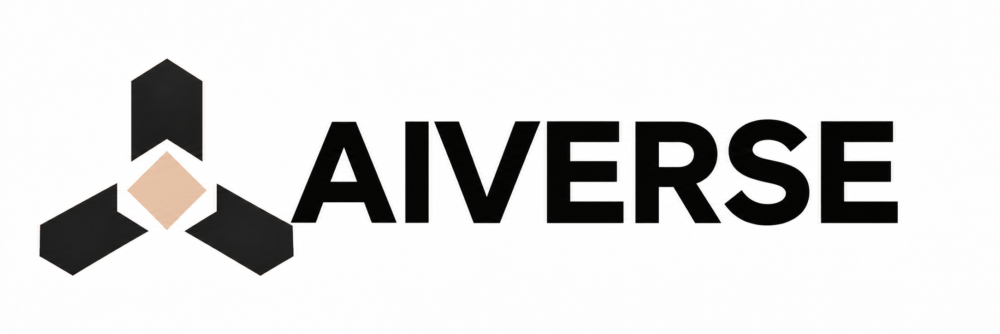
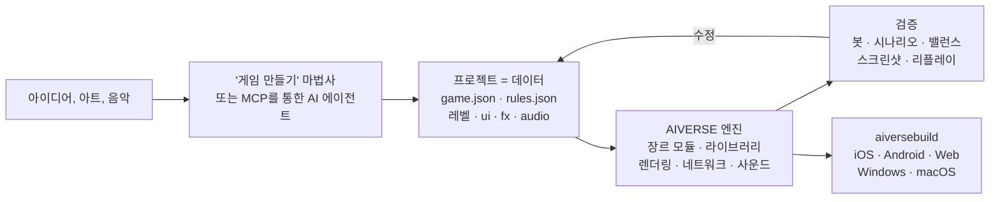

<p align="center">
  
</p>

<h3 align="center">모든 장르를 위한 게임 엔진. AI 에이전트가 코드가 아닌 데이터로 게임을 만듭니다</h3>

<p align="center">
  모든 장르 · 완전한 RTS 및 FPS 모듈 · 88개 메커닉 라이브러리 · 결정론적 시뮬레이션 · 약 190개 MCP 도구 · 6개 플랫폼
</p>

<p align="center">
  
  
  
  
  
</p>

<p align="center">
  <a href="README.md">English</a> · <a href="README.ru.md">Русский</a> · <a href="README.zh-CN.md">简体中文</a> · <a href="README.ja.md">日本語</a> · <b>한국어</b> · <a href="README.es.md">Español</a> · <a href="README.pt-BR.md">Português</a> · <a href="README.de.md">Deutsch</a> · <a href="README.fr.md">Français</a>
</p>

<p align="center">
  <a href="#왜-필요한가">왜 필요한가</a> ·
  <a href="#모든-장르">장르</a> ·
  <a href="#작동-방식">작동 방식</a> ·
  <a href="#바로-쓸-수-있는-템플릿">템플릿</a> ·
  <a href="#빠른-시작">빠른 시작</a> ·
  <a href="docs/ko/overview.md">전체 개요</a>
</p>

---

## 요약

**AIVERSE**는 단 하나의 목표를 위해 처음부터 작성한 C++20 엔진입니다. **어떤 장르**의 게임이든
처음부터 프로그래밍하지 않고 **설명하는 것**만으로 만들 수 있어야 한다는 것입니다.

게임은 데이터 폴더입니다. 오브젝트, 규칙, 레벨, UI, 사운드, 이펙트. 엔진은 이 데이터에 생명을 불어넣는
결정론적 메커닉 라이브러리입니다. 기지 건설과 수천 유닛의 군대부터 플랫포머, 근접 전투, 대화, 카드 규칙,
퍼즐까지. 그 사이에는 에디터와 MCP 서버가 있어, 사람이나 AI 에이전트가 이를 통해 프로젝트를 다룹니다.
게임을 만들고, 밸런스를 조정하고, 봇 대전을 돌리고, 스크린샷을 확인하고, 스토어용 빌드를 만듭니다.

> 아이디어를 설명하고 아트 폴더를 지정하면 **"게임 만들기"** 마법사가 레벨, 튜토리얼, 메타, 상점, 아이콘,
> 스플래시 화면을 갖춘 프로젝트를 만들고, 봇으로 튜토리얼을 직접 플레이하며 모든 레벨을 검증합니다.

---

## 왜 필요한가

게임 개발을 어렵게 만드는 것은 그래픽이 아닙니다. 어려운 것은 그 아래에 있는 이동, 전투, AI, 네트워크,
밸런스, 성장 시스템입니다. 범용 엔진은 렌더러만 주고 나머지는 모두 개발자에게 맡깁니다. AIVERSE는
메커닉 자체를 제공하고, 에이전트가 게임을 다룰 수 있게 합니다.

| 문제 | AIVERSE의 해결 방식 |
|---|---|
| **범용 엔진은 게임플레이를 제공하지 않습니다.** Unity, Unreal, Godot는 렌더링과 물리를 제공하지만, 대규모 길찾기, 콤보와 패리가 있는 전투, 적 AI, 턴 순서, 카드 규칙, 경제는 모든 스튜디오가 몇 달씩 직접 작성합니다. | 메커닉이 곧 엔진의 구성 요소입니다. 완전한 RTS·FPS 모듈과 다른 장르를 위한 88개의 결정론적 라이브러리. 데이터로 설정하고, 부족하면 Lua나 프로젝트 자체 C++로 확장합니다. |
| **기존 엔진은 AI 에이전트에게 불편합니다.** 바이너리 씬, 모든 것이 GUI를 거치고 빠른 피드백이 없어 에이전트는 눈을 감고 일합니다. | 프로젝트는 읽을 수 있는 텍스트 파일입니다. 약 190개의 MCP 도구가 맵, 규칙, 지형, UI, 이펙트, 조명, 빌드를 다룹니다. 에이전트는 결과를 스스로 검증합니다. 봇 대전, 합격/불합격 판정이 있는 시나리오, 밸런스 매트릭스, "did you mean…" 힌트를 주는 규칙 린터, 스크린샷. |
| **멀티플레이는 끝없는 동기화 오류입니다.** `float` 하나만으로 iPhone과 Android의 경기가 어긋나기 시작합니다. | 시뮬레이션은 어디서나 비트 단위로 동일합니다. 부동소수점 대신 고정소수점, 자체 난수 생성기, 체크섬. CI가 푸시할 때마다 Linux x64/ARM64, Windows, macOS의 경기를 비교합니다. 네트워크로는 명령만 전송되며, 롤백 락스텝과 매치메이킹 및 리플레이 판정을 갖춘 서버가 있습니다. |
| **모바일 GPU는 약하지만 게임은 아름다워야 합니다.** | 그림자, 파티클, 지형, 포스트 이펙트 등 비용이 큰 모든 기능에는 품질 단계가 있으며, 오래된 Mali와 Adreno부터 Apple Silicon까지 GPU에 맞춰 자동 조정됩니다. |
| **모든 플랫폼 출시는 그 자체로 하나의 프로젝트입니다.** 서명, 아이콘, 스토어와 광고 SDK. | `aiversebuild` 명령 하나로 .app, Xcode 프로젝트, Gradle/APK, 웹, .exe를 만듭니다. 아이콘과 스플래시 화면은 자동 생성됩니다. App Store, Google Play, RuStore, Yandex Games, Steam, AdMob, AppLovin 등의 플러그인이 있으며, 빌드에는 게임이 선택한 것만 들어갑니다. |
| **새 게임은 매번 처음부터 시작합니다.** | 30개 이상의 플레이 가능한 템플릿, 인수 체크리스트가 포함된 장르 키트, 에이전트용 스킬 126개. 새 게임은 이미 돌아가는 게임에서 출발합니다. |
| **메타와 LiveOps는 프로젝트마다 다시 작성됩니다.** | `aiverse::meta`: 상점, 재화, 퀘스트, 패스, 일일 보상, 에너지, 클랜, 토너먼트, 천장이 있는 상자 — JSON으로 설정합니다. |

---

## 모든 장르

두 장르에는 에디터, 봇, 템플릿을 갖춘 완전한 엔진 모듈이 있습니다. 나머지는 메커닉 라이브러리를 조합해
만듭니다. 각 라이브러리는 결정론적이고 테스트되었으며, 저장/복원을 지원하고 검증 가능한 설정을 갖습니다.

| 장르 | 엔진이 제공하는 것 |
|---|---|
| **RTS, 타워 디펜스, 땅따먹기** | 완전한 `rts` 모듈: 데이터 기반 유닛과 건물, 최대 2048² 맵에서 수천 유닛의 군대를 움직이는 A\* / HPA\* / 플로우 필드, 경제, 건설, 전장의 안개, AI, 지형과 행성, 템플릿 26개 |
| **FPS와 TPS** | 완전한 `fps` 모듈: 클라이언트와 권한 서버, 최대 100명의 스트리밍 대형 월드, 봇, 템플릿 4개. `weapon-policies`(반동, 탄도, 관통), `match-rules`(라운드, 화물 호송, 폭탄 설치/해체, 탈출) |
| **액션, 대전 격투, 소울라이크** | `combat-actions`, `melee-combat`: 히트박스와 허트박스, 콤보와 캔슬 구간, 회피 무적 프레임, 패리, 강인도, 락온. 상대는 `genre-bots` |
| **플랫포머, 메트로배니아** | `character-locomotion`: 코요테 타임, 점프 버퍼, 난간 잡기, 사다리, 수영, 벽 오르기, 넘기. `zone-graph`: 능력 게이트, 체크포인트, 진행 불가 상태가 없음을 증명 |
| **스텔스, 이머시브 심** | `stealth-senses`: 시야 원뿔, 청각, 의심과 경보, 수색, 변장. `physical-interactions`: 들기, 던지기, 로프, 문, 움직이는 발판, 파괴 가능한 오브젝트 |
| **스토리 게임, 비주얼 노벨** | `narrative-graphs`: 조건이 있는 대화, 호감도, 선택의 결과, VN 백로그와 자동 넘김. `cinematic-gameplay`: 타임라인, QTE, 슬로 모션 |
| **턴제 전략, 카드, 보드게임** | `turn-scheduler`: 이니셔티브, 행동 포인트, 반응. `card-runtime`: 존, 우선권 스택, 비공개 정보 |
| **퍼즐** | `grid-puzzles`: 소코반 규칙, 실행 취소/다시 실행, 솔버. `puzzle-machine`: 프로그래밍 퍼즐용 가상 머신 |
| **로그라이크** | `run-graph`: 시드 기반 런과 조우 예산. 희귀 보상이 보장되는 `loot-tables` |
| **방치형, 공장, 콜로니** | `big-numbers`, `offline-production`(정확한 오프라인 진행), `production-networks`, `logistics`, `tasks` |
| **리듬 게임** | `rhythm-timing`: 템포 맵과 프레임레이트와 무관한 판정 |
| **모든 모바일 게임** | `aiverse::meta`와 LiveOps, 튜토리얼, UI 화면, 스토어와 광고 플러그인 |

레이싱, 스포츠, 탈것은 아직 [로드맵](docs/genre-mechanics-roadmap.md)에 있습니다. 전체 라이브러리 목록:
[`libraries/catalog.json`](libraries/catalog.json) 및 [장르 패키지](docs/genre-packages.md).

---

## 작동 방식



오브젝트는 그저 설명일 뿐입니다. 아래는 RTS 템플릿 `skirmish`의 일꾼입니다. 금과 나무를 모으고,
건물 다섯 종류를 짓고, 곡괭이로 싸웁니다.

```jsonc
"peasant": {
  "health":  { "max": 220, "armorType": "light" },
  "move":    { "speed": 2.4, "radius": 0.35 },
  "sight":   7,
  "weapons": [{ "id": "pick", "range": 0.5, "damage": 5, "cooldown": 1.5 }],
  "cost":    { "gold": 75, "time": 12, "supply": 1 },
  "gather":  { "gold": { "carry": 10, "time": 2.0 }, "wood": { "carry": 10, "time": 3.0 } },
  "builds":  ["townhall", "farm", "barracks", "workshop", "tower"],
  "view":    { "shape": "worker", "scale": 0.8 }
}
```

데이터만으로 부족하면 세 단계로 확장합니다. JSON의 **트리거** → **Lua**(결정론적 수학과 핫 리로드를 갖춘
샌드박스) → 위의 라이브러리를 연결하는 프로젝트 자체의 **네이티브 C++ 모듈**. 엔진 자체는 바뀌지 않습니다.
메커닉은 범용적인 형태로만 엔진에 추가되며, 특정 게임만을 위한 예외는 만들지 않습니다.

---

## Unity에서 넘어오기

임포터에 Unity 프로젝트를 지정하면 AIVERSE 프로젝트가 만들어집니다. 에셋, 씬, 파라미터는 자동으로 옮겨지고, 나머지는 보고서에 정리되어 에이전트가 MCP로 이전을 마무리합니다. 에디터의 **프로젝트 → 엔진 프로젝트 가져오기**와 MCP `port_scan` / `port_import` / `port_report` / `port_resolve`로도 쓸 수 있습니다.

```bash
python3 tools/importers/port/aiverse_port.py /path/to/UnityProject --out /path/to/MyGame --mode auto
```

| Unity에서 | AIVERSE에서 |
|---|---|
| 씬 | 맵 `maps/*.json`: 오브젝트 배치, 카메라, 2D 또는 3D 모드 |
| 프리팹, 중첩 프리팹과 변형 | `rules.json`의 오브젝트 타입. 직렬화된 필드(`hp`, `speed`, `damage`, `fireRate` 등)는 데이터 블록이 됨 |
| ScriptableObject | 규칙 데이터 |
| C#으로 작성한 MonoBehaviour 로직 | 에이전트가 이전: 데이터 블록 → Lua → 네이티브 C++ 모듈 |
| 모델, 텍스처, 머티리얼, 사운드 | 그대로 복사. PBR 머티리얼, glTF/FBX/OBJ는 직접 로드 |
| 스프라이트와 Tilemap | 아틀라스 스프라이트와 타일맵 |
| ParticleSystem | `fx/*.json`, 거의 모든 모듈 지원 |
| Inspector, Hierarchy, Scene, Game | AIVERSE 에디터의 같은 창 |
| Build Settings, Unity IAP, Unity Ads | `aiversebuild`, 스토어와 광고 플러그인 |
| Addressables / Asset Bundles | `.rpak` 팩, 빌드 분할과 콘텐츠 다운로드 |

보고서는 각 항목을 정확히 이전, 근사 이전, 미이전으로 표시합니다. 다시 가져와도 수정한 내용은 유지됩니다. 에셋 직렬화는 **Force Text**여야 합니다. Godot 프로젝트도 같은 방식으로 가져옵니다. 자세히: [엔진 프로젝트 가져오기](docs/ko/engine-import.md).

---

## 바로 쓸 수 있는 템플릿

모든 템플릿은 봇과 함께 완전히 플레이할 수 있는 게임입니다. 에디터에서 열고 바로 수정하면 됩니다.

| 장르 | 템플릿 |
|---|---|
| 클래식 기지 건설 RTS | **Iron and Gold**(Warcraft / Red Alert) · **Iron Front**(Red Alert: MCV, 광석, 사이드바) · **Starfall Sectors**(StarCraft: 세 종족) · **Frost Crown**(Warcraft III: 영웅, 크립, 지형) · **Four Ages**(Age of Empires II) · **Amber Sands**(Dune II) · **Metal Tide**(Total Annihilation: 흐름 경제) |
| 점령과 주둔 | **Mushroom Clash**와 **Shroom Wars**(Mushroom Wars 1–2) · **Spore Lanes** · **Spell Bunkers**(Bunker Wars) · **Border Rush**(State.io) · **Clan Lands**(Northgard) · **Flag Sectors**(Z) |
| 분대, 웨이브, 생존 | **Hold the Line**(Company of Heroes) · **Last Colony**(They Are Billions) · **Lane Clash**(라인 배틀러) |
| 경제와 건설 | **Hearth and Haul**(Knights and Merchants) · **Underlord**(Dungeon Keeper) |
| 2D와 실험 | **Crystal Dunes**(타일, Dune II) · **Green Hills**(3D 지형 위의 2D 스프라이트) · **Planets**(구형 행성과 궤도) · **Wildfire**(필드: 산불과 크립) |
| FPS | **Crossfire Arena**(5대5) · **Breach Protocol**(전술 라운드) · **Last Survivor**(100인 배틀로얄) · **Aim Lab**(사격장) |

---

## 구성 요소

<table>
<tr>
<td width="50%" valign="top">

**게임플레이**
- 고정소수점 ECS 시뮬레이션, 리플레이, 롤백용 스냅샷
- 장르 모듈: RTS(경제, 건설, 군대, AI)와 FPS(권한 서버, 대형 월드)
- 88개 라이브러리: 이동, 전투, 무기, 감각, 대화, 턴, 카드, 퍼즐, 런, 리듬, 생산
- 길찾기: A\*, HPA\*, 플로우 필드, 내비메시, ORCA/RVO2
- 경사와 시야를 고려한 지형, 최대 2048² 맵, 구형 행성
- 트리거, Lua 5.4, 네이티브 C++ 모듈

</td>
<td width="50%" valign="top">

**그래픽과 사운드**
- 자체 RHI: Metal, GLES3 / WebGL2, GL 3.3
- PBR, glTF/OBJ, 스켈레탈 및 절차적 애니메이션
- 그림자, 동적 조명, 밤, 포스트 이펙트, Shader Graph
- Unity ParticleSystem 모듈을 지원하는 파티클과 Unity 임포터
- 2D: 스프라이트, 오토타일 타일맵
- 사운드: 3D, 적응형 음악, 플랫폼별 압축

</td>
</tr>
<tr>
<td valign="top">

**도구**
- Unity 스타일 도킹 에디터: 씬, 인스펙터, 지형, 이펙트, 조명, UI, 테스트 플레이, 기기 시뮬레이터
- `aiversemcp` — 에이전트용 MCP 서버
- **"게임 만들기"** 마법사
- 에이전트용 스킬 126개와 인수 체크리스트가 있는 장르 키트
- 직접 소유한 사본에서 고전 게임 에셋을 가져오는 임포터

</td>
<td valign="top">

**출시**
- `aiversebuild`: .app, Xcode, Gradle/APK, 웹, .exe
- `.rpak` 리소스 팩(zstd), 빌드 분할과 콘텐츠 다운로드
- 스토어와 광고 플러그인
- HTML/CSS 게임 UI(RmlUi), 현지화
- 멀티플레이: UDP와 WebSocket, 전용 서버, Elo 매치메이킹
- 메타 라이브러리와 LiveOps

</td>
</tr>
</table>

---

## 빠른 시작

**1. 엔진 빌드** (macOS, Xcode와 CMake 필요):

```bash
cmake -S . -B build/mac -DCMAKE_BUILD_TYPE=Release
cmake --build build/mac -j 8
open build/mac/AiverseEditor.app        # 에디터: 프로젝트 허브와 템플릿
```

Linux: `cmake --preset linux-release && cmake --build build/linux-release`. 직접 컴파일하고 싶지 않다면
`builds` 브랜치에 미리 빌드된 에디터와 도구가 있습니다
([자세히](docs/ko/overview.md#미리-빌드된-엔진builds-브랜치과-컴파일러-없는-aiversemcp)).

**2. 게임 만들기.** 허브에서 **"게임 만들기"**를 누르거나 템플릿으로 프로젝트를 만드세요. Game 창에서
바로 봇과 플레이할 수 있습니다.

**3. AI 에이전트 연결.** 에디터의 **Agent** 창에 바로 쓸 수 있는 설정이 표시됩니다. Claude Code의 경우:

```bash
claude mcp add aiverse -- /path/to/aiversemcp --engine /path/to/AIVERSE
```

그다음 에이전트에게 이렇게 말하면 됩니다: *"겨울 맵에서 Northgard 스타일 전략 게임을 만들고,
봇으로 세 진영의 밸런스를 확인한 뒤 웹 버전을 빌드해 줘."*

**4. 출시:**

```bash
./build/mac/aiversebuild --project "My Game.rtsproj" --target all   # macOS, iOS, Android, 웹, Windows
```

---

## 상태

엔진은 활발히 개발 중입니다. 검증된 항목:

- ✅ **Linux**: 클라이언트, 에디터, 테스트, 봇 대전. x64와 ARM64에서 체크섬 일치
- ✅ **macOS / Metal**: 빌드, 테스트, 게임. `aiversebuild` → .app 및 시뮬레이터 빌드가 포함된 iOS 프로젝트
- ✅ **웹**: 헤드리스 Chromium(WebGL2)에서 경기 실행
- ✅ **Windows**: MinGW로 크로스 빌드한 .exe를 Wine에서 실행
- 🛠 RTS와 FPS 외 장르의 템플릿은 제작 중

서브시스템별 자세한 내용은
[검증됨 / 미검증](docs/ko/overview.md#검증됨--미검증)을 참고하세요.

---

## 문서

참조 문서는 영어입니다. 개요, 게임 만들기 마법사, Unity에서 넘어오기, 장르 패키지는 한국어로도 제공됩니다.

| | |
|---|---|
| [**전체 개요**](docs/ko/overview.md) | 모든 서브시스템, 빌드, 플랫폼, CI, 릴리스 |
| [게임 포맷](docs/game-format.md) | `game.json`, `rules.json`, 맵과 모든 데이터 블록 |
| [장르 패키지](docs/genre-packages.md) · [라이브러리](docs/libraries.md) | 모든 장르를 위한 메커닉 |
| ["게임 만들기" 마법사](docs/ko/game-wizard.md) | 아이디어와 아트가 완성된 프로젝트가 되는 과정 |
| [스크립팅](docs/scripting.md) · [C++ 모듈](docs/native-modules.md) | 데이터로 부족할 때 |
| [지형](docs/terrain.md) · [행성](docs/planets.md) · [길찾기](docs/pathfinding.md) | 월드와 이동 |
| [파티클](docs/particles.md) · [모델](docs/models.md) · [Shader Graph](docs/shader-graph.md) | 비주얼 |
| [메타 게임](docs/meta-game.md) · [LiveOps](docs/meta-liveops.md) · [플러그인](docs/plugins.md) | 수익화와 스토어 |
| [FPS](docs/fps.md) · [대형 월드](docs/large-worlds.md) | FPS 모듈 |
| [AGENTS.md](AGENTS.md) | 엔진 자체를 수정하는 에이전트를 위한 규칙 |
| [Unity에서 넘어오기](docs/ko/engine-import.md) | 씬, 프리팹, 에셋 가져오기와 에이전트를 통한 로직 이전 |

## 라이선스

[MIT](LICENSE). 서드파티 라이브러리는 각자의 라이선스와 함께 `third_party/`에 있습니다(MIT, BSD, zlib,
OFL, CC0, CC-BY만 허용). 상용 게임의 원본 에셋은 포함되어 있지 않으며, 임포터는 사용자가 소유한 사본에서
읽어 옵니다.
