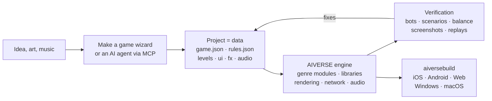

<p align="center">
  
</p>

<h3 align="center">A game engine for any genre, where an AI agent builds the game from data, not code</h3>

<p align="center">
  any genre · full RTS and FPS modules · 88 mechanics libraries · deterministic simulation · ~190 MCP tools · 6 platforms
</p>

<p align="center">
  
  
  
  
  
</p>

<p align="center">
  <b>English</b> · <a href="README.ru.md">Русский</a> · <a href="README.zh-CN.md">简体中文</a> · <a href="README.ja.md">日本語</a> · <a href="README.ko.md">한국어</a> · <a href="README.es.md">Español</a> · <a href="README.pt-BR.md">Português</a> · <a href="README.de.md">Deutsch</a> · <a href="README.fr.md">Français</a>
</p>

<p align="center">
  <a href="#why-it-exists">Why</a> ·
  <a href="#any-genre">Genres</a> ·
  <a href="#how-it-works">How it works</a> ·
  <a href="#ready-made-templates">Templates</a> ·
  <a href="#quick-start">Quick start</a> ·
  <a href="docs/overview.md">Full overview</a>
</p>

---

## In short

**AIVERSE** is a C++20 engine written from scratch for one goal: a game **of any genre** should be
something you **describe**, not something you program from scratch.

A game is a folder of data: objects, rules, levels, UI, audio, effects. The engine is a library of
ready-made, deterministic mechanics that brings that data to life — from base building and armies of
thousands to platforming, melee combat, dialogue, card rules and puzzles. In between sit the editor and
an MCP server, through which a person or an AI agent works on the project: creates the game, tunes the
balance, runs bot matches, looks at screenshots and ships store builds.

> Describe the idea and point at a folder of art — the **Make a game** wizard produces a project with
> levels, a tutorial, meta, a shop, an icon and a splash screen, then plays through the tutorial with a
> bot and checks every level itself.

---

## Why it exists

Graphics are not what makes a game hard. The hard part is under the hood: movement, combat, AI,
networking, balance, progression. General-purpose engines give you a renderer and leave all of that to
you. AIVERSE ships the mechanics themselves — and makes the game something an agent can work on.

| Problem | How AIVERSE solves it |
|---|---|
| **General-purpose engines don't ship gameplay.** Unity, Unreal and Godot give you a renderer and physics; pathfinding for crowds, combat with combos and parries, enemy AI, turn order, card rules, economy — every studio spends months writing them. | Mechanics are the engine's building blocks: full RTS and FPS modules plus 88 deterministic libraries for other genres. They are configured with data, and when that's not enough, extended with Lua or the project's own C++. |
| **Classic engines are awkward for AI agents.** Binary scenes, everything through a GUI, no fast feedback — the agent works blind. | A project is readable text files. ~190 MCP tools cover maps, rules, terrain, UI, effects, lighting and builds. The agent checks its own work: bot matches, scenarios with pass/fail checks, balance matrices, a rules linter with "did you mean…" hints, screenshots. |
| **Multiplayer means endless desyncs.** One `float` is enough for a match on an iPhone and an Android phone to drift apart. | The simulation is bit-identical everywhere: fixed-point instead of floats, its own RNG, checksums. CI compares matches across Linux x64/ARM64, Windows and macOS on every push. Only commands go over the network; there is rollback lockstep and a server with matchmaking and replay-based verdicts. |
| **Mobile GPUs are weak, yet the game must look good.** | Every expensive feature — shadows, particles, terrain, post-effects — has quality tiers and adapts to the GPU, from old Mali and Adreno to Apple Silicon. |
| **Shipping on every platform is a project of its own.** Signing, icons, store and ads SDKs. | `aiversebuild` makes an .app, an Xcode project, Gradle/APK, web and .exe in one command. Icons and splash screens are generated. Plugins for the App Store, Google Play, RuStore, Yandex Games, Steam, AdMob, AppLovin and more — a build carries only the ones the game selects. |
| **Every new game starts from zero.** | 30+ playable templates, genre kits with acceptance checklists, 126 skills for agents. A new game starts from a working one. |
| **Meta and LiveOps get rewritten in every project.** | `aiverse::meta`: shop, currencies, quests, passes, daily rewards, energy, clans, tournaments, chests with pity — configured in JSON. |

---

## Any genre

Two genres have full engine modules with an editor, bots and templates. Everything else is assembled
from the mechanics libraries — each one deterministic, tested, with save/restore and a validated config.

| Genre | What the engine provides |
|---|---|
| **RTS, tower defense, capture games** | Full `rts` module: units and buildings from data, A\* / HPA\* / flow fields for armies of thousands of units on maps up to 2048², economy, construction, fog of war, AI, terrain and planets, 26 templates |
| **FPS and TPS** | Full `fps` module: client and authoritative server, large streamed worlds up to 100 players, bots, 4 templates; `weapon-policies` (recoil, ballistics, penetration), `match-rules` (rounds, payload, bomb/defuse, extraction) |
| **Action, fighting, soulslike** | `combat-actions`, `melee-combat`: hitboxes and hurtboxes, combos and cancel windows, dodge i-frames, parry, poise, lock-on; `genre-bots` for opponents |
| **Platformer, metroidvania** | `character-locomotion`: coyote time, jump buffer, ledges, ladders, swimming, climbing, mantling; `zone-graph`: ability gates, checkpoints and softlock proofs |
| **Stealth, immersive sim** | `stealth-senses`: sight cones, hearing, suspicion and alerts, searches, disguises; `physical-interactions`: carrying, throwing, ropes, doors, platforms, breakables |
| **Story games, visual novels** | `narrative-graphs`: dialogue with conditions, relationships, consequences, VN backlog and auto-advance; `cinematic-gameplay`: timelines, QTE, slow motion |
| **Turn-based tactics, cards, board games** | `turn-scheduler`: initiative, action points, reactions; `card-runtime`: zones, priority stack, hidden information |
| **Puzzles** | `grid-puzzles`: Sokoban rules, undo/redo and a solver; `puzzle-machine`: a VM for programming puzzles |
| **Roguelikes** | `run-graph`: seeded runs and encounter budgets; `loot-tables` with a guaranteed rare drop |
| **Idle, factory, colony** | `big-numbers`, `offline-production` (exact offline progress), `production-networks`, `logistics`, `tasks` |
| **Rhythm games** | `rhythm-timing`: tempo maps and frame-independent hit judgement |
| **Any mobile game** | `aiverse::meta` and LiveOps, tutorials, UI screens, store and ads plugins |

Racing, sports and vehicles are still on the [roadmap](docs/genre-mechanics-roadmap.md). Full list of
libraries: [`libraries/catalog.json`](libraries/catalog.json) and [genre packages](docs/genre-packages.md).

---

## How it works



An object is just a description. Here is the worker from the RTS template `skirmish`: it gathers gold
and wood, builds five structures and fights with a pick.

```jsonc
"peasant": {
  "health":  { "max": 220, "armorType": "light" },
  "move":    { "speed": 2.4, "radius": 0.35 },
  "sight":   7,
  "weapons": [{ "id": "pick", "range": 0.5, "damage": 5, "cooldown": 1.5 }],
  "cost":    { "gold": 75, "time": 12, "supply": 1 },
  "gather":  { "gold": { "carry": 10, "time": 2.0 }, "wood": { "carry": 10, "time": 3.0 } },
  "builds":  ["townhall", "farm", "barracks", "workshop", "tower"],
  "view":    { "shape": "worker", "scale": 0.8 }
}
```

When data isn't enough, there are three steps up: **triggers** in JSON → **Lua** (a sandbox with
deterministic math and hot reload) → the project's own **native C++ modules**, which plug in the
libraries above. The engine itself stays untouched: mechanics are added to it only in a general form,
never for one specific game.

---

## Coming from Unity

Point the importer at a Unity project and get an AIVERSE project. Assets, scenes and parameters move over automatically; everything else lands in a report that an agent works through via MCP. Also available as **Project → Import engine project** in the editor and as MCP `port_scan` / `port_import` / `port_report` / `port_resolve`.

```bash
python3 tools/importers/port/aiverse_port.py /path/to/UnityProject --out /path/to/MyGame --mode auto
```

| In Unity | In AIVERSE |
|---|---|
| Scene | map `maps/*.json`: object placement, camera, 2D or 3D mode |
| Prefab, nested prefabs and variants | object type in `rules.json`; serialized fields (`hp`, `speed`, `damage`, `fireRate`, …) become data blocks |
| ScriptableObject | rules data |
| MonoBehaviour logic in C# | ported by the agent: data blocks → Lua → native C++ module |
| Models, textures, materials, audio | copied as is; PBR materials, glTF/FBX/OBJ load directly |
| Sprites and Tilemap | atlas sprites and tile maps |
| ParticleSystem | `fx/*.json`, nearly every module is supported |
| Inspector, Hierarchy, Scene, Game | the same windows in the AIVERSE editor |
| Build Settings, Unity IAP, Unity Ads | `aiversebuild`, store and ads plugins |
| Addressables / Asset Bundles | `.rpak` packs, split builds and content download |

The report marks every item as exact, approximate or not transferred. Re-importing keeps your edits. The project needs **Force Text** asset serialization. Godot projects are imported the same way. Details: [Engine project import](docs/engine-import.md).

---

## Ready-made templates

Every template is a fully playable game with bots. Open it in the editor and start changing it.

| Genre | Templates |
|---|---|
| Classic base-building RTS | **Iron and Gold** (Warcraft / Red Alert) · **Iron Front** (Red Alert: MCV, ore, sidebar) · **Starfall Sectors** (StarCraft: three races) · **Frost Crown** (Warcraft III: heroes, creeps, terrain) · **Four Ages** (Age of Empires II) · **Amber Sands** (Dune II) · **Metal Tide** (Total Annihilation: flow economy) |
| Capture and garrisons | **Mushroom Clash** and **Shroom Wars** (Mushroom Wars 1–2) · **Spore Lanes** · **Spell Bunkers** (Bunker Wars) · **Border Rush** (State.io) · **Clan Lands** (Northgard) · **Flag Sectors** (Z) |
| Squads, waves, survival | **Hold the Line** (Company of Heroes) · **Last Colony** (They Are Billions) · **Lane Clash** (lane battler) |
| Economy and building | **Hearth and Haul** (Knights and Merchants) · **Underlord** (Dungeon Keeper) |
| 2D and experiments | **Crystal Dunes** (tiles, Dune II) · **Green Hills** (2D sprites on 3D terrain) · **Planets** (spherical planets and orbits) · **Wildfire** (fields: wildfires and creep) |
| FPS | **Crossfire Arena** (5v5) · **Breach Protocol** (tactical rounds) · **Last Survivor** (100-player battle royale) · **Aim Lab** (shooting range) |

---

## What's inside

<table>
<tr>
<td width="50%" valign="top">

**Gameplay**
- Fixed-point ECS simulation, replays, snapshots for rollback
- Genre modules: RTS (economy, construction, armies, AI) and FPS (authoritative server, large worlds)
- 88 libraries: movement, combat, weapons, senses, dialogue, turns, cards, puzzles, runs, rhythm, production
- Pathfinding: A\*, HPA\*, flow fields, navmesh, ORCA/RVO2
- Terrain with slopes and line of sight, maps up to 2048², spherical planets
- Triggers, Lua 5.4, native C++ modules

</td>
<td width="50%" valign="top">

**Graphics and audio**
- Own RHI: Metal, GLES3 / WebGL2, GL 3.3
- PBR, glTF/OBJ, skeletal and procedural animation, procedural cables, parented entity rendering
- Shadows, dynamic lights, night, post-effects, Shader Graph
- Particles with Unity ParticleSystem modules and an importer from Unity
- 2D: sprites, tile maps with autotiling
- Audio: 3D, adaptive music, per-platform compression

</td>
</tr>
<tr>
<td valign="top">

**Tools**
- Unity-style docking editor: scene, inspector, terrain, effects, lighting, UI, play test and device simulator
- `aiversemcp` — MCP server for agents
- **Make a game** wizard
- 126 skills for agents and genre kits with acceptance checklists
- Importers for assets of classic games from your own copy

</td>
<td valign="top">

**Shipping**
- `aiversebuild`: .app, Xcode, Gradle/APK, web, .exe
- `.rpak` resource packs (zstd), split builds and content download
- Store and ads plugins
- In-game UI in HTML/CSS (RmlUi), localization
- Multiplayer: UDP and WebSocket, dedicated server, Elo matchmaking
- Meta library and LiveOps

</td>
</tr>
</table>

---

## Quick start

**1. Build the engine** (macOS; requires Xcode and CMake):

```bash
cmake -S . -B build/mac -DCMAKE_BUILD_TYPE=Release
cmake --build build/mac -j 8
open build/mac/AiverseEditor.app        # editor: project hub and templates
```

Linux: `cmake --preset linux-release && cmake --build build/linux-release`. If you'd rather not compile,
the `builds` branch has a prebuilt editor and tools
([details](docs/overview.md#prebuilt-engine-the-builds-branch-and-aiversemcp-without-a-compiler)).

**2. Make a game.** In the hub, click **Make a game** or create a project from a template. You can
play it with bots right away in the Game window.

**3. Connect an AI agent.** The **Agent** window in the editor shows a ready-made config. For Claude Code:

```bash
claude mcp add aiverse -- /path/to/aiversemcp --engine /path/to/AIVERSE
```

Then you can tell the agent something like: *"Make a Northgard-style strategy on a winter map, check
the balance of three factions with bots and build a web version."*

**4. Ship:**

```bash
./build/mac/aiversebuild --project "My Game.aiverse" --target all   # macOS, iOS, Android, web, Windows
```

---

## Status

The engine is under active development. What has been verified:

- ✅ **Linux**: client, editor, tests, bot matches; identical checksums on x64 and ARM64
- ✅ **macOS / Metal**: build, tests, game; `aiversebuild` → .app and an iOS project with a simulator build
- ✅ **Web**: a match runs in headless Chromium (WebGL2)
- ✅ **Windows**: .exe cross-built with MinGW, run under Wine
- 🛠 Ready-made templates for genres beyond RTS and FPS are in progress

Per-subsystem details are in
[Verified / not verified](docs/overview.md#verified--not-verified).

---

## Documentation

Reference documents are in English. The overview, the game wizard, Unity migration and genre packages are also translated into every README language.

| | |
|---|---|
| [**Full overview**](docs/overview.md) | every subsystem, building, platforms, CI, releases |
| [Game format](docs/game-format.md) | `game.json`, `rules.json`, maps and all data blocks |
| [Genre packages](docs/genre-packages.md) · [Libraries](docs/libraries.md) | mechanics for any genre |
| [Make a game wizard](docs/game-wizard.md) | how an idea plus art becomes a finished project |
| [Scripting](docs/scripting.md) · [C++ modules](docs/native-modules.md) | when data isn't enough |
| [Terrain](docs/terrain.md) · [Planets](docs/planets.md) · [Pathfinding](docs/pathfinding.md) | world and movement |
| [Particles](docs/particles.md) · [Models](docs/models.md) · [Shader Graph](docs/shader-graph.md) | visuals |
| [Meta game](docs/meta-game.md) · [LiveOps](docs/meta-liveops.md) · [Plugins](docs/plugins.md) | monetization and stores |
| [FPS](docs/fps.md) · [Large worlds](docs/large-worlds.md) | FPS module |
| [Top-down heroes](docs/topdown.md) · [Driving](docs/driving.md) · [City traffic](docs/traffic.md) | city games: cars, traffic lights, pedestrians, services, citizens with jobs |
| [AGENTS.md](AGENTS.md) | rules for agents that change the engine itself |
| [Migrating from Unity](docs/engine-import.md) | importing scenes, prefabs and assets, then porting the logic with an agent |

## License

[MIT](LICENSE). Third-party libraries live in `third_party/` with their own licenses (MIT, MIT-0, BSD, ISC, zlib,
OFL, CC0 and CC-BY, among others). Original assets of commercial games are not included: importers read them
from your own copy.

Game builds automatically include `THIRD_PARTY_NOTICES.txt`; external SDK notices must be supplied by the project (see [details](docs/third-party-notices.md)).
