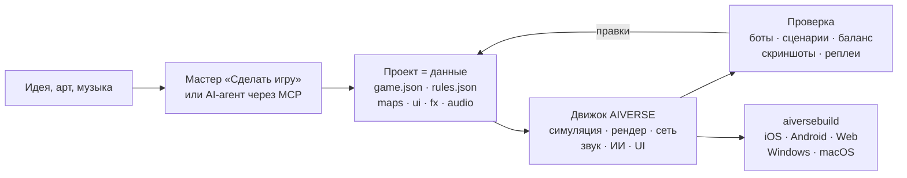

<p align="center">
  
</p>

<h3 align="center">Игровой движок, в котором игру собирает AI-агент — из данных, а не из кода</h3>

<p align="center">
  RTS любого поджанра и FPS · детерминированная симуляция · ~190 MCP-инструментов · сборка под 6 платформ одной командой
</p>

<p align="center">
  
  
  
  
  
</p>

<p align="center">
  <a href="README.en.md">English</a> · <b>Русский</b>
</p>

<p align="center">
  <a href="#зачем-он-нужен">Зачем</a> ·
  <a href="#как-это-устроено">Как устроено</a> ·
  <a href="#что-уже-можно-сделать">Шаблоны</a> ·
  <a href="#быстрый-старт">Быстрый старт</a> ·
  <a href="docs/overview.md">Полный обзор</a>
</p>

---

## Коротко

**AIVERSE** — движок на C++20, написанный с нуля под одну задачу: чтобы стратегию (а теперь и шутер)
можно было сделать, **описав её**, а не запрограммировав.

Игра — это папка с JSON: юниты, здания, ресурсы, карты, интерфейс, звук, эффекты. Движок — это
фиксированная библиотека механик, которая умеет оживить любой такой набор данных. Между ними —
редактор и MCP-сервер, через которые с проектом работает человек или AI-агент: создаёт игру,
правит баланс, гоняет матчи ботов, смотрит скриншоты и собирает билды под сторы.

> Опишите идею и дайте папку с артом — мастер «Сделать игру» соберёт проект с уровнями, обучением,
> метой, магазином, иконкой и заставкой, сам пройдёт обучение ботом и проверит уровни.

---

## Зачем он нужен

Сделать RTS тяжело не из-за графики. Тяжело то, что под капотом: тысячи юнитов, поиск пути,
синхронная сеть, ИИ, баланс. Универсальные движки всё это оставляют вам. AIVERSE даёт это из коробки
и делает так, чтобы с игрой мог работать агент.

| Проблема | Как её решает AIVERSE |
|---|---|
| **Unity, Unreal и Godot не знают, что такое RTS.** Поиск пути для толп, экономика, стройка, туман войны, ИИ противника — каждая студия месяцами пишет это сама. | Всё это уже в движке и настраивается данными. Тип объекта — набор блоков (`health`, `move`, `weapons`, `gather`, `garrison`, …): что задано, то юнит и умеет. A\*, HPA\* и flow fields: приказ 2000 юнитам на карте 1024² — за 13 мс. |
| **AI-агенту неудобно в классических движках.** Бинарные сцены, всё через GUI, нет быстрой обратной связи — агент работает вслепую. | Проект — читаемые текстовые файлы. ~190 MCP-инструментов: карты, правила, рельеф, UI, эффекты, свет, сборка. Агент сам проверяет результат: матчи ботов, сценарии с pass/fail, матрицы баланса, линтер правил с подсказками «did you mean…», скриншоты. |
| **Сетевая RTS = вечные рассинхроны.** Достаточно одного `float`, чтобы матч на iPhone и Android разошёлся. | Симуляция побитово одинакова везде: fixed-point вместо float, свой RNG, контрольные суммы. CI на каждом push сверяет матчи на Linux x64/ARM64, Windows и macOS. По сети идут только команды, есть lockstep с откатами, сервер с матчмейкингом и вердиктом по реплею. |
| **Мобильные GPU слабые, а игра должна быть красивой.** | Каждая дорогая функция — тени, частицы, рельеф, постэффекты — имеет уровни качества и сама подстраивается под GPU: от старых Mali и Adreno до Apple Silicon. |
| **Выпустить игру на все платформы — отдельный проект.** Подписи, иконки, SDK сторов и рекламы. | `aiversebuild` одной командой делает .app, проект Xcode, Gradle/APK, web и .exe. Иконки и заставки генерируются. Плагины App Store, Google Play, RuStore, Yandex Games, Steam, AdMob, AppLovin и других — в билд попадают только выбранные. |
| **Каждый клон жанра пишется с нуля.** | 30+ готовых шаблонов — от Warcraft и Red Alert до Mushroom Wars, Northgard и They Are Billions. Новая игра начинается с работающей. |
| **Мета и LiveOps переписываются в каждом проекте.** | `aiverse::meta`: магазин, валюты, задания, пассы, ежедневные награды, энергия, кланы, турниры, сундуки с pity — настраивается JSON-ом. |

---

## Как это устроено



Юнит — это просто описание. Вот рабочий из шаблона `skirmish`: он добывает золото и дерево,
строит пять зданий и умеет драться киркой.

```jsonc
"peasant": {
  "health":  { "max": 220, "armorType": "light" },
  "move":    { "speed": 2.4, "radius": 0.35 },
  "sight":   7,
  "weapons": [{ "id": "pick", "range": 0.5, "damage": 5, "cooldown": 1.5 }],
  "cost":    { "gold": 75, "time": 12, "supply": 1 },
  "gather":  { "gold": { "carry": 10, "time": 2.0 }, "wood": { "carry": 10, "time": 3.0 } },
  "builds":  ["townhall", "farm", "barracks", "workshop", "tower"],
  "view":    { "shape": "worker", "scale": 0.8 }
}
```

Если данных не хватает, есть три ступени: **триггеры** в JSON → **Lua** (песочница с детерминированной
математикой, горячая перезагрузка) → **нативные C++-модули** проекта. Движок при этом не меняется:
механики добавляются в него только в общем виде, а не под конкретную игру.

---

## Что уже можно сделать

Каждый шаблон — полностью играбельная игра с ботами. Её можно открыть в редакторе и сразу менять.

| Жанр | Шаблоны |
|---|---|
| Классическая RTS с базой | **Iron and Gold** (Warcraft / Red Alert) · **Iron Front** (Red Alert: MCV, руда, сайдбар) · **Starfall Sectors** (StarCraft: три расы) · **Frost Crown** (Warcraft III: герои, крипы, рельеф) · **Four Ages** (Age of Empires II) · **Amber Sands** (Dune II) · **Metal Tide** (Total Annihilation: потоковая экономика) |
| Захват и гарнизоны | **Mushroom Clash** и **Shroom Wars** (Mushroom Wars 1–2) · **Spore Lanes** · **Spell Bunkers** (Bunker Wars) · **Border Rush** (State.io) · **Clan Lands** (Northgard) · **Flag Sectors** (Z) |
| Отряды, волны, выживание | **Hold the Line** (Company of Heroes) · **Last Colony** (They Are Billions) · **Lane Clash** (лайн-баттлер) |
| Экономика и стройка | **Hearth and Haul** (Knights and Merchants) · **Underlord** (Dungeon Keeper) |
| 2D и эксперименты | **Crystal Dunes** (тайлы, Dune II) · **Green Hills** (2D-спрайты на 3D-рельефе) · **Planets** (сферические планеты и орбиты) · **Wildfire** (поля: пожары и крип) |
| FPS | **Crossfire Arena** (5×5) · **Breach Protocol** (тактические раунды) · **Last Survivor** (королевская битва на 100 игроков) · **Aim Lab** (тир) |

---

## Что внутри

<table>
<tr>
<td width="50%" valign="top">

**Геймплей**
- ECS-симуляция на fixed-point, реплеи, снимки для откатов
- Поиск пути: A\*, HPA\*, flow fields, ORCA/RVO2
- Экономика (добыча и потоки), стройка, производство, технологии, гарнизоны, дороги, территории
- Рельеф с уклонами и линией видимости, карты до 2048², сферические планеты
- ИИ противника, детерминированный генератор карт
- Триггеры, Lua 5.4, нативные C++-модули

</td>
<td width="50%" valign="top">

**Картинка и звук**
- Свой RHI: Metal, GLES3 / WebGL2, GL 3.3
- PBR, glTF/OBJ, скелетная и процедурная анимация
- Тени, динамический свет, ночь, постэффекты, Shader Graph
- Частицы с модулями Unity ParticleSystem и импорт из Unity
- Рельеф: чанки, CDLOD, splat-материалы, вода
- Звук: 3D, адаптивная музыка, сжатие под платформу

</td>
</tr>
<tr>
<td valign="top">

**Инструменты**
- Редактор с окнами, как в Unity: сцена, инспектор, рельеф, эффекты, свет, UI, тест с ботами и симулятор устройств
- `aiversemcp` — MCP-сервер для агентов
- Мастер «Сделать игру»
- 118 навыков (skills) и каталог переиспользуемых библиотек механик
- Импорт ресурсов старых игр из вашей собственной копии

</td>
<td valign="top">

**Выпуск**
- `aiversebuild`: .app, Xcode, Gradle/APK, web, .exe
- Ресурс-паки `.rpak` (zstd), разбиение и докачка контента
- Плагины сторов и рекламы
- UI игры на HTML/CSS (RmlUi), локализация
- Сетевая игра: UDP и WebSocket, выделенный сервер, Elo-матчмейкинг
- Мета-библиотека и LiveOps

</td>
</tr>
</table>

---

## Быстрый старт

**1. Собрать движок** (macOS; нужны Xcode и CMake):

```bash
cmake -S . -B build/mac -DCMAKE_BUILD_TYPE=Release
cmake --build build/mac -j 8
open build/mac/AiverseEditor.app        # редактор: хаб проектов и шаблоны
```

Linux: `cmake --preset linux-release && cmake --build build/linux-release`. Если компилировать не хочется,
в ветке `builds` есть готовые сборки редактора и инструментов
([подробнее](docs/overview.md#готовые-сборки-движка-ветка-builds-и-aiversemcp-без-компилятора)).

**2. Сделать игру.** В хабе нажмите **«Сделать игру»** или создайте проект из шаблона. Игру можно
сразу запустить с ботами в окне Game.

**3. Подключить AI-агента.** Окно **Agent** в редакторе показывает готовую конфигурацию. Для Claude Code:

```bash
claude mcp add aiverse -- /path/to/aiversemcp --engine /path/to/AIVERSE
```

После этого агенту можно сказать, например: *«Сделай стратегию в духе Northgard на зимней карте,
проверь баланс трёх фракций ботами и собери web-версию»*.

**4. Выпустить:**

```bash
./build/mac/aiversebuild --project "Моя игра.rtsproj" --target all   # macOS, iOS, Android, web, Windows
```

---

## Статус

Движок активно развивается. Что проверено:

- ✅ **Linux**: клиент, редактор, тесты, матчи ботов; одинаковые контрольные суммы на x64 и ARM64
- ✅ **macOS / Metal**: сборка, тесты, игра; `aiversebuild` → .app и проект iOS со сборкой для симулятора
- ✅ **Web**: матч запускается в headless Chromium (WebGL2)
- ✅ **Windows**: .exe кросс-сборкой MinGW, запуск под Wine
- ⏳ **Android** (APK собирается только в CI), **iOS на устройстве** и **Windows на реальном железе** — ещё не запускались
- ⏳ Часть Metal-шейдеров новых подсистем ещё не компилировалась

Подробности по каждой подсистеме — в разделе
[«Проверено / не проверено»](docs/overview.md#проверено--не-проверено).

---

## Документация

| | |
|---|---|
| [**Подробный обзор**](docs/overview.md) | все подсистемы, сборка, платформы, CI, релизы |
| [Формат игры](docs/game-format.md) | `game.json`, `rules.json`, карты и все блоки данных |
| [Мастер «Сделать игру»](docs/game-wizard.md) | как из идеи и арта получается готовый проект |
| [Скриптинг](docs/scripting.md) · [C++-модули](docs/native-modules.md) | когда данных не хватает |
| [Ландшафт](docs/terrain.md) · [Планеты](docs/planets.md) · [Поиск пути](docs/pathfinding.md) | мир и движение |
| [Частицы](docs/particles.md) · [Модели](docs/models.md) · [Shader Graph](docs/shader-graph.md) | картинка |
| [Мета-игра](docs/meta-game.md) · [LiveOps](docs/meta-liveops.md) · [Плагины](docs/plugins.md) | монетизация и сторы |
| [FPS](docs/fps.md) · [Большие миры](docs/large-worlds.md) | FPS-модуль |
| [AGENTS.md](AGENTS.md) | правила для агентов, которые меняют сам движок |
| [Миграция с RTSEngine](docs/aiverse-migration.md) | старые имена, проекты и параметры сборки |

## Лицензия

[MIT](LICENSE). Сторонние библиотеки лежат в `third_party/` со своими лицензиями (только MIT, BSD, zlib,
OFL, CC0, CC-BY). Оригинальные ресурсы коммерческих игр в репозиторий не входят: импортёры читают
их из вашей собственной копии.
