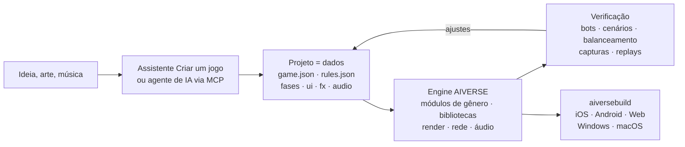

<p align="center">
  
</p>

<h3 align="center">Uma engine de jogos para qualquer gênero, em que um agente de IA constrói o jogo com dados, não com código</h3>

<p align="center">
  qualquer gênero · módulos completos de RTS e FPS · 88 bibliotecas de mecânicas · simulação determinística · ~190 ferramentas MCP · 6 plataformas
</p>

<p align="center">
  
  
  
  
  
</p>

<p align="center">
  <a href="README.md">English</a> · <a href="README.ru.md">Русский</a> · <a href="README.zh-CN.md">简体中文</a> · <a href="README.ja.md">日本語</a> · <a href="README.ko.md">한국어</a> · <a href="README.es.md">Español</a> · <b>Português</b> · <a href="README.de.md">Deutsch</a> · <a href="README.fr.md">Français</a>
</p>

<p align="center">
  <a href="#por-que-ela-existe">Por quê</a> ·
  <a href="#qualquer-gênero">Gêneros</a> ·
  <a href="#como-funciona">Como funciona</a> ·
  <a href="#templates-prontos">Templates</a> ·
  <a href="#início-rápido">Início rápido</a> ·
  <a href="docs/pt-BR/overview.md">Visão completa</a>
</p>

---

## Em resumo

**AIVERSE** é uma engine em C++20 escrita do zero com um único objetivo: um jogo **de qualquer gênero**
deve poder ser **descrito**, e não programado do zero.

Um jogo é uma pasta de dados: objetos, regras, fases, interface, áudio, efeitos. A engine é uma biblioteca
de mecânicas determinísticas prontas que dá vida a esses dados — de construção de bases e exércitos com
milhares de unidades a plataforma, combate corpo a corpo, diálogos, regras de cartas e quebra-cabeças.
Entre os dois ficam o editor e um servidor MCP, pelos quais uma pessoa ou um agente de IA trabalha no
projeto: cria o jogo, ajusta o balanceamento, roda partidas entre bots, confere capturas de tela e gera
builds para as lojas.

> Descreva a ideia e aponte uma pasta com arte — o assistente **Criar um jogo** gera um projeto com fases,
> tutorial, meta, loja, ícone e tela de abertura, depois joga o tutorial com um bot e verifica cada fase
> sozinho.

---

## Por que ela existe

O que torna um jogo difícil não são os gráficos. O difícil está por baixo: movimento, combate, IA, rede,
balanceamento, progressão. Engines de uso geral entregam um renderizador e deixam todo o resto para você.
A AIVERSE entrega as próprias mecânicas — e permite que um agente trabalhe no jogo.

| Problema | Como a AIVERSE resolve |
|---|---|
| **Engines de uso geral não trazem gameplay.** Unity, Unreal e Godot oferecem renderização e física; pathfinding para multidões, combate com combos e aparos, IA inimiga, ordem de turnos, regras de cartas, economia — cada estúdio passa meses escrevendo tudo isso. | As mecânicas são os blocos da engine: módulos completos de RTS e FPS e mais 88 bibliotecas determinísticas para outros gêneros. São configuradas com dados e, quando isso não basta, estendidas com Lua ou com o C++ do próprio projeto. |
| **Engines clássicas são ruins para agentes de IA.** Cenas binárias, tudo por GUI, sem feedback rápido — o agente trabalha às cegas. | O projeto é feito de arquivos de texto legíveis. ~190 ferramentas MCP cobrem mapas, regras, terreno, UI, efeitos, iluminação e builds. O agente confere o próprio trabalho: partidas entre bots, cenários com verificação de aprovação/reprovação, matrizes de balanceamento, um linter de regras com dicas "did you mean…", capturas de tela. |
| **Multiplayer significa dessincronização sem fim.** Basta um `float` para uma partida entre um iPhone e um Android sair de sincronia. | A simulação é idêntica bit a bit em todo lugar: ponto fixo em vez de ponto flutuante, gerador aleatório próprio, checksums. A CI compara partidas em Linux x64/ARM64, Windows e macOS a cada push. Só comandos trafegam pela rede; há lockstep com rollback e um servidor com matchmaking e veredito por replay. |
| **GPUs móveis são fracas, mas o jogo precisa ser bonito.** | Todo recurso caro — sombras, partículas, terreno, pós-processamento — tem níveis de qualidade e se adapta à GPU, das antigas Mali e Adreno ao Apple Silicon. |
| **Lançar em todas as plataformas é um projeto à parte.** Assinaturas, ícones, SDKs de lojas e anúncios. | O `aiversebuild` gera .app, projeto Xcode, Gradle/APK, web e .exe com um único comando. Ícones e telas de abertura são gerados automaticamente. Plugins para App Store, Google Play, RuStore, Yandex Games, Steam, AdMob, AppLovin e outros — o build leva só os que o jogo escolher. |
| **Todo jogo novo começa do zero.** | Mais de 30 templates jogáveis, kits de gênero com checklists de aceitação e 118 skills para agentes. Um jogo novo começa a partir de um que já funciona. |
| **Meta e LiveOps são reescritos em cada projeto.** | `aiverse::meta`: loja, moedas, missões, passes, recompensas diárias, energia, clãs, torneios, baús com garantia — configurados em JSON. |

---

## Qualquer gênero

Dois gêneros têm módulos completos na engine, com editor, bots e templates. Todo o resto é montado com as
bibliotecas de mecânicas — cada uma determinística, testada, com salvamento/restauração e configuração
validável.

| Gênero | O que a engine oferece |
|---|---|
| **RTS, tower defense, jogos de conquista** | Módulo `rts` completo: unidades e construções definidas por dados, A\* / HPA\* / flow fields para exércitos de milhares de unidades em mapas de até 2048², economia, construção, névoa de guerra, IA, terreno e planetas, 26 templates |
| **FPS e TPS** | Módulo `fps` completo: cliente e servidor autoritativo, grandes mundos com streaming para até 100 jogadores, bots, 4 templates; `weapon-policies` (recuo, balística, penetração), `match-rules` (rodadas, escolta, bomba, extração) |
| **Ação, luta, soulslike** | `combat-actions`, `melee-combat`: hitboxes e hurtboxes, combos e janelas de cancelamento, invulnerabilidade na esquiva, aparo, postura, trava de alvo; `genre-bots` para os oponentes |
| **Plataforma, metroidvania** | `character-locomotion`: coyote time, buffer de pulo, bordas, escadas, natação, escalada, transposição; `zone-graph`: portões de habilidade, checkpoints e prova de ausência de becos sem saída |
| **Furtividade, immersive sim** | `stealth-senses`: cones de visão, audição, suspeita e alerta, buscas, disfarces; `physical-interactions`: carregar, arremessar, cordas, portas, plataformas, objetos destrutíveis |
| **Jogos narrativos, visual novels** | `narrative-graphs`: diálogos com condições, relacionamentos, consequências, histórico e avanço automático de VN; `cinematic-gameplay`: linhas do tempo, QTE, câmera lenta |
| **Táticos por turnos, cartas, tabuleiro** | `turn-scheduler`: iniciativa, pontos de ação, reações; `card-runtime`: zonas, pilha de prioridade, informação oculta |
| **Quebra-cabeças** | `grid-puzzles`: regras de Sokoban, desfazer/refazer e um solucionador; `puzzle-machine`: uma máquina virtual para quebra-cabeças de programação |
| **Roguelikes** | `run-graph`: runs com seed e orçamento de encontros; `loot-tables` com item raro garantido |
| **Idle, fábricas, colônias** | `big-numbers`, `offline-production` (progresso offline exato), `production-networks`, `logistics`, `tasks` |
| **Jogos de ritmo** | `rhythm-timing`: mapas de andamento e avaliação de acertos independente da taxa de quadros |
| **Qualquer jogo mobile** | `aiverse::meta` e LiveOps, tutoriais, telas de UI, plugins de lojas e anúncios |

Corrida, esportes e veículos ainda estão no [roadmap](docs/genre-mechanics-roadmap.md). Lista completa de
bibliotecas: [`libraries/catalog.json`](libraries/catalog.json) e [pacotes de gênero](docs/genre-packages.md).

---

## Como funciona



Um objeto é só uma descrição. Este é o camponês do template RTS `skirmish`: coleta ouro e madeira,
constrói cinco edificações e luta com uma picareta.

```jsonc
"peasant": {
  "health":  { "max": 220, "armorType": "light" },
  "move":    { "speed": 2.4, "radius": 0.35 },
  "sight":   7,
  "weapons": [{ "id": "pick", "range": 0.5, "damage": 5, "cooldown": 1.5 }],
  "cost":    { "gold": 75, "time": 12, "supply": 1 },
  "gather":  { "gold": { "carry": 10, "time": 2.0 }, "wood": { "carry": 10, "time": 3.0 } },
  "builds":  ["townhall", "farm", "barracks", "workshop", "tower"],
  "view":    { "shape": "worker", "scale": 0.8 }
}
```

Quando os dados não bastam, há três degraus: **gatilhos** em JSON → **Lua** (um sandbox com matemática
determinística e recarga a quente) → **módulos nativos em C++** do próprio projeto, que usam as
bibliotecas acima. A engine em si não muda: mecânicas entram nela só de forma genérica, nunca para um jogo
específico.

---

## Vindo do Unity

Aponte o importador para um projeto Unity e receba um projeto AIVERSE. Assets, cenas e parâmetros são migrados automaticamente; o resto vai para um relatório que um agente usa para concluir a migração via MCP. Também disponível no editor em **Projeto → Importar projeto de engine** e via MCP com `port_scan` / `port_import` / `port_report` / `port_resolve`.

```bash
python3 tools/importers/port/aiverse_port.py /path/to/UnityProject --out /path/to/MyGame --mode auto
```

| No Unity | Na AIVERSE |
|---|---|
| Cena | mapa `maps/*.json`: posicionamento de objetos, câmera, modo 2D ou 3D |
| Prefab, prefabs aninhados e variantes | tipo de objeto em `rules.json`; campos serializados (`hp`, `speed`, `damage`, `fireRate`, …) viram blocos de dados |
| ScriptableObject | dados de regras |
| Lógica de MonoBehaviour em C# | portada pelo agente: blocos de dados → Lua → módulo nativo em C++ |
| Modelos, texturas, materiais, áudio | copiados como estão; materiais PBR, glTF/FBX/OBJ carregam diretamente |
| Sprites e Tilemap | sprites de atlas e mapas de tiles |
| ParticleSystem | `fx/*.json`, quase todos os módulos são suportados |
| Inspector, Hierarchy, Scene, Game | as mesmas janelas no editor da AIVERSE |
| Build Settings, Unity IAP, Unity Ads | `aiversebuild`, plugins de lojas e anúncios |
| Addressables / Asset Bundles | pacotes `.rpak`, builds divididos e download de conteúdo |

O relatório marca cada item como migrado com exatidão, de forma aproximada ou não migrado. Reimportar preserva suas edições. O projeto precisa usar a serialização de assets **Force Text**. Projetos Godot são importados do mesmo jeito. Detalhes: [Importação de projeto de engine](docs/pt-BR/engine-import.md).

---

## Templates prontos

Cada template é um jogo totalmente jogável com bots. Abra no editor e comece a modificar.

| Gênero | Templates |
|---|---|
| RTS clássico com base | **Iron and Gold** (Warcraft / Red Alert) · **Iron Front** (Red Alert: MCV, minério, barra lateral) · **Starfall Sectors** (StarCraft: três raças) · **Frost Crown** (Warcraft III: heróis, creeps, terreno) · **Four Ages** (Age of Empires II) · **Amber Sands** (Dune II) · **Metal Tide** (Total Annihilation: economia de fluxo) |
| Conquista e guarnições | **Mushroom Clash** e **Shroom Wars** (Mushroom Wars 1–2) · **Spore Lanes** · **Spell Bunkers** (Bunker Wars) · **Border Rush** (State.io) · **Clan Lands** (Northgard) · **Flag Sectors** (Z) |
| Esquadrões, ondas, sobrevivência | **Hold the Line** (Company of Heroes) · **Last Colony** (They Are Billions) · **Lane Clash** (batalha de rotas) |
| Economia e construção | **Hearth and Haul** (Knights and Merchants) · **Underlord** (Dungeon Keeper) |
| 2D e experimentos | **Crystal Dunes** (tiles, Dune II) · **Green Hills** (sprites 2D sobre terreno 3D) · **Planets** (planetas esféricos e órbitas) · **Wildfire** (campos: incêndios e creep) |
| FPS | **Crossfire Arena** (5 contra 5) · **Breach Protocol** (rodadas táticas) · **Last Survivor** (battle royale com 100 jogadores) · **Aim Lab** (estande de tiro) |

---

## O que tem dentro

<table>
<tr>
<td width="50%" valign="top">

**Gameplay**
- Simulação ECS em ponto fixo, replays, snapshots para rollback
- Módulos de gênero: RTS (economia, construção, exércitos, IA) e FPS (servidor autoritativo, mundos grandes)
- 88 bibliotecas: movimento, combate, armas, sentidos, diálogos, turnos, cartas, quebra-cabeças, runs, ritmo, produção
- Pathfinding: A\*, HPA\*, flow fields, navmesh, ORCA/RVO2
- Terreno com declives e linha de visão, mapas de até 2048², planetas esféricos
- Gatilhos, Lua 5.4, módulos nativos em C++

</td>
<td width="50%" valign="top">

**Gráficos e áudio**
- RHI próprio: Metal, GLES3 / WebGL2, GL 3.3
- PBR, glTF/OBJ, animação esquelética e procedural
- Sombras, luzes dinâmicas, noite, pós-processamento, Shader Graph
- Partículas com os módulos do Unity ParticleSystem e importador do Unity
- 2D: sprites, mapas de tiles com autotile
- Áudio: 3D, música adaptativa, compressão por plataforma

</td>
</tr>
<tr>
<td valign="top">

**Ferramentas**
- Editor com janelas encaixáveis no estilo Unity: cena, inspetor, terreno, efeitos, iluminação, UI, teste de jogo e simulador de dispositivos
- `aiversemcp` — servidor MCP para agentes
- Assistente **Criar um jogo**
- 118 skills para agentes e kits de gênero com checklists de aceitação
- Importadores de assets de jogos clássicos a partir da sua própria cópia

</td>
<td valign="top">

**Lançamento**
- `aiversebuild`: .app, Xcode, Gradle/APK, web, .exe
- Pacotes de recursos `.rpak` (zstd), builds divididos e download de conteúdo
- Plugins de lojas e anúncios
- UI do jogo em HTML/CSS (RmlUi), localização
- Multiplayer: UDP e WebSocket, servidor dedicado, matchmaking Elo
- Biblioteca de meta e LiveOps

</td>
</tr>
</table>

---

## Início rápido

**1. Compile a engine** (macOS; requer Xcode e CMake):

```bash
cmake -S . -B build/mac -DCMAKE_BUILD_TYPE=Release
cmake --build build/mac -j 8
open build/mac/AiverseEditor.app        # editor: hub de projetos e templates
```

Linux: `cmake --preset linux-release && cmake --build build/linux-release`. Se preferir não compilar, a
branch `builds` tem o editor e as ferramentas pré-compilados
([detalhes](docs/pt-BR/overview.md#engine-pré-compilada-branch-builds-e-aiversemcp-sem-compilador)).

**2. Crie um jogo.** No hub, clique em **Criar um jogo** ou crie um projeto a partir de um template. Dá
para jogar com bots na hora, na janela Game.

**3. Conecte um agente de IA.** A janela **Agent** do editor mostra uma configuração pronta. Para o Claude Code:

```bash
claude mcp add aiverse -- /path/to/aiversemcp --engine /path/to/AIVERSE
```

Depois é só pedir ao agente algo como: *"Faça um jogo de estratégia no estilo Northgard num mapa de
inverno, confira com bots o balanceamento de três facções e gere uma versão web."*

**4. Lance:**

```bash
./build/mac/aiversebuild --project "Meu Jogo.aiverse" --target all   # macOS, iOS, Android, web, Windows
```

---

## Status

A engine está em desenvolvimento ativo. O que já foi verificado:

- ✅ **Linux**: cliente, editor, testes, partidas entre bots; checksums idênticos em x64 e ARM64
- ✅ **macOS / Metal**: build, testes, jogo; `aiversebuild` → .app e projeto iOS com build para o simulador
- ✅ **Web**: uma partida roda no Chromium headless (WebGL2)
- ✅ **Windows**: .exe compilado de forma cruzada com MinGW, executado no Wine
- 🛠 Templates para gêneros além de RTS e FPS estão em produção

Detalhes por subsistema em
[Verificado / não verificado](docs/pt-BR/overview.md#verificado--não-verificado).

---

## Documentação

Os documentos de referência estão em inglês. A visão completa, o assistente de jogos, a migração do Unity e os pacotes de gênero também estão em português.

| | |
|---|---|
| [**Visão completa**](docs/pt-BR/overview.md) | todos os subsistemas, build, plataformas, CI, releases |
| [Formato do jogo](docs/game-format.md) | `game.json`, `rules.json`, mapas e todos os blocos de dados |
| [Pacotes de gênero](docs/genre-packages.md) · [Bibliotecas](docs/libraries.md) | mecânicas para qualquer gênero |
| [Assistente Criar um jogo](docs/pt-BR/game-wizard.md) | como ideia e arte viram um projeto pronto |
| [Scripting](docs/scripting.md) · [Módulos C++](docs/native-modules.md) | quando os dados não bastam |
| [Terreno](docs/terrain.md) · [Planetas](docs/planets.md) · [Pathfinding](docs/pathfinding.md) | mundo e movimento |
| [Partículas](docs/particles.md) · [Modelos](docs/models.md) · [Shader Graph](docs/shader-graph.md) | visual |
| [Meta](docs/meta-game.md) · [LiveOps](docs/meta-liveops.md) · [Plugins](docs/plugins.md) | monetização e lojas |
| [FPS](docs/fps.md) · [Mundos grandes](docs/large-worlds.md) | módulo FPS |
| [AGENTS.md](AGENTS.md) | regras para agentes que alteram a própria engine |
| [Migrando do Unity](docs/pt-BR/engine-import.md) | importar cenas, prefabs e assets, e portar a lógica com um agente |

## Licença

[MIT](LICENSE). Bibliotecas de terceiros ficam em `third_party/` com suas próprias licenças (apenas MIT,
BSD, zlib, OFL, CC0 e CC-BY). Assets originais de jogos comerciais não estão incluídos: os importadores
os leem da sua própria cópia.
