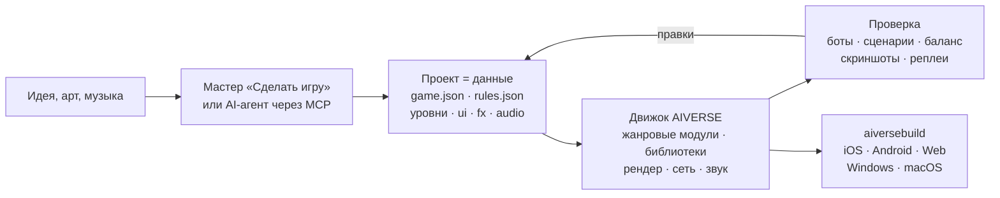

<p align="center">
  
</p>

<h3 align="center">Игровой движок для любого жанра, в котором игру собирает AI-агент — из данных, а не из кода</h3>

<p align="center">
  любой жанр · полные модули RTS и FPS · 88 библиотек механик · детерминированная симуляция · ~190 MCP-инструментов · 6 платформ
</p>

<p align="center">
  
  
  
  
  
</p>

<p align="center">
  <a href="README.md">English</a> · <b>Русский</b> · <a href="README.zh-CN.md">简体中文</a> · <a href="README.ja.md">日本語</a> · <a href="README.ko.md">한국어</a> · <a href="README.es.md">Español</a> · <a href="README.pt-BR.md">Português</a> · <a href="README.de.md">Deutsch</a> · <a href="README.fr.md">Français</a>
</p>

<p align="center">
  <a href="#зачем-он-нужен">Зачем</a> ·
  <a href="#любой-жанр">Жанры</a> ·
  <a href="#как-это-устроено">Как устроено</a> ·
  <a href="#готовые-шаблоны">Шаблоны</a> ·
  <a href="#быстрый-старт">Быстрый старт</a> ·
  <a href="docs/ru/overview.md">Полный обзор</a>
</p>

---

## Коротко

**AIVERSE** — движок на C++20, написанный с нуля под одну задачу: игру **любого жанра** должно быть
можно **описать**, а не программировать с нуля.

Игра — это папка с данными: объекты, правила, уровни, интерфейс, звук, эффекты. Движок — библиотека
готовых детерминированных механик, которая оживляет эти данные: от стройки базы и армий в тысячи
юнитов до платформинга, ближнего боя, диалогов, карточных правил и головоломок. Между ними — редактор и
MCP-сервер, через которые с проектом работает человек или AI-агент: создаёт игру, правит баланс,
гоняет матчи ботов, смотрит скриншоты и собирает билды под сторы.

> Опишите идею и дайте папку с артом — мастер «Сделать игру» соберёт проект с уровнями, обучением,
> метой, магазином, иконкой и заставкой, сам пройдёт обучение ботом и проверит уровни.

---

## Зачем он нужен

Сделать игру тяжело не из-за графики. Тяжело то, что под капотом: движение, бой, ИИ, сеть, баланс,
прогрессия. Универсальные движки дают рендер, а всё это оставляют вам. AIVERSE даёт сами механики и
делает так, чтобы с игрой мог работать агент.

| Проблема | Как её решает AIVERSE |
|---|---|
| **Универсальные движки не дают геймплея.** Unity, Unreal и Godot дают рендер и физику; поиск пути для толп, бой с комбо и парированием, ИИ противника, очерёдность ходов, правила карт, экономику каждая студия месяцами пишет сама. | Механики — строительные блоки движка: полные модули RTS и FPS плюс 88 детерминированных библиотек для остальных жанров. Настраиваются данными, а когда данных мало — расширяются Lua или собственным C++ проекта. |
| **AI-агенту неудобно в классических движках.** Бинарные сцены, всё через GUI, нет быстрой обратной связи — агент работает вслепую. | Проект — читаемые текстовые файлы. ~190 MCP-инструментов: карты, правила, рельеф, UI, эффекты, свет, сборка. Агент сам проверяет результат: матчи ботов, сценарии с pass/fail, матрицы баланса, линтер правил с подсказками «did you mean…», скриншоты. |
| **Мультиплеер = вечные рассинхроны.** Достаточно одного `float`, чтобы матч на iPhone и Android разошёлся. | Симуляция побитово одинакова везде: fixed-point вместо float, свой RNG, контрольные суммы. CI на каждом push сверяет матчи на Linux x64/ARM64, Windows и macOS. По сети идут только команды, есть lockstep с откатами, сервер с матчмейкингом и вердиктом по реплею. |
| **Мобильные GPU слабые, а игра должна быть красивой.** | Каждая дорогая функция — тени, частицы, рельеф, постэффекты — имеет уровни качества и сама подстраивается под GPU: от старых Mali и Adreno до Apple Silicon. |
| **Выпустить игру на все платформы — отдельный проект.** Подписи, иконки, SDK сторов и рекламы. | `aiversebuild` одной командой делает .app, проект Xcode, Gradle/APK, web и .exe. Иконки и заставки генерируются. Плагины App Store, Google Play, RuStore, Yandex Games, Steam, AdMob, AppLovin и других — в билд попадают только выбранные. |
| **Каждая новая игра начинается с нуля.** | 30+ играбельных шаблонов, жанровые наборы с чек-листами приёмки, 126 навыков для агентов. Новая игра начинается с работающей. |
| **Мета и LiveOps переписываются в каждом проекте.** | `aiverse::meta`: магазин, валюты, задания, пассы, ежедневные награды, энергия, кланы, турниры, сундуки с pity — настраивается JSON-ом. |

---

## Любой жанр

У двух жанров есть полные модули движка с редактором, ботами и шаблонами. Всё остальное собирается из
библиотек механик — каждая детерминированная, покрыта тестами, с сохранением/восстановлением и
проверяемой конфигурацией.

| Жанр | Что даёт движок |
|---|---|
| **RTS, tower defense, захват территорий** | Полный модуль `rts`: юниты и здания из данных, A\* / HPA\* / flow fields для армий в тысячи юнитов на картах до 2048², экономика, стройка, туман войны, ИИ, рельеф и планеты, 26 шаблонов |
| **FPS и TPS** | Полный модуль `fps`: клиент и авторитетный сервер, большие миры с подгрузкой до 100 игроков, боты, 4 шаблона; `weapon-policies` (отдача, баллистика, пробитие), `match-rules` (раунды, сопровождение, бомба, эвакуация) |
| **Экшен, файтинг, соулслайк** | `combat-actions`, `melee-combat`: хитбоксы и хёртбоксы, комбо и окна отмены, неуязвимость при уклонении, парирование, стойкость, захват цели; `genre-bots` для противников |
| **Платформер, метроидвания** | `character-locomotion`: coyote time, буфер прыжка, уступы, лестницы, плавание, лазание, перелезание; `zone-graph`: ворота способностей, чекпоинты и доказательство отсутствия тупиков |
| **Стелс, immersive sim** | `stealth-senses`: конусы зрения, слух, подозрение и тревога, поиск, маскировка; `physical-interactions`: перенос, броски, верёвки, двери, платформы, разрушаемые объекты |
| **Сюжетные игры, визуальные новеллы** | `narrative-graphs`: диалоги с условиями, отношения, последствия, журнал и автопрокрутка VN; `cinematic-gameplay`: таймлайны, QTE, замедление времени |
| **Пошаговая тактика, карточные и настольные** | `turn-scheduler`: инициатива, очки действий, реакции; `card-runtime`: зоны, стек приоритета, скрытая информация |
| **Головоломки** | `grid-puzzles`: правила Sokoban, отмена ходов и решатель; `puzzle-machine`: виртуальная машина для головоломок-программ |
| **Роглайки** | `run-graph`: забеги по сиду и бюджеты встреч; `loot-tables` с гарантированной редкой наградой |
| **Idle, фабрики, колонии** | `big-numbers`, `offline-production` (точный офлайн-прогресс), `production-networks`, `logistics`, `tasks` |
| **Ритм-игры** | `rhythm-timing`: карты темпа и оценка попаданий, не зависящая от частоты кадров |
| **Любая мобильная игра** | `aiverse::meta` и LiveOps, обучение, экраны интерфейса, плагины сторов и рекламы |

Гонки, спорт и транспорт пока в [плане](docs/genre-mechanics-roadmap.md). Полный список библиотек —
[`libraries/catalog.json`](libraries/catalog.json) и [жанровые пакеты](docs/genre-packages.md).

---

## Как это устроено



Объект — это просто описание. Вот рабочий из RTS-шаблона `skirmish`: он добывает золото и дерево,
строит пять зданий и умеет драться киркой.

```jsonc
"peasant": {
  "health":  { "max": 220, "armorType": "light" },
  "move":    { "speed": 2.4, "radius": 0.35 },
  "sight":   7,
  "weapons": [{ "id": "pick", "range": 0.5, "damage": 5, "cooldown": 1.5 }],
  "cost":    { "gold": 75, "time": 12, "supply": 1 },
  "gather":  { "gold": { "carry": 10, "time": 2.0 }, "wood": { "carry": 10, "time": 3.0 } },
  "builds":  ["townhall", "farm", "barracks", "workshop", "tower"],
  "view":    { "shape": "worker", "scale": 0.8 }
}
```

Если данных не хватает, есть три ступени: **триггеры** в JSON → **Lua** (песочница с детерминированной
математикой, горячая перезагрузка) → **нативные C++-модули** проекта, которые подключают библиотеки
выше. Движок при этом не меняется: механики добавляются в него только в общем виде, а не под
конкретную игру.

---

## Переход с Unity

Укажите импортёру проект Unity — получите проект AIVERSE. Ассеты, сцены и параметры переносятся автоматически, остальное попадает в отчёт, по которому агент доделывает перенос через MCP. То же самое — **Проект → Импорт проекта движка** в редакторе и MCP `port_scan` / `port_import` / `port_report` / `port_resolve`.

```bash
python3 tools/importers/port/aiverse_port.py /path/to/UnityProject --out /path/to/MyGame --mode auto
```

| В Unity | В AIVERSE |
|---|---|
| Сцена | карта `maps/*.json`: расстановка объектов, камера, режим 2D или 3D |
| Префаб, вложенные префабы и варианты | тип объекта в `rules.json`; сериализованные поля (`hp`, `speed`, `damage`, `fireRate`, …) становятся блоками данных |
| ScriptableObject | данные правил |
| Логика MonoBehaviour на C# | переносит агент: блоки данных → Lua → нативный C++-модуль |
| Модели, текстуры, материалы, звук | копируются как есть; PBR-материалы, glTF/FBX/OBJ грузятся напрямую |
| Спрайты и Tilemap | спрайты из атласа и тайловые карты |
| ParticleSystem | `fx/*.json`, поддержаны почти все модули |
| Inspector, Hierarchy, Scene, Game | те же окна в редакторе AIVERSE |
| Build Settings, Unity IAP, Unity Ads | `aiversebuild`, плагины сторов и рекламы |
| Addressables / Asset Bundles | паки `.rpak`, разбиение сборки и докачка контента |

В отчёте каждый элемент помечен: перенесён точно, приближённо или не перенесён. Повторный импорт сохраняет ваши правки. Нужна сериализация ассетов **Force Text**. Так же импортируются проекты Godot. Подробно — [импорт проекта другого движка](docs/ru/engine-import.md).

---

## Готовые шаблоны

Каждый шаблон — полностью играбельная игра с ботами. Её можно открыть в редакторе и сразу менять.

| Жанр | Шаблоны |
|---|---|
| Классическая RTS с базой | **Iron and Gold** (Warcraft / Red Alert) · **Iron Front** (Red Alert: MCV, руда, сайдбар) · **Starfall Sectors** (StarCraft: три расы) · **Frost Crown** (Warcraft III: герои, крипы, рельеф) · **Four Ages** (Age of Empires II) · **Amber Sands** (Dune II) · **Metal Tide** (Total Annihilation: потоковая экономика) |
| Захват и гарнизоны | **Mushroom Clash** и **Shroom Wars** (Mushroom Wars 1–2) · **Spore Lanes** · **Spell Bunkers** (Bunker Wars) · **Border Rush** (State.io) · **Clan Lands** (Northgard) · **Flag Sectors** (Z) |
| Отряды, волны, выживание | **Hold the Line** (Company of Heroes) · **Last Colony** (They Are Billions) · **Lane Clash** (лайн-баттлер) |
| Экономика и стройка | **Hearth and Haul** (Knights and Merchants) · **Underlord** (Dungeon Keeper) |
| 2D и эксперименты | **Crystal Dunes** (тайлы, Dune II) · **Green Hills** (2D-спрайты на 3D-рельефе) · **Planets** (сферические планеты и орбиты) · **Wildfire** (поля: пожары и крип) |
| FPS | **Crossfire Arena** (5×5) · **Breach Protocol** (тактические раунды) · **Last Survivor** (королевская битва на 100 игроков) · **Aim Lab** (тир) |

---

## Что внутри

<table>
<tr>
<td width="50%" valign="top">

**Геймплей**
- ECS-симуляция на fixed-point, реплеи, снимки для откатов
- Жанровые модули: RTS (экономика, стройка, армии, ИИ) и FPS (авторитетный сервер, большие миры)
- 88 библиотек: движение, бой, оружие, органы чувств, диалоги, ходы, карты, головоломки, забеги, ритм, производство
- Поиск пути: A\*, HPA\*, flow fields, navmesh, ORCA/RVO2
- Рельеф с уклонами и линией видимости, карты до 2048², сферические планеты
- Триггеры, Lua 5.4, нативные C++-модули

</td>
<td width="50%" valign="top">

**Картинка и звук**
- Свой RHI: Metal, GLES3 / WebGL2, GL 3.3
- PBR, glTF/OBJ, скелетная и процедурная анимация, процедурные провода, отрисовка вложенных объектов
- Тени, динамический свет, ночь, постэффекты, Shader Graph
- Частицы с модулями Unity ParticleSystem и импорт из Unity
- 2D: спрайты, тайловые карты с автотайлингом
- Звук: 3D, адаптивная музыка, сжатие под платформу

</td>
</tr>
<tr>
<td valign="top">

**Инструменты**
- Редактор с окнами, как в Unity: сцена, инспектор, рельеф, эффекты, свет, UI, тестовая игра и симулятор устройств
- `aiversemcp` — MCP-сервер для агентов
- Мастер «Сделать игру»
- 126 навыков для агентов и жанровые наборы с чек-листами приёмки
- Импорт ресурсов старых игр из вашей собственной копии

</td>
<td valign="top">

**Выпуск**
- `aiversebuild`: .app, Xcode, Gradle/APK, web, .exe
- Ресурс-паки `.rpak` (zstd), разбиение и докачка контента
- Плагины сторов и рекламы
- UI игры на HTML/CSS (RmlUi), локализация
- Сетевая игра: UDP и WebSocket, выделенный сервер, Elo-матчмейкинг
- Мета-библиотека и LiveOps

</td>
</tr>
</table>

---

## Быстрый старт

**1. Собрать движок** (macOS; нужны Xcode и CMake):

```bash
cmake -S . -B build/mac -DCMAKE_BUILD_TYPE=Release
cmake --build build/mac -j 8
open build/mac/AiverseEditor.app        # редактор: хаб проектов и шаблоны
```

Linux: `cmake --preset linux-release && cmake --build build/linux-release`. Если компилировать не хочется,
в ветке `builds` есть готовые сборки редактора и инструментов
([подробнее](docs/ru/overview.md#готовые-сборки-движка-ветка-builds-и-aiversemcp-без-компилятора)).

**2. Сделать игру.** В хабе нажмите **«Сделать игру»** или создайте проект из шаблона. Игру можно
сразу запустить с ботами в окне Game.

**3. Подключить AI-агента.** Окно **Agent** в редакторе показывает готовую конфигурацию. Для Claude Code:

```bash
claude mcp add aiverse -- /path/to/aiversemcp --engine /path/to/AIVERSE
```

После этого агенту можно сказать, например: *«Сделай стратегию в духе Northgard на зимней карте,
проверь баланс трёх фракций ботами и собери web-версию»*.

**4. Выпустить:**

```bash
./build/mac/aiversebuild --project "Моя игра.aiverse" --target all   # macOS, iOS, Android, web, Windows
```

---

## Статус

Движок активно развивается. Что проверено:

- ✅ **Linux**: клиент, редактор, тесты, матчи ботов; одинаковые контрольные суммы на x64 и ARM64
- ✅ **macOS / Metal**: сборка, тесты, игра; `aiversebuild` → .app и проект iOS со сборкой для симулятора
- ✅ **Web**: матч запускается в headless Chromium (WebGL2)
- ✅ **Windows**: .exe кросс-сборкой MinGW, запуск под Wine
- 🛠 Готовые шаблоны для жанров кроме RTS и FPS — в работе

Подробности по каждой подсистеме — в разделе
[«Проверено / не проверено»](docs/ru/overview.md#проверено--не-проверено).

---

## Документация

| | |
|---|---|
| [**Подробный обзор**](docs/ru/overview.md) | все подсистемы, сборка, платформы, CI, релизы |
| [Формат игры](docs/game-format.md) | `game.json`, `rules.json`, карты и все блоки данных |
| [Жанровые пакеты](docs/genre-packages.md) · [Библиотеки](docs/libraries.md) | механики для любого жанра |
| [Мастер «Сделать игру»](docs/ru/game-wizard.md) | как из идеи и арта получается готовый проект |
| [Скриптинг](docs/scripting.md) · [C++-модули](docs/native-modules.md) | когда данных не хватает |
| [Ландшафт](docs/terrain.md) · [Планеты](docs/planets.md) · [Поиск пути](docs/pathfinding.md) | мир и движение |
| [Частицы](docs/particles.md) · [Модели](docs/models.md) · [Shader Graph](docs/shader-graph.md) | картинка |
| [Мета-игра](docs/meta-game.md) · [LiveOps](docs/meta-liveops.md) · [Плагины](docs/plugins.md) | монетизация и сторы |
| [FPS](docs/fps.md) · [Большие миры](docs/large-worlds.md) | FPS-модуль |
| [Герои с видом сверху](docs/topdown.md) · [Вождение](docs/driving.md) · [Городской трафик](docs/traffic.md) | городские игры: машины, светофоры, пешеходы, службы, жители с работой |
| [AGENTS.md](AGENTS.md) | правила для агентов, которые меняют сам движок |
| [Переход с Unity](docs/ru/engine-import.md) | импорт сцен, префабов и ассетов, перенос логики агентом |

## Лицензия

[MIT](LICENSE). Сторонние библиотеки лежат в `third_party/` со своими лицензиями (только MIT, BSD, zlib,
OFL, CC0, CC-BY). Оригинальные ресурсы коммерческих игр в репозиторий не входят: импортёры читают
их из вашей собственной копии.
