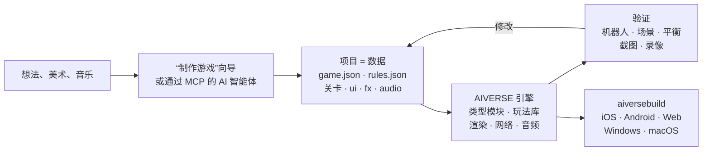

<p align="center">
  
</p>

<h3 align="center">适用于任何类型游戏的引擎：由 AI 智能体用数据而不是代码来构建游戏</h3>

<p align="center">
  任意游戏类型 · 完整的 RTS 与 FPS 模块 · 88 个玩法库 · 确定性模拟 · 约 190 个 MCP 工具 · 6 个平台
</p>

<p align="center">
  
  
  
  
  
</p>

<p align="center">
  <a href="README.md">English</a> · <a href="README.ru.md">Русский</a> · <b>简体中文</b> · <a href="README.ja.md">日本語</a> · <a href="README.ko.md">한국어</a> · <a href="README.es.md">Español</a> · <a href="README.pt-BR.md">Português</a> · <a href="README.de.md">Deutsch</a> · <a href="README.fr.md">Français</a>
</p>

<p align="center">
  <a href="#为什么需要它">为什么</a> ·
  <a href="#任意游戏类型">游戏类型</a> ·
  <a href="#工作原理">工作原理</a> ·
  <a href="#现成模板">模板</a> ·
  <a href="#快速开始">快速开始</a> ·
  <a href="docs/zh-CN/overview.md">完整概览</a>
</p>

---

## 简介

**AIVERSE** 是一款从零编写的 C++20 引擎，只为一个目标：**任何类型**的游戏都应该可以通过**描述**来制作，
而不是从头编程。

游戏就是一个数据文件夹：对象、规则、关卡、界面、音频、特效。引擎是一套现成的确定性玩法机制库，
负责让这些数据运转起来——从基地建设和成千上万单位的大军，到平台跳跃、近战、对话、卡牌规则和解谜。
两者之间是编辑器和 MCP 服务器：人或 AI 智能体通过它们处理项目——创建游戏、调整平衡、运行机器人对战、
查看截图并构建上架版本。

> 描述你的想法并给出一个美术素材文件夹——**“制作游戏”**向导会生成包含关卡、新手教程、元游戏、商店、
> 图标和启动画面的项目，然后用机器人自行通关教程并检查每一个关卡。

---

## 为什么需要它

让游戏变难的不是画面，而是底层：移动、战斗、AI、网络、平衡、成长系统。通用引擎只给你渲染器，
其余全部留给你自己。AIVERSE 直接提供这些机制本身，并让游戏可以由智能体来开发。

| 问题 | AIVERSE 的解决方式 |
|---|---|
| **通用引擎不提供玩法。** Unity、Unreal 和 Godot 提供渲染和物理；而大规模寻路、带连招和格挡的战斗、敌方 AI、回合顺序、卡牌规则、经济系统——每个工作室都要花几个月自己写。 | 机制就是引擎的积木：完整的 RTS 和 FPS 模块，外加面向其他类型的 88 个确定性库。用数据配置；数据不够时，用 Lua 或项目自己的 C++ 扩展。 |
| **传统引擎不适合 AI 智能体。** 二进制场景、一切都要通过 GUI、没有快速反馈——智能体只能盲目工作。 | 项目是可读的文本文件。约 190 个 MCP 工具覆盖地图、规则、地形、UI、特效、光照和构建。智能体能自行验证结果：机器人对战、带通过/失败检查的场景、平衡矩阵、会提示 “did you mean…” 的规则检查器、截图。 |
| **多人游戏意味着无尽的不同步。** 一个 `float` 就足以让 iPhone 和 Android 上的对局分道扬镳。 | 模拟在所有平台上逐位一致：用定点数代替浮点、自有随机数生成器、校验和。CI 在每次推送时比对 Linux x64/ARM64、Windows 和 macOS 上的对局。网络上只传输指令；支持带回滚的锁步，以及带匹配和录像裁决的服务器。 |
| **移动端 GPU 很弱，但游戏必须好看。** | 每个高开销功能——阴影、粒子、地形、后处理——都有画质等级并自动适配 GPU，从老旧的 Mali、Adreno 到 Apple Silicon。 |
| **多平台发布本身就是一个项目。** 签名、图标、商店和广告 SDK。 | `aiversebuild` 一条命令生成 .app、Xcode 项目、Gradle/APK、Web 和 .exe。图标和启动画面自动生成。提供 App Store、Google Play、RuStore、Yandex Games、Steam、AdMob、AppLovin 等插件——构建中只包含游戏选用的那些。 |
| **每款新游戏都从零开始。** | 30+ 个可玩模板、带验收清单的类型套件、126 个智能体技能。新游戏从一个能运行的游戏开始。 |
| **元游戏和 LiveOps 在每个项目里都要重写。** | `aiverse::meta`：商店、货币、任务、通行证、每日奖励、体力、公会、锦标赛、带保底的宝箱——用 JSON 配置。 |

---

## 任意游戏类型

两种类型拥有完整的引擎模块，带编辑器、机器人和模板。其余类型由玩法库组合而成——每个库都是确定性的、
经过测试，支持存档/恢复，并带有可校验的配置。

| 类型 | 引擎提供的内容 |
|---|---|
| **RTS、塔防、领地争夺** | 完整的 `rts` 模块：数据驱动的单位和建筑，A\* / HPA\* / 流场寻路，支持在最大 2048² 的地图上调动成千上万单位的大军；经济、建造、战争迷雾、AI、地形与星球，26 个模板 |
| **FPS 和 TPS** | 完整的 `fps` 模块：客户端和权威服务器、最多 100 名玩家的流式大世界、机器人、4 个模板；`weapon-policies`（后坐力、弹道、穿透）、`match-rules`（回合、护送、爆破、撤离） |
| **动作、格斗、魂类** | `combat-actions`、`melee-combat`：攻击框与受击框、连招与取消窗口、闪避无敌帧、格挡反击、韧性、锁定；`genre-bots` 提供对手 |
| **平台跳跃、银河城** | `character-locomotion`：土狼时间、跳跃缓冲、攀边、梯子、游泳、攀爬、翻越；`zone-graph`：能力门槛、检查点以及无死局证明 |
| **潜行、沉浸式模拟** | `stealth-senses`：视锥、听觉、怀疑与警报、搜索、伪装；`physical-interactions`：搬运、投掷、绳索、门、移动平台、可破坏物 |
| **剧情游戏、视觉小说** | `narrative-graphs`：带条件的对话、好感关系、后果、VN 回看与自动播放；`cinematic-gameplay`：时间轴、QTE、慢动作 |
| **回合制战术、卡牌、桌游** | `turn-scheduler`：先攻、行动点、反应；`card-runtime`：区域、优先级栈、隐藏信息 |
| **解谜** | `grid-puzzles`：推箱子规则、撤销/重做和求解器；`puzzle-machine`：编程解谜用的虚拟机 |
| **Roguelike** | `run-graph`：基于种子的流程与遭遇预算；`loot-tables` 带稀有保底 |
| **放置、工厂、殖民地** | `big-numbers`、`offline-production`（精确的离线收益）、`production-networks`、`logistics`、`tasks` |
| **节奏游戏** | `rhythm-timing`：节拍图和与帧率无关的判定 |
| **任何手机游戏** | `aiverse::meta` 和 LiveOps、新手教程、界面、商店和广告插件 |

竞速、体育和载具仍在[路线图](docs/genre-mechanics-roadmap.md)中。完整的库列表：
[`libraries/catalog.json`](libraries/catalog.json) 和[类型包](docs/genre-packages.md)。

---

## 工作原理



对象只是一段描述。这是 RTS 模板 `skirmish` 中的农民：采集金子和木材，能建造五种建筑，还能用镐子战斗。

```jsonc
"peasant": {
  "health":  { "max": 220, "armorType": "light" },
  "move":    { "speed": 2.4, "radius": 0.35 },
  "sight":   7,
  "weapons": [{ "id": "pick", "range": 0.5, "damage": 5, "cooldown": 1.5 }],
  "cost":    { "gold": 75, "time": 12, "supply": 1 },
  "gather":  { "gold": { "carry": 10, "time": 2.0 }, "wood": { "carry": 10, "time": 3.0 } },
  "builds":  ["townhall", "farm", "barracks", "workshop", "tower"],
  "view":    { "shape": "worker", "scale": 0.8 }
}
```

数据不够用时，还有三级扩展：JSON 中的**触发器** → **Lua**（带确定性数学和热重载的沙箱）→
项目自己的**原生 C++ 模块**，可接入上述各个库。引擎本身保持不变：机制只以通用形式加入引擎，
从不为某一款游戏做特例。

---

## 从 Unity 迁移

把导入器指向一个 Unity 项目，即可得到 AIVERSE 项目。资源、场景和参数自动迁移；其余内容写入报告，由智能体通过 MCP 完成迁移。也可在编辑器中通过 **项目 → 导入引擎项目**，或使用 MCP `port_scan` / `port_import` / `port_report` / `port_resolve`。

```bash
python3 tools/importers/port/aiverse_port.py /path/to/UnityProject --out /path/to/MyGame --mode auto
```

| 在 Unity 中 | 在 AIVERSE 中 |
|---|---|
| 场景 | 地图 `maps/*.json`：对象摆放、相机、2D 或 3D 模式 |
| 预制体、嵌套预制体和变体 | `rules.json` 中的对象类型；序列化字段（`hp`、`speed`、`damage`、`fireRate`……）变为数据块 |
| ScriptableObject | 规则数据 |
| C# 编写的 MonoBehaviour 逻辑 | 由智能体迁移：数据块 → Lua → 原生 C++ 模块 |
| 模型、纹理、材质、音频 | 原样复制；PBR 材质，glTF/FBX/OBJ 直接加载 |
| 精灵和 Tilemap | 图集精灵和瓦片地图 |
| ParticleSystem | `fx/*.json`，几乎支持全部模块 |
| Inspector、Hierarchy、Scene、Game | AIVERSE 编辑器中的同名窗口 |
| Build Settings、Unity IAP、Unity Ads | `aiversebuild`、商店和广告插件 |
| Addressables / Asset Bundles | `.rpak` 资源包、分包和内容下载 |

报告会把每一项标记为精确迁移、近似迁移或未迁移。重复导入会保留你的修改。项目需要使用 **Force Text** 资源序列化。Godot 项目也以同样方式导入。详情：[引擎项目导入](docs/zh-CN/engine-import.md)。

---

## 现成模板

每个模板都是带机器人的完整可玩游戏。在编辑器中打开即可开始修改。

| 类型 | 模板 |
|---|---|
| 经典基地建设 RTS | **Iron and Gold**（Warcraft / Red Alert）· **Iron Front**（Red Alert：MCV、矿石、侧边栏）· **Starfall Sectors**（StarCraft：三个种族）· **Frost Crown**（Warcraft III：英雄、野怪、地形）· **Four Ages**（Age of Empires II）· **Amber Sands**（Dune II）· **Metal Tide**（Total Annihilation：流式经济） |
| 占领与驻军 | **Mushroom Clash** 和 **Shroom Wars**（Mushroom Wars 1–2）· **Spore Lanes** · **Spell Bunkers**（Bunker Wars）· **Border Rush**（State.io）· **Clan Lands**（Northgard）· **Flag Sectors**（Z） |
| 小队、波次、生存 | **Hold the Line**（Company of Heroes）· **Last Colony**（They Are Billions）· **Lane Clash**（兵线对战） |
| 经济与建造 | **Hearth and Haul**（Knights and Merchants）· **Underlord**（Dungeon Keeper） |
| 2D 与实验 | **Crystal Dunes**（瓦片地图，Dune II）· **Green Hills**（3D 地形上的 2D 精灵）· **Planets**（球形星球与轨道）· **Wildfire**（场：野火与菌毯） |
| FPS | **Crossfire Arena**（5v5）· **Breach Protocol**（战术回合）· **Last Survivor**（100 人大逃杀）· **Aim Lab**（射击训练场） |

---

## 内部构成

<table>
<tr>
<td width="50%" valign="top">

**玩法**
- 定点数 ECS 模拟、录像、用于回滚的快照
- 类型模块：RTS（经济、建造、军队、AI）和 FPS（权威服务器、大世界）
- 88 个库：移动、战斗、武器、感知、对话、回合、卡牌、解谜、流程、节奏、生产
- 寻路：A\*、HPA\*、流场、导航网格、ORCA/RVO2
- 带坡度和视线的地形、最大 2048² 的地图、球形星球
- 触发器、Lua 5.4、原生 C++ 模块

</td>
<td width="50%" valign="top">

**画面与音频**
- 自研 RHI：Metal、GLES3 / WebGL2、GL 3.3
- PBR、glTF/OBJ、骨骼与程序化动画、程序化线缆、父子实体渲染
- 阴影、动态光源、夜晚、后处理、Shader Graph
- 支持 Unity ParticleSystem 模块的粒子系统及 Unity 导入器
- 2D：精灵、带自动拼接的瓦片地图
- 音频：3D、自适应音乐、按平台压缩

</td>
</tr>
<tr>
<td valign="top">

**工具**
- Unity 风格的可停靠编辑器：场景、检视器、地形、特效、光照、UI、试玩和设备模拟器
- `aiversemcp`——面向智能体的 MCP 服务器
- **“制作游戏”**向导
- 126 个智能体技能和带验收清单的类型套件
- 从你自己的正版副本导入经典游戏资源

</td>
<td valign="top">

**发布**
- `aiversebuild`：.app、Xcode、Gradle/APK、Web、.exe
- `.rpak` 资源包（zstd）、分包与内容下载
- 商店和广告插件
- HTML/CSS 游戏界面（RmlUi）、本地化
- 多人游戏：UDP 和 WebSocket、专用服务器、Elo 匹配
- 元游戏库和 LiveOps

</td>
</tr>
</table>

---

## 快速开始

**1. 构建引擎**（macOS；需要 Xcode 和 CMake）：

```bash
cmake -S . -B build/mac -DCMAKE_BUILD_TYPE=Release
cmake --build build/mac -j 8
open build/mac/AiverseEditor.app        # 编辑器：项目中心和模板
```

Linux：`cmake --preset linux-release && cmake --build build/linux-release`。如果不想编译，
`builds` 分支提供预构建的编辑器和工具
（[详情](docs/zh-CN/overview.md#预构建引擎builds-分支与无需编译器的-aiversemcp)）。

**2. 制作游戏。** 在项目中心点击**“制作游戏”**，或从模板创建项目。可以立即在 Game 窗口中与机器人对战。

**3. 连接 AI 智能体。** 编辑器的 **Agent** 窗口会显示现成的配置。以 Claude Code 为例：

```bash
claude mcp add aiverse -- /path/to/aiversemcp --engine /path/to/AIVERSE
```

然后就可以对智能体说，例如：*“做一款 Northgard 风格、冬季地图的策略游戏，用机器人检查三个阵营的平衡，
并构建 Web 版本。”*

**4. 发布：**

```bash
./build/mac/aiversebuild --project "My Game.aiverse" --target all   # macOS、iOS、Android、Web、Windows
```

---

## 状态

引擎正在积极开发中。已验证：

- ✅ **Linux**：客户端、编辑器、测试、机器人对战；x64 和 ARM64 上校验和一致
- ✅ **macOS / Metal**：构建、测试、游戏；`aiversebuild` → .app 和可在模拟器构建的 iOS 项目
- ✅ **Web**：对局可在无头 Chromium（WebGL2）中运行
- ✅ **Windows**：通过 MinGW 交叉编译的 .exe，在 Wine 下运行
- 🛠 RTS 和 FPS 以外类型的现成模板正在制作中

各子系统的详细情况见
[已验证 / 未验证](docs/zh-CN/overview.md#已验证--未验证)。

---

## 文档

参考文档为英文。概览、“制作游戏”向导、从 Unity 迁移和类型包也提供中文版。

| | |
|---|---|
| [**完整概览**](docs/zh-CN/overview.md) | 所有子系统、构建、平台、CI、发布 |
| [游戏格式](docs/game-format.md) | `game.json`、`rules.json`、地图及所有数据块 |
| [类型包](docs/genre-packages.md) · [库](docs/libraries.md) | 适用于任何类型的机制 |
| [“制作游戏”向导](docs/zh-CN/game-wizard.md) | 想法加美术如何变成完整项目 |
| [脚本](docs/scripting.md) · [C++ 模块](docs/native-modules.md) | 当数据不够用时 |
| [地形](docs/terrain.md) · [星球](docs/planets.md) · [寻路](docs/pathfinding.md) | 世界与移动 |
| [粒子](docs/particles.md) · [模型](docs/models.md) · [Shader Graph](docs/shader-graph.md) | 画面 |
| [元游戏](docs/meta-game.md) · [LiveOps](docs/meta-liveops.md) · [插件](docs/plugins.md) | 变现与商店 |
| [FPS](docs/fps.md) · [大世界](docs/large-worlds.md) | FPS 模块 |
| [俯视角英雄](docs/topdown.md) · [驾驶](docs/driving.md) · [城市交通](docs/traffic.md) | 城市游戏：汽车、红绿灯、行人、公共服务、有工作的居民 |
| [AGENTS.md](AGENTS.md) | 修改引擎本身的智能体须遵守的规则 |
| [从 Unity 迁移](docs/zh-CN/engine-import.md) | 导入场景、预制体和资源，再由智能体迁移逻辑 |

## 许可证

[MIT](LICENSE)。第三方库位于 `third_party/`，各自附带许可证（包括 MIT、MIT-0、BSD、ISC、zlib、OFL、CC0 和 CC-BY）。
仓库不包含商业游戏的原始资源：导入器从你自己的副本中读取它们。

游戏构建会自动包含 `THIRD_PARTY_NOTICES.txt`；外部 SDK 的许可声明须由项目提供（见[详情](docs/third-party-notices.md)）。
