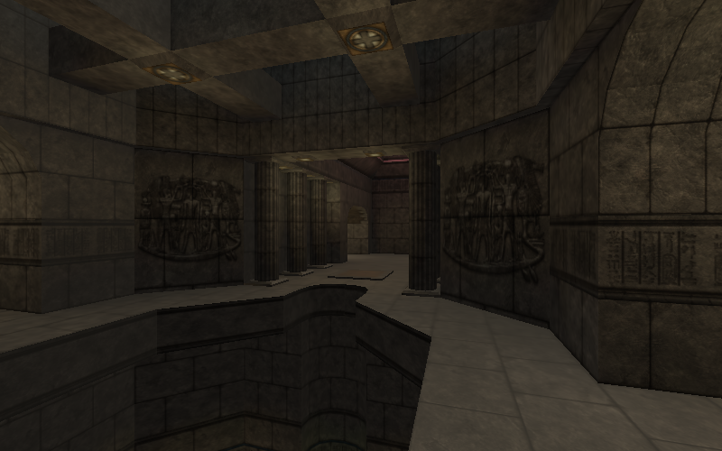

# Egyptian Trouble

AIVERSE captured the intermission camera of Egyptian Trouble by Akom74 and Neon_Knight. The level is part of OpenArena Community Map Pack 1 v3. Egyptian textures are by Simon “sock” O'Callaghan. The capture contains GPL-2.0-or-later map and texture artwork; keep these credits and the corresponding source link when redistributing. Original notices accompany the OpenArena package. [Map pack, source and Debian licensing records](https://deb.debian.org/debian/pool/main/o/openarena-oacmp1/).

The native Metal frame is 800×500 pixels. The original BSP SHA-256 is fedb5c645a33e9ee3c5172c654e356c058692009c1308f16d9073aef2a1d84b4. See [capture reproduction](../models.md#quake-iii-ibsp-v46) and [recorded optical comparison](quake3-bsp-openarena-metal-20261125.log.txt).
