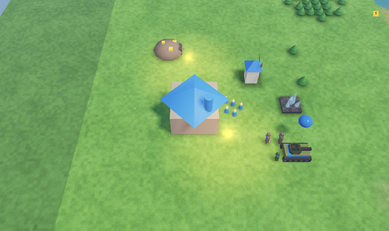
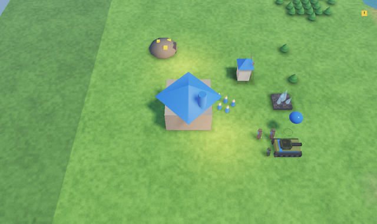
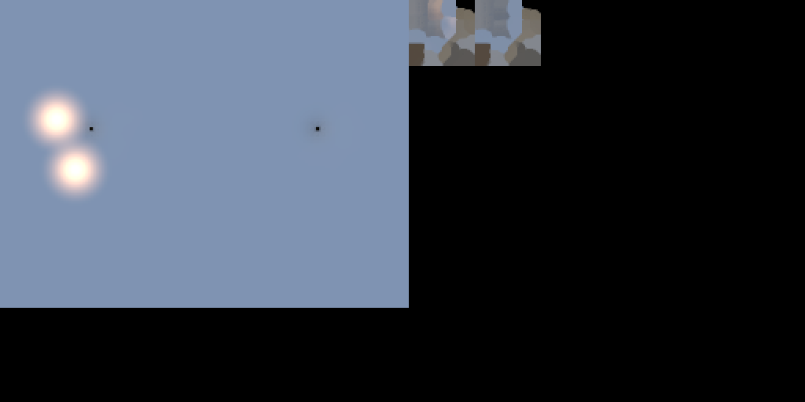

# Baked lighting (lightmaps, light probes, the light baker)

AIVERSE bakes global illumination itself: an offline CPU path tracer (`engine/bake`) writes lightmaps for
static objects and the terrain plus a light probe grid for everything that moves. The runtime samples
them in the lit shaders (GLSL + MSL) and mixes them with the realtime sun like Unity's mixed lighting.
Owner: agent-lightbake.

## Quick start

1. Mark map lights that should be baked: `"bake": "mixed"` (stays realtime, its bounce is baked) or
   `"bake": "baked"` (only in the lightmap / probes; its realtime light and halo sprite switch off once a bake
   is loaded). MCP: `light_add` / `light_update` with `bake`.
2. Editor → **Графика → Запекание света**: mode, density, samples, bounces, probes → **Запечь**.
   MCP: `lightbake_set {quality: "preview"|"medium"|"high", mode, ...}`, `lightbake_bake {force?}`, poll
   `lightbake_status`, `lightbake_get`, `lightbake_clear`.
3. The result is `maps/<map>.bake/` next to the map; the game client loads it when the map starts.

**Rebakes are skipped** when nothing changed: the bake stores a 64-bit content hash of everything it used
(geometry, materials, textures, transforms, sun / sky / lights, settings); `lightbake_bake` without `force`
compares it first.

## What is static

The bake captures what the Scene view draws with `kDrawStatic` (`Renderer3D::DrawFlags`): objects of types
that cannot move (`structure` or speed 0), finished, alive, not flying, without entity fx. Every such model
node is a lightmap receiver and an occluder. Anything else (units, projectiles) is lit by the probes.
Other renderers can opt in by setting `kDrawStatic` on their `ModelDraw`.

At runtime a model node finds its lightmap region by **model path + node index + world matrix**
(quantized to 1/256), so no ids have to be stored in the map: an object drawn exactly where it was baked
is lightmapped, a moved one falls back to probes. Animated nodes therefore are not lightmapped.

## Lightmap UVs

- Models with a second UV set use it: glTF `TEXCOORD_1`, FBX second UV set (Unity's UV2; values in
  [0, 1]). Unskinned primitives only; stored in `ModelVertex::joints` as two unorm16
  (`engine/render/LightmapUv.h`), so the vertex layout is unchanged.
- Otherwise the baker unwraps the mesh with **xatlas** (MIT, `third_party/xatlas`, pinned
  f700c7790aaa030e794b52ba7791a05c085faf0c) and writes `<model>.lmuv` next to the model; `loadModel`
  applies it from then on (it checks a hash of the source geometry, a stale sidecar is ignored with a
  warning). Commit the `.lmuv` files with the models.
- Each mesh has its own [0, 1] space; each placed node gets a region sized by `texelsPerUnit` × its world
  area, packed into power-of-two pages.

## Mixing modes (`mode`)

| mode | lightmap holds | sun on static objects | for |
|---|---|---|---|
| `indirect` | sky, bounces, emissive, baked-only lights | realtime (shadow map) | day/night cycles |
| `shadowmask` (default) | as indirect + sun visibility mask | realtime, shadow = min(shadow map, mask) | static shadows beyond the shadow distance and with shadows off |
| `subtractive` | everything incl. the direct sun | baked; realtime shadows of dynamic objects darken it to `shadowColor` | weak phones |

Dynamic objects always get the realtime sun plus probe ambient. The sky term is exact: an open floor
bakes to the same ambient the realtime shader computes (`mix(ground, sky, n.y * .5 + .5)`), so lightmapped
and realtime objects match where nothing occludes.

## Quality tiers

`Renderer3D::setBakedQuality(Off | Low | High)`, default Low on phones (`defaultBakedQualityFor`),
`AIVERSE_BAKED=off|low|high` overrides. Low: lightmaps + shadow mask, probes from the nearest probe
(3 texel fetches per vertex). High: trilinear probes (24 fetches per vertex). Off: realtime only. Lightmaps
cost one RGBM fetch (+ one mask fetch in shadowmask mode) per pixel on every tier.

## Baker

`engine/bake` (host library `aiverse_bake`, also usable without the editor — see `tests/bake`):

- `SceneBuilder` loads models (CPU geometry), unwraps, converts materials (base colour × base texture
  for albedo, alpha test for masked foliage, emissive; unlit materials glow), adds a terrain mesh from
  a height function with planar lightmap UVs.
- Binned-SAH BVH, closest / any hit, alpha test.
- Per texel: cosine-weighted hemisphere paths (R2 sequence rotated per texel) with next-event estimation
  of the sun (soft, `angle`) and point / spot lights at every bounce, sky on miss; sun visibility mask
  (`maskSamples`); direct light of baked-only lights; optional AO; texels inside geometry (backface hits)
  are dropped and refilled by dilation; edge-aware à-trous denoiser on the indirect term.
- Probes: regular grid over the scene (`probeSpacing`, `probeHeight` above the floor, capped by
  `maxProbes`), uniform sphere sampling into ambient + gradient (`irradiance(n) = a + B n`), baked-only
  lights added analytically; probes inside geometry are refilled from neighbours.
- Multithreaded (`threads`, 0 = all cores). Every random stream is keyed by its texel / probe, so the
  output is **bit-identical for any thread count** (tested).

Presets: `preview` (16 samples, 1 bounce, 2 texels/m), `medium` (64, 2, 4), `high` (256, 3, 8).

## Files (`maps/<map>.bake/`)

`lightmap.json` (version, hash, mode, RGBM range, pages, regions `key -> [page, scale.xy, offset.xy]`,
terrain region, probe grid, settings, stats), `lm<i>.png` RGBM pages (linear, range `rgbmRange`),
`mask<i>.png` (shadowmask mode, r = sun visibility), `probes.bin` (float16 × 12 per probe). PNG and
float16 keep the folder small and pack-friendly; the folder is plain content (rpak includes it like any
other file). Settings live in the map's `"bake"` block.

## Hooks for other renderers

- Models: automatic (`Renderer3D::drawModel`, `ModelShaders.h` variants `LIGHTMAP` / `PROBES`).
- Terrain and other custom lit shaders: `AIVERSE_GLSL_BAKED_TERRAIN(block, lmTex, maskTex)` /
  `AIVERSE_MSL_BAKED_TERRAIN` (`engine/render/BakedShaders.h`) and `Renderer3D::bindBakedTerrain(uniformSlot,
  lightmapSlot, maskSlot)`; the flat terrain (`RtsTerrainShaders.h`) uses U3 + tex19 / tex20. The baker's
  terrain covers [0, w] × [0, h] of the map.

## Example (templates/showcase, valley)

Before (realtime only) / after (shadowmask bake, AO 1 m, two `"bake": "baked"` lamps) / the decoded lightmap
page (terrain region left, crystal tower and windmill regions top right):

 

Bake: 0.5 s on 4 VM cores (medium: 64 samples, 2 bounces, 52k texels, 2475 probes); a second
`lightbake_bake` reports "up to date" (hash unchanged).

## Limits / not yet

- No directional lightmaps (normal maps use the lightmap irradiance only), no baked specular.
- Albedo of the terrain in the bake is a constant (bounce colour from splat materials is not sampled);
  vertex colours are ignored in bounces.
- Planet terrain, sprites and procedural shapes (`shape:*` models of types without a model file, `drawMesh`) are
  not part of the bake: they neither receive lightmaps nor occlude; shape models are lit by the probes.
- A day/night cycle keeps baked indirect light fixed (use `indirect` mode).
- Importing Bakery / Unity lightmaps is not implemented (rebake with the engine's baker; UV2 is read).
- Metal (MSL) variants are written but compiled only on macOS/iOS builds.
